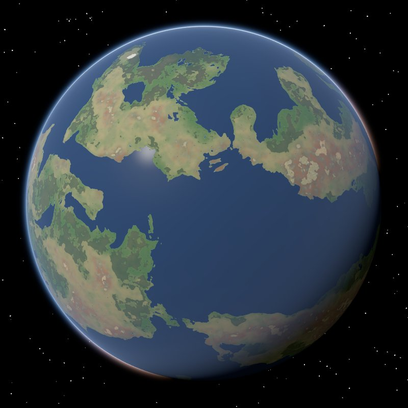
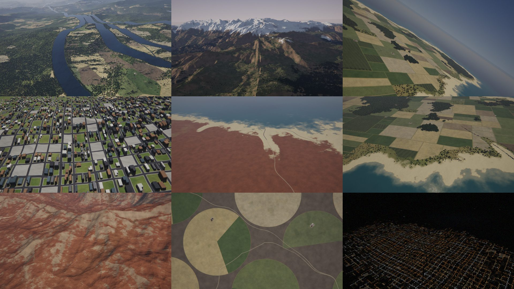
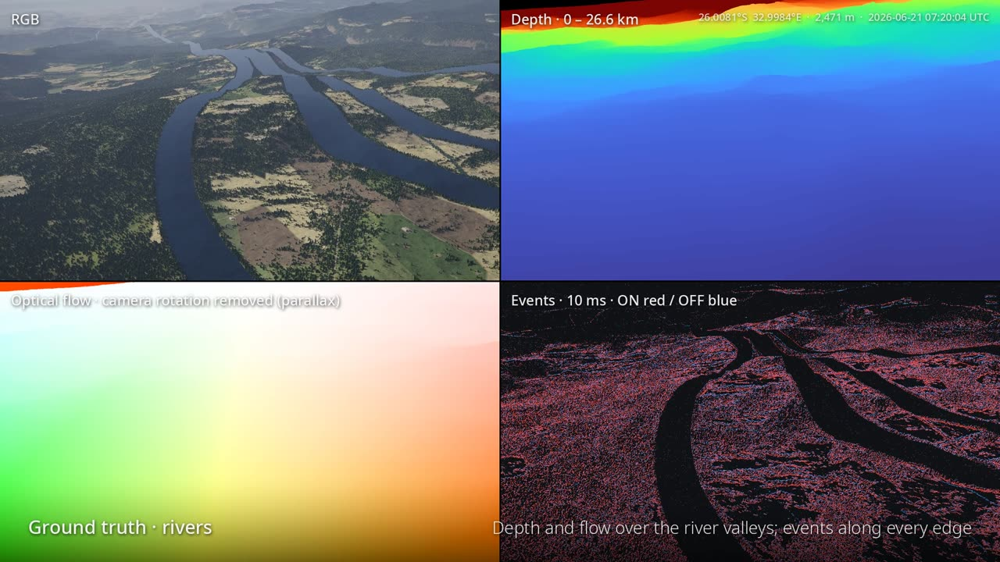

# aerialsynth

<p align="center"></p>

A procedural planet for aerial vision research. `terrain` generates a deterministic world as
Web-Mercator XYZ tiles, flies cameras and an IMU over it, and writes datasets with exact
ground truth. A viewer flies over the world in realtime. There is no imagery or elevation data
anywhere: every pixel comes from the generator, so any place on the planet, at any zoom, can be
produced on demand and reproduced exactly from a seed.





<sub>Top: stills from the [showcase video](showcase/README.md), rendered from generated tiles
only. Bottom: one frame of a dataset with its ground truth: RGB, depth, optical flow (parallax)
and events.</sub>

**Videos:** [the feature showcase](https://youtu.be/SkTq4ph64l4) (4:35) and
[a long-haul airliner flight](https://youtu.be/ByafGs-iNug) from the equator to the arctic
(3:49), also downloadable from the
[v0.1.0 release](https://github.com/shadymeowy/aerialsynth/releases/tag/v0.1.0).

- **World:** continents, mountains carved by erosion, rivers, lakes, climate and biomes,
  forests of individual trees, fields, towns with buildings, roads, night lights. Any place,
  any zoom, generated on demand (on the GPU or the CPU) into one HDF5 tile store.
- **Flights:** spline paths with wind, gusts, turbulence and engine vibration, or your own
  trajectory CSV.
- **Sensors:** cameras of any model (pinhole, fisheye, omnidirectional) lit for the date and
  time (sun, moon, stars, planets, night lights) with atmosphere, shadows and a sensor model;
  ground truth (depth, optical flow, land cover, star positions); event cameras; an IMU.
- **Tools:** a live viewer of the world (`terrain view`), a dataset viewer and exporter
  (`terrain show`, `terrain export`), and C and Python bindings for tiles and camera images.

## Install

Each [GitHub release](https://github.com/shadymeowy/aerialsynth/releases) has self-contained
builds (HDF5 and zlib linked in) for Linux (x86_64, aarch64; glibc ≥ 2.28), macOS (Apple
silicon, Intel; ≥ 11) and Windows (x86_64):

- `terrain-<version>-<target>.tar.gz` / `.zip`: the `terrain` CLI and the C library
  ([`bindings/`](bindings/README.md#c));
- `aerialsynth-<version>-cp310-abi3-<platform>.whl`: the Python package for CPython ≥ 3.10
  ([`bindings/python`](bindings/python/README.md#install)).

**From source** (`cargo build --release`): Rust ≥ 1.99, a C compiler and CMake ≥ 3.26 (HDF5
2.2.0 and zlib are built from source and linked statically; the first build takes a few
minutes). Linux: `build-essential` and `cmake` (or `pip install cmake`); macOS: the Xcode
Command Line Tools and `brew install cmake`; Windows: the Visual Studio Build Tools ("Desktop
development with C++"), which include CMake; the C runtime is linked statically. CI builds and
tests Linux, macOS (Apple silicon and Intel) and Windows.

**GPU:** optional but much faster (wgpu: Vulkan, Metal or DX12). Tiles are generated on the
GPU when it has 64-bit float and integer shaders (Vulkan on NVIDIA and recent AMD; not Metal),
else on the CPU, about 10× slower; frames are rendered on any GPU, else on the CPU. The viewer
needs a GPU. [`docs/gpu.md`](docs/gpu.md) covers choosing a GPU and troubleshooting.

## Quick start

```sh
cargo build --release                       # target/release/terrain
cargo install --locked --path crates/cli --target-dir target   # optional: `terrain` on the PATH
terrain view                                # look around the default world (seed 1, tiles in out/world.h5)
terrain run -c configs/quick.yaml           # a 3 s smoke-test dataset: out/quick/seq.h5
terrain show out/quick/seq.h5               # look at it
terrain config > my.yaml                    # a commented scenario template: edit it, then
terrain run -c my.yaml                      # trajectory → tiles → render (→ events)
```

Without `-c` every command uses the default scenario; `--seed N` makes a different planet. A
tile store holds exactly one world: a store made with another seed or world config is refused
(the error names what differs), so give each world its own `tiles.file`. The first run on a GPU
compiles its shaders (about 30 s, then cached; [`docs/gpu.md`](docs/gpu.md#first-run)).

`configs/quick.yaml` takes about a minute on 4 CPU cores without a GPU (mostly generating its
~75 tiles) and seconds with one; `configs/dataset.yaml` is a fuller dataset, and
`configs/examples/` has night flights, a full moon, an event camera rig, a star tracker, a
fisheye, a 10 km cruise, a sunset and an IMU check.

## Commands

| command | |
|---|---|
| `terrain run` | make a dataset: trajectory → tiles → render → events; `--step traj,tiles,render,events` runs single steps, `--lazy` generates missing tiles while rendering |
| `terrain tiles` | generate the flight's tiles, a region's (`--bbox … --zooms 6-14`) or a list's (`--list`); `--dry-run` only lists them; `--png PREFIX` previews a mosaic without a store |
| `terrain view` | the live viewer: map and camera, generating as you go ([`docs/viewer.md`](docs/viewer.md)) |
| `terrain show SEQ.h5` | look at a dataset: every modality on a timeline, pose, IMU, pixel values; `--snapshot` without a window ([`docs/show.md`](docs/show.md)) |
| `terrain export SEQ.h5 --out DIR\|FILE.mp4` | PNG sequences or videos (ffmpeg) of a camera's modalities |
| `terrain survey` | find diverse places (coasts, mountains, towns, …) and render stills of each, with a contact sheet and `places.csv`; `--places FILE.csv` re-renders a list |
| `terrain info FILE` | summarize a tile store or a sequence file |
| `terrain config` | the scenario template; `--all` every setting; `-c my.yaml` a scenario with its defaults filled in |

`run`, `tiles`, `view`, `survey` and `config` read one scenario (`-c`) and take `--seed` and
`-j` (threads); `terrain <command> --help` lists every option.

## Outputs

- **Tile store** (`tiles.file`): the world's tiles (rgb, albedo, elevation as a surface model
  with trees and buildings, normals, land cover, night lights). It holds one world and grows as
  needed.
- **Sequence file** (`output.file`): body poses, the IMU, and every camera's frames, depth,
  flow, land cover, events and stars, with i64 µs timestamps and self-describing datasets;
  optionally PNG files too.

Both are plain HDF5 (h5py reads them as they are); layouts in [`docs/formats.md`](docs/formats.md).

## Python and C

Read a layer of any tile, or render a camera image (RGB, depth, land cover) from a pose with the
renderer of `terrain run`; missing tiles are generated and stored first
([`bindings/`](bindings/README.md)).

```python
import aerialsynth                                       # the release wheel
w = aerialsynth.World("out/world.h5")                    # the default world; created if missing
rgb = w.tile(12, 2200, 1500, "rgb")                      # np.uint8 (256, 256, 3)
cam = w.camera(width=640, height=480, hfov=90)           # or a scenario camera: config=, camera=
f = cam.render(45.0, 10.0, w.surface_height(45.0, 10.0) + 300, pitch=-30, yaw=90,
               time="2026-06-21T07:30:00Z", depth=True)  # f.rgb (480, 640, 3), f.depth (480, 640)
```

The first render at a new place generates a few hundred tiles: under half a minute on a GPU,
minutes on a CPU ([details](bindings/README.md#rendering)).

## Documentation

| | |
|---|---|
| [`docs/scenario.md`](docs/scenario.md) | writing scenarios: sections, cameras and modalities, conventions, look |
| [`docs/formats.md`](docs/formats.md) | the tile store and sequence file layouts, land-cover classes |
| [`docs/simulation.md`](docs/simulation.md) | what is simulated: terrain, rendering, lighting, sensor, IMU, flights; performance, tests |
| [`docs/gpu.md`](docs/gpu.md) | the GPU: first run, choosing a GPU, troubleshooting, how the work is split |
| [`docs/viewer.md`](docs/viewer.md) | `terrain view`: map and camera views, controls, snapshots and recordings |
| [`docs/show.md`](docs/show.md) | `terrain show` and `terrain export` |
| [`docs/events.md`](docs/events.md) | event cameras |
| [`docs/stars.md`](docs/stars.md) | stars, planets and the Moon: catalogue, astrometry, star ground truth |
| [`bindings/README.md`](bindings/README.md) | the C and Python bindings |
| [`examples/camera-footprint`](examples/camera-footprint) | camera ↔ geodetic / ECEF / ENU ↔ XYZ tiles, a camera's ground footprint on the stitched map |
| [`docs/next/`](docs/next/README.md) | experimental: the modular `next` terrain generator (`world.generator: next`) |

## Repository layout

```
crates/geodesy    ellipsoid, geodetic/ECEF/ENU/NED/AER, XYZ tile math, attitude
crates/h5         safe wrapper over hdf5-sys (HDF5 2.2.0 bundled)
crates/tilestore  the HDF5 tile store
crates/terragen   the world generator (CPU / GPU)
crates/render     cameras, flights, level of detail, renderer (CPU / GPU), lighting, sensor, events, IMU, writers
crates/viewer     terrain view
crates/seqview    terrain show / export
crates/cli        the terrain command
bindings/         C library (libaerialsynth) and Python package (aerialsynth)
examples/         example programs
configs/          example scenarios
scripts/          builders of the bundled star catalogue and ephemeris (pip install -r scripts/requirements.txt)
showcase/         the showcase videos, rendered from this repository (its own README)
```

`cargo test --release` runs the tests ([`docs/simulation.md`](docs/simulation.md#tests)).

## License

Licensed under the Apache License, Version 2.0 ([LICENSE](LICENSE)). The showcase's fonts
(Noto Sans, `showcase/fonts/`) are under the SIL Open Font License.

Bundled data (`crates/render/data/`, built by `scripts/build_stars.py` and
`scripts/build_planets.py`; [credits](docs/stars.md#data-credits)):

- `stars_v9.bin`: derived from the Hipparcos (ESA 1997; new reduction, van Leeuwen 2007) and
  Tycho-2 (Høg et al. 2000) catalogues, ESA, obtained from CDS / VizieR (I/239, I/311, I/259).
- `planets.bin`: a subset of the JPL DE440 planetary ephemeris (Park et al. 2021), public
  domain.

The astrometry follows ERFA (BSD-3-Clause, derived from IAU SOFA); its nutation series is taken
from ERFA's `nut00b.c` (license text in [NOTICE](NOTICE)).
