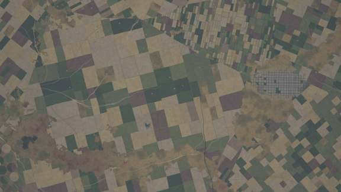
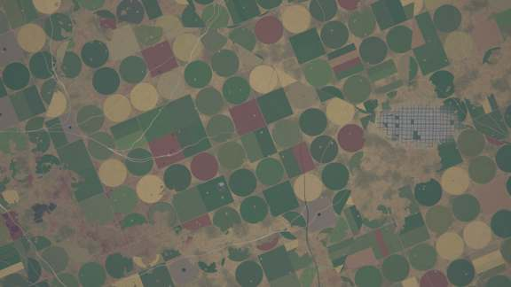
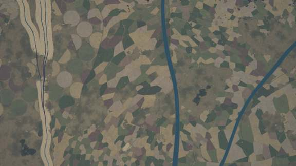
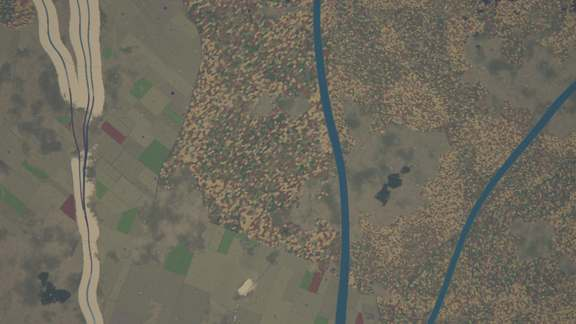
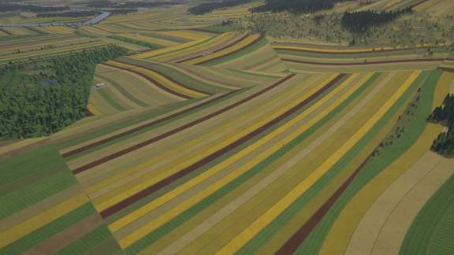

# Agriculture kit

`crates/terragen/src/kits/agriculture.rs` (catalogue, shading, tests), its WGSL twin
`src/gpu/wgsl/kits/agriculture.wgsl` (the tables are generated from the Rust file) and
`biomes/agriculture.yaml` (empty: the systems are code). Design:
[terrain-next.md §5.8](../design/terrain-next.md), contract: [kit-guide.md](../design/kit-guide.md).

## What it draws

The core drew one field look everywhere. Now every land-use region (~7 km) draws one **field
system** of a catalogue, weighted by its ecoregion's culture archetype, Köppen class and
development (one dominant system per ecoregion), in place of the core's fields; the weights keep a
share for the core's fields. Systems change at region and ecoregion borders, never per sample.

| system | look |
|---|---|
| section grid | 1-mile sections, quarter sections, centre pivots where dry, farmsteads, section-line roads |
| shelterbelt steppe | huge fields bordered by tree belts, strip-fallow stripes |
| open-field strips | furlongs of long narrow strips, each its own crop, reverse-S curves |
| bocage | small irregular pastures and fields inside hedgerows, trees in the hedges |
| smallholder mosaic | tiny irregular plots, scattered trees, homestead compounds |
| rice paddies | bunded plots, flooded / transplanted / green / ripe by season; contour terraces on slopes; canals, fish ponds |
| dry terraces | stone-walled benches with grain, olives and orchards on contours |
| vineyards | parcels of vine rows along the field axis or the contours |
| groves | olive, almond, citrus groves; date palms in deserts, apples in cool climates |
| plantations | oil palm, rubber, tea on contours, cane; estate roads |
| greenhouse seas | white plastic bays in different states, irrigation ponds |
| pastures | paddocks, livestock trails to troughs, farm dams, hay meadows, savanna trees in warm climates |
| irrigated pivots | centre pivots in the desert |

Parcels are crisp units with hashed ids; rows, furrows, crowns and trails are band-limited and
blend to the system's mean at coarse pixels. Field tracks only: roads are the transport kit's.

## Stills

GPU-generated (`terrain survey`, `AERIALSYNTH_GPU_STRICT=1`), default world, 10:30 local on the
equinox. Lat, lon in brackets.

**Section grid with pivots** (35.871, 51.847): oblique 300 m, nadir 10 km. **Before / after
(10 km nadir, the core's fields without the kit, then the kit)**:

**Smallholder mosaic** (15.229, 58.043), the same 10 km without and with the kit, and 1.5 km:

**Open-field strips** (55.645, 28.069): oblique 300 m and nadir 10 km.

**Bocage** (-51.817, -103.984), **rice paddies** (18.420, 160.804), **dry terraces**
(-38.496, 176.292), **groves** (29.000, 107.235), **greenhouse sea** (27.783, 172.016),
**pasture** (34.443, 147.270, nadir 1.5 km):

## Tests

* `registry_compiles`, `wgsl_tables_are_current` (`AERIALSYNTH_BLESS=1` rewrites the tables),
  `systems_vary` (every archetype draws several systems, every system appears);
* `tiles_match_the_cpu` (GPU): the 13 places at z12, z14, z16, at most 0.5 % of the pixels off;
* `lod_seams_determinism`: parent vs mean of children (albedo, class histogram) at z12 and z15,
  determinism with a fresh generator, the E-W seam;
* `places_stay_on_the_gpu`: the places at z6 to z16 without a CPU fallback;
* `find_places`, `bench_places` (ignored).

## Performance

See the table in the commit message / CHANGELOG notes: `bench_places` (GPU, 13 places x 8 x 8
tiles per zoom), with and without the kit's `KITS` entry.
