# Coast and ocean kit: cliffs, skerries, tidal flats, barrier islands, reefs, atolls, ponds

`crates/terragen/src/kits/coast.rs` (types, creeks, relief, atoll family, layers, tests), its WGSL
twins `src/gpu/wgsl/kits/coast_relief.wgsl` (types, creeks, relief, atoll family) and
`coast.wgsl` (the layers). No biomes (design: [terrain-next.md §5.5](../design/terrain-next.md),
contract: [kit-guide.md](../design/kit-guide.md)).

## What it draws

**Coast type per ~50 km stretch.** Three noises (55, 38 and 47 km) × the relief potential
(atlas uplift, the mountain mask) × glaciation × the sea-level temperature give smooth weights of
five types (the strongest wins, near-ties blend): cliff (mountain / tectonic coasts), skerry
(glaciated), tidal flat (low coasts), barrier (low coasts, the other half of the noise), and
reef (warm water, on top of any type). Every effect is a function of the pre-remap height `h0`
near sea level, so none needs a distance to the coast; all run in pass A (`relief`) and gate on
the atlas coast distance (−100..30 km) and on a window of `h0` before any noise.

| feature | pass A (height remap) | pass B |
|---|---|---|
| cliffs | `h + C·smoothstep(0, ε, h)`, C 12-112 m, fading above 1.5-4 C, ε = max(2 m, 0.04 gsd); below sea level a wave-cut platform (`-1.3 + 0.1 h` in the first 10 m of depth) | rock face on slopes > 0.4 (strata by lithology: chalk, red sandstone, granite, basalt, alluvium; streaks), pale shallow water over the platform (core surf at the foot) |
| rocky shores, skerries | noise 700 / 230 / 75 m in a window around -8 m: islets and coves | bare rock and lichen on the islets, kelp patches in the water |
| archipelagos | the same at 2.6 km / 900 m / 260 m, wider window (island-arc coasts) | |
| tidal flats, salt marsh | the intertidal band compressed to a fifth of its slope; dendritic creeks (3 levels of ridged noise, 14 / 6 / 2.4 m wide) cut 1.9 m | grey-brown mud (wet darker), marsh above 1 m (green with rust patches), creeks as dark channels, no towns |
| barrier islands, lagoons | bump at -6 m (8.7 m, width 2.8 m), inlets where a 3.2 km noise closes it | the core's beach on the island, green-sand lagoon water |
| reefs | bump at -7 m (fringing) or -28 m (barrier reef) up to -0.9 m, passes where a noise closes it | turquoise sand by depth, coral heads, the core's surf on the crest |
| salt / aquaculture ponds | | on the high flats and marsh, in the land-use region's field frame: 150 × 85 m ponds with dykes; salt (pink, white, turquoise, green) where moist < 0.45, aquaculture (blue-greens) elsewhere; patches by a 2.4 km noise |
| atolls | family `coast_atolls` (cell 80 km, reach 24 km): ring of reef R 2-14 km, rim 180-400 m wide at -0.3 m, motus (+1.9 m, noise > threshold), lagoon 12-30 m, outer slope 0.5 to the sea floor; ocean floor 1.5-5.5 km deep, > 150 km from any coast, SST > 25 °C, mostly hotspot tracks | turquoise lagoon with coral, scrub on the motus (the core's beach is the sand) |

Creek, ring and rim widths below a pixel are widened or show their mean (creeks fade to a mean
cover of 5.5 % by pixel size, no step between zooms).

## Placement

Weights, not decisions: a coast has a type by the atlas fields at the pixel, so tiles agree
across zooms and backends. Atolls are an instance family (existence at the site from the atlas).

Places (default world, `PLACES` in the tests): cliff coast (-21.804, -43.364), Adriatic tidal flats
(44.107, 11.756), arid tidal flats and creeks (26.538, -5.414), barrier / lagoon coast
(19.379, -14.658), fringing reef (11.859, 81.198), glaciated skerry coast (61.882, 19.636), atoll
(7.131, 87.717), plain coast (-41.129, -152.831). Find more with the ignored tests
`find_coast_places` (atlas), `find_coast_crossings` (pass-A coast crossings by type) and
`find_atolls`.

## Tests

Kit unit tests (class ids, continuity of every remap in the height, cliff step, flat slope,
creek cover, weights vary), LOD consistency (parent ≈ mean of children: elevation ≤ 1.1 m,
albedo ≤ 5.3 DN at the places), seams E-W / N-S, determinism, `tiles_match_the_cpu` (11 tiles at
z12-z16: at most 0.05 % of the pixels off), `places_stay_on_the_gpu`, ignored `bench_places`.
No kernels: no kernel parity test.

## Performance

`bench_places` (GPU tiles/s at the 8 places, 64 tiles per place and zoom, median of three
blocks; Tesla P4, other farm jobs running, so ±5 % noise), with and without the `KITS` entry:

| zoom | without | with |
|---|---|---|
| z8 | 8.8 | 9.1 |
| z10 | 21.6 | 21.4 |
| z12 | 22.1 | 21.6 |
| z14 | 19.8 | 19.3 |
| z16 | 21.2 | 20.0 |

At most ~5 % (z16, within the noise of the blocks); the relief gates on the atlas coast distance
and a window of heights before any noise, the layers on ground height and coast distance.

Cold compile (RTX 6000 Ada, all seven kits, the farm busy with other jobs of the same run):
pass B 31.8 / 26.2 / 30.7 s (25.4 / 25.7 / 26.9 s with `TERRAGEN_COMPILE_DROP=coast`: the kit costs
up to 6 s in the first stage), points 23 s, drainage heights 17.5 s. The first stage is at the
~30 s budget; the cost is the two copies of the coast-type noises (slots 3 and 8 are in different
stages).

## Stills

GPU-generated (`terrain survey`, default world, 10:30 local on the equinox, all seven kits).

**Cliffs** (35.772, 168.689; 300 m, 1.5 km): red sandstone faces on a headland coast, clear
shallows over the platform.
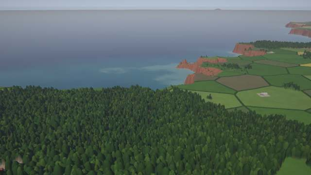
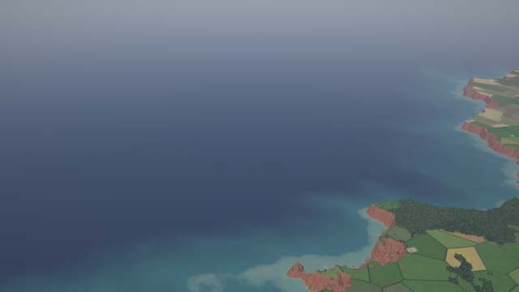

**Fringing reef** (11.859, 81.198; 300 m, 1.5 km): turquoise lagoon, coral heads.
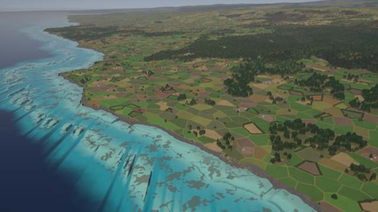
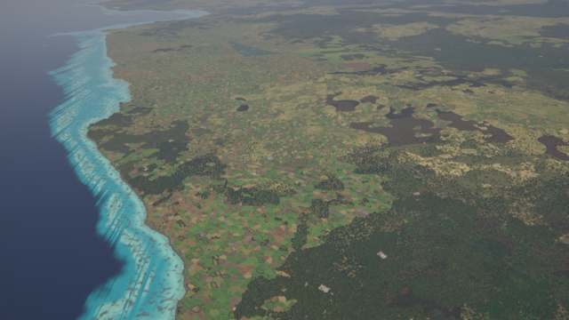

**Tidal flats, creeks and ponds**: Adriatic (44.107, 11.756, 1.5 km); arid coast with salt ponds
(26.538, -5.414; 300 m, 1.5 km); ponds beside a town coast (27.579, 159.589, 10 km).
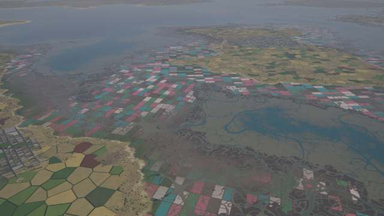
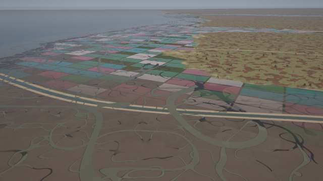
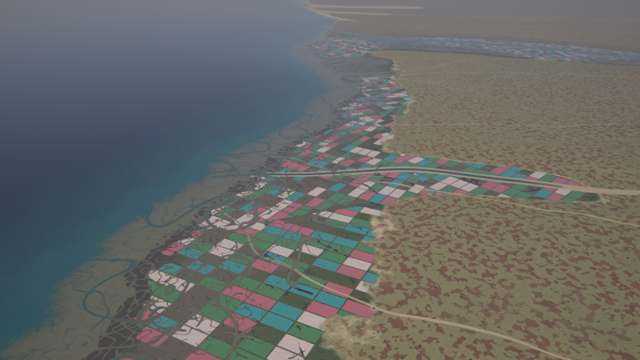
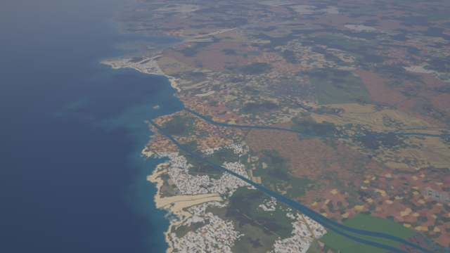

**Barrier / lagoon coast** (19.379, -14.658, 1.5 km); **skerry coast** with kelp (62.333, 21.760,
1.5 km); **atoll** (7.131, 87.717, 10 km: ring of reef, motus, lagoon).
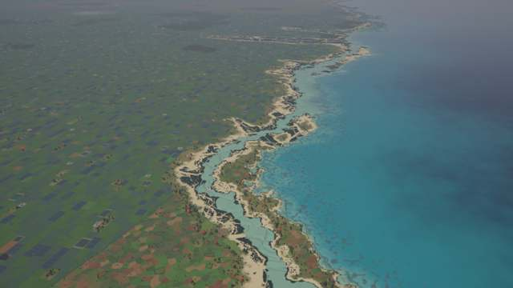
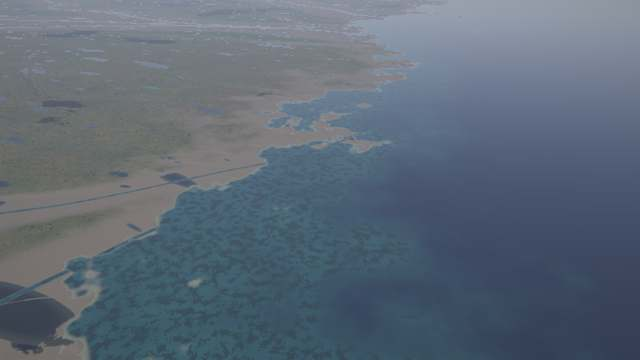
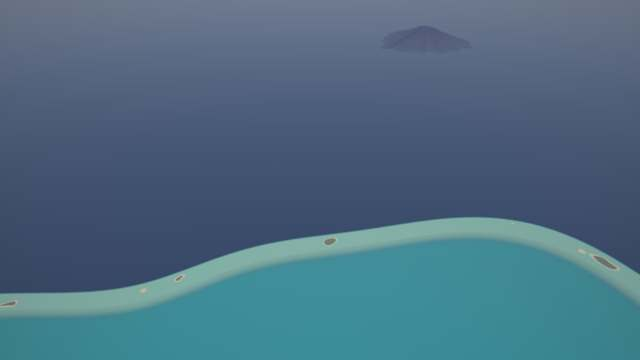

## Known limits

* Weights come from atlas fields (uplift, mountains, glaciation, temperature) and noise, not from
  lithology or wave / tide data: a cliff coast needs a tectonic or mountainous coast (13 of ~1000
  coast crossings in the default world), tides are not modelled (flats are the band ±2 m around
  sea level, compressed).
* Remaps are functions of the pre-remap height: the width of a barrier island, reef flat or flat
  follows the bathymetric slope; on a steep shelf they are narrow.
* Reefs do not avoid river mouths; barrier reefs depend on a −28 m contour existing.
* Creeks narrower than a pixel exist only in pass B (colour); at z ≥ 11 the main channels fade
  to their mean cover (5.5 %).
* Reef crests show streaky dark lines in oblique views (thin ridges of the contour bump; not
  fixed). Skerry coasts show kelp and rock but few islets where the shelf is steep.
* Ponds cover large patchworks on wide marsh (patch noise 2.4 km); the town / field layers do not
  avoid them beyond `natural_ok`.
* Deltas, mangroves and ports belong to other kits and are not drawn here.
* A straight scarp inside a tidal-flat view is the core's arid mesa terrace, not a seam.
