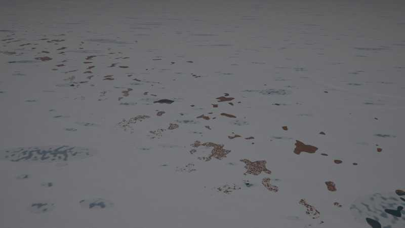
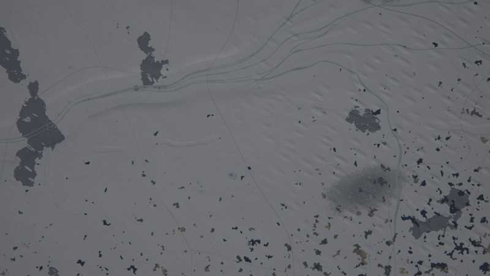

# Cold kit: glacial, periglacial and ice

`crates/terragen/src/kits/cold.rs` (layer functions, kernel, drumlin family, tests), its WGSL
twin `src/gpu/wgsl/kits/cold.wgsl` (+ `cold_relief.wgsl`), and its biomes
`crates/terragen/biomes/cold.yaml` (design: [terrain-next.md §5.4](../design/terrain-next.md),
contract: [kit-guide.md](../design/kit-guide.md)). Taiga, lichen woodland, krummholz and alpine
meadow belong to the temperate kit.

## What it draws

**Biomes:** `polygon_tundra` (ice-wedge polygons, sorted circles, wet sedge), `shrub_tundra`,
`polar_desert` (frost-shattered gravel, patterned ground), `forest_tundra` (tundra with scattered
stunted spruce).

**Layer functions** (climate: warmest-month temperature for snow line and glaciers, temperature at
the ecoregion's date for seasonal snow and frozen water):

| slot | draws |
|---|---|
| 1 zonal | perennial snow mask by the summer temperature (snow line lower on shaded, steep ground by aspect) |
| 3 azonal | thermokarst and kettle lakes, drained lake basins (sedge meadow), pingos (some collapsed) |
| 8 water | sea ice (fast ice, floes, leads, pressure ridges), frozen lakes, seasonal (frozen) rivers |
| 9 seasonal | glaciers (firn, bare ice, crevasses, ogives, medial moraines), lateral and terminal moraines, seasonal snow and névé |

**Drumlin fields with eskers** (instance family `cold_drumlins`, pass-A relief): glaciated lowlands
(atlas `glaciation`) get streamlined hills along one ice-flow azimuth per field and sinuous esker
ridges.

**Kernel** `cold_polygons` (3D Worley lattice, calibrated mean). The kernel's parameters and
calibrated means are generated into the WGSL file; `AERIALSYNTH_BLESS=1` rewrites it.

## Tests

`registry_compiles_with_the_cold_biomes`, `class_ids_are_the_v2_table`, `lakes_stay_within_reach`,
`lake_means_match_explicit_averages`, `polygon_mean_matches_explicit_average`, `dates`,
`lod_consistent_at_cold_places`, `seamless_at_cold_places`, `kernels_match_the_cpu` and
`tiles_match_the_cpu` (GPU), `places_stay_on_the_gpu` (z6 to z16 of the nine places under
`GPU_STRICT` semantics), `bench_places` (ignored; GPU tiles/s).

## Performance

`bench_places` (RTX 6000 Ada, 9 places x 8 x 8 tiles per zoom), tiles/s, same build with the
`KITS` entry commented out vs the kit:

| zoom | without | with | change |
|---|---|---|---|
| z10 | 124.4 | 116.6 | -6 % |
| z12 | 125.2 | 114.1 | -9 % |
| z14 | 131.4 | 115.7 | -12 % |
| z16 | 109.1 | 124.6 | noise (+14 %) |

(z8 is dominated by shader compilation and is not meaningful.) Within the 15 % budget where the
kit draws.

## Stills

GPU-generated (`terrain survey`, `AERIALSYNTH_GPU_STRICT=1`), default world, 10:30 local on the
equinox (glacier and polygon tundra: 12:00 at the December solstice). Lat, lon in brackets.

**Valley glacier** (-66.095, 123.288, oblique 1.5 km, summer solstice noon): firn, dirty ice, crevasse
fields, flow lines. The stills' grey snow is the sensor's fixed exposure, not the albedo.

**Ice field** (-72.199, -89.333, oblique 10 km): outlet streams, moraine bands.

**Late-melt polygon tundra** (-72.339, -102.499, oblique 1.5 km): the bare patches are fragments
with a polygon net of snow in the troughs, not blobs.

**Kettle lakes and snowy taiga** (58.609, -92.893, oblique 1.5 km); the pale rectangles are the
temperate kit's boreal clear-cuts (this is taiga at 2 C, not forest tundra).

**Forest tundra** (-71.075, -168.603, oblique and nadir 300 m): ice-wedge polygons, thermokarst
ponds.

**Sea ice** (-71.842, -70.019, oblique and nadir 10 km): fast ice, leads, floes.

**Drumlin field under snow** (57.314, -26.177, nadir 10 km): the relief is subtle under the snow.

## Notes

* Seasonal snow's date fades to the annual mean over 10 km towards an ecoregion border (the
  mosaic of two ecoregions with different dates drew snow-free blobs next to snow). The melt edge
  is ragged with fine noise and a snow net along ~18 m polygon troughs.
* The temperate kit's `forestry` is zero where the biome's trees are below 0.6 (forest tundra,
  tundra, polar desert): no managed stands there.
