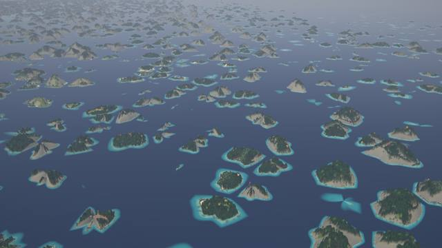
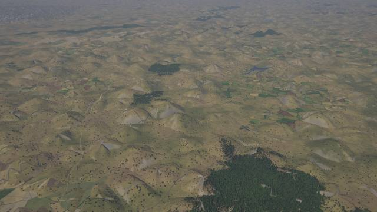
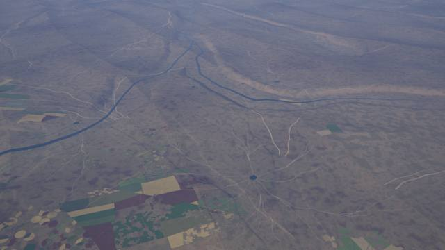
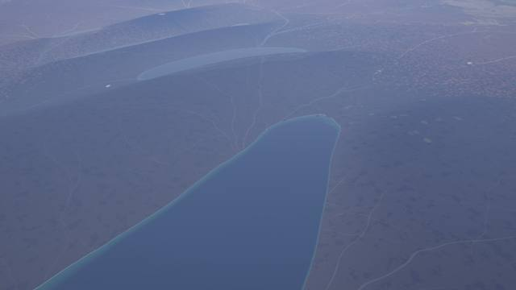
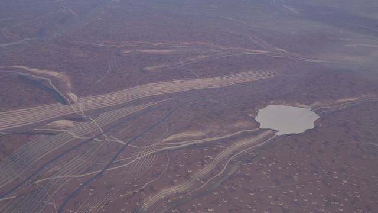
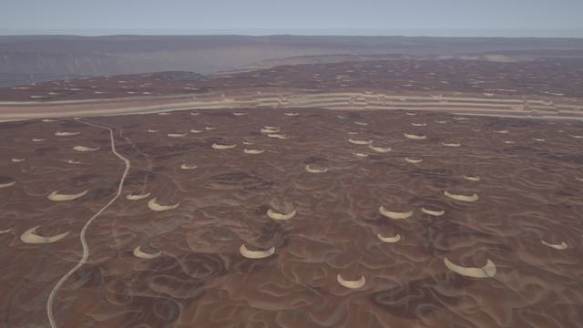
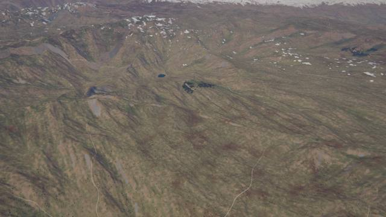
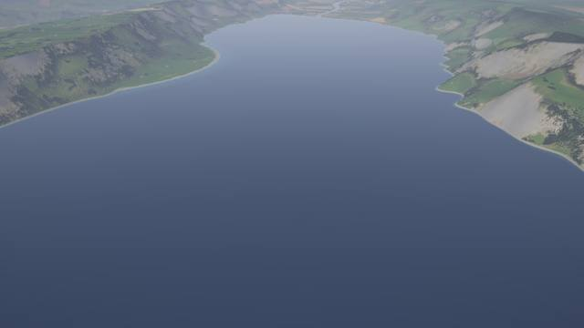
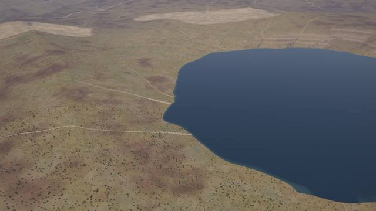

# Mountains kit: karst, folded ridges, fault blocks, canyons, badlands, glacial troughs, fjords, fans

`crates/terragen/src/kits/mountains.rs` (zones, relief, carve hook, fan family, layer, tests), its
WGSL twins `src/gpu/wgsl/kits/mountains_relief.wgsl` (fields, zones, relief, carve hook, fan family;
in every module with pass A) and `mountains.wgsl` (the layer). No biomes and no kernels (design:
[terrain-next.md §5.3, §5.4](../design/terrain-next.md), contract:
[kit-guide.md](../design/kit-guide.md)). The kit is also the first to use a **core hook**, the
*carve hook* (below), because glacial troughs, fjords and canyons change how the drainage carves
its valleys, and that happens after the relief operators have run.

## What it draws

Where a landform lives is a **zone** (0..1) from smooth fields only (`zones`): the atlas'
lithology, the climate (moisture, temperature at the smooth elevation), the mountain mask, the
tectonic uplift, the continent value, the coast distance and the glaciation. The lithology is the
atlas' dominant rock at the texel nearest to the pixel, looked up at a position warped by two
noises (14 and 11 km, up to 4 km), so the 20 km texel borders are ragged; two more noises of the
same wavelengths cut patches out of the karst and badland zones. A zone is crisp where it
matters (a tower is there or not); only its extent is smooth.

| landform | where (zone) | pass A (relief) | pass B (slot 6) |
|---|---|---|---|
| tower karst | carbonate × humid (moisture 0.42-0.58) × warm (15-21 °C), off high mountains, on the shelf | floors flattened towards the 5 km smooth elevation (88 %); 3D Worley lattice of 420 m cells, 70 % of the cells carry an oval, ragged tower `H (1 - F1/R)^0.6` (H 90-260 m, R 0.4-0.7 cell), clipped at the bisector; the calibrated mean (16.85 m) where the cells are below the pixel | pale grey cliffs on slopes > 0.8-1.4, forest above (the biome's canopy) |
| drowned towers (islands) | the same, near the coast | the plain falls to -11 m within 10 km of the coast (the coast retreats a few km): the towers stand in the sea; no towers beyond 30 km at sea | the core's shallow water and beaches |
| cockpit karst | carbonate × humid, cooler or drier (moisture 0.28+, 4-12 °C+) | a cone hill in every cell (H 60-160 m, linear flanks), the star-shaped depressions lie between them (mean 15.24 m subtracted: zero-mean) | pale cliffs on the steepest flanks |
| folded ridges | old orogens (mountain mask with little tectonic uplift) and foreland belts (uplift 0.04-0.5) | ridges `t^1.6` on an 8-corner lattice of 140 km cells (below), λ 6.3-11.7 km, 520 m; the old relief is 85 % smoothed away first | the core's rock on slopes |
| fault blocks | extensional provinces (negative uplift, inland) | tilted sawtooth (a scarp on a fifth of the period), λ 11-21 km, 900 m, the same lattice | |
| badlands | soft sediment (sedimentary, unconsolidated) × arid (moisture < 0.14-0.28) × not in sand seas | three octaves of creased noise (300, 130, 55 m; `|perlin|^0.7`, zero mean; 25-55 m deep) | pale clay floors, strata bands of 9 m (cream, rust, brown) on the gully walls |
| alluvial fans | family `mountains_fans` (cell 12 km, reach 7.2 km): the atlas' uplift 0.12-0.55 falling by 0.03 over 24 km, dry (moisture index < 0.33), > 5 km from the coast; the fan points down the gradient | a cone `H (1 - r/R)^1.3` (R 2.6-5.6 km, H 1.6-3 % of R) blended 70 % over the smooth elevation in a ±60° sector, a lobed outline | pale gravel with radial streaks, 85 % of the vegetation cleared |
| glacial troughs, hanging tributaries | glaciation 0.3-0.6 × mountain mask 0.25-0.55 | *carve hook*: U profile (`t^1.5`), walls 25 % steeper than the core's, floors 1.5 × wider and over-deepened by 90 m (rivers) / 40 m (tributaries), the depth cap × 2 (rivers 400 → 800 m) and × 8 (tributaries 35 → 280 m): the side valleys end above the trunk valley | scoured pale rock on slopes > 0.75-1.1 |
| cirques and tarns | the head (a spring piece) of a glaciated tributary | a round floor of 240 m at the head, 130 m lake (a bowl 4 m deep, level 1.4 m above the floor), fading over the first 6 % of the piece | |
| fjords | glaciated coastal mountains, the river's floor within 20-70 km of the coast | floor from -70 m at the mouth to -330 … -530 m 12 km inland and up to 0 at the head; the flood plain no longer clamped above the sea (`fp_min`), so the ocean fills the valley; fades with the land mask into the open sea | |
| stepped canyons | arid (moisture < 0.22-0.36) × sedimentary or carbonate × plateau (150-450 m) × the mesa field, rivers (tributaries 35 %) | floor lowered by 350-1200 m (not below 30 m), walls 3.3 × steeper, floors 0.6 ×, depth cap 1500 m, benches of 55 ± 25 m (smooth S between them, faded out when the benches are below ~160 m) | strata bands of 14 m on arid sedimentary walls |

**Ridges (`ridges`).** The stripes of folds and fault blocks must keep their phase at any zoom
(R-wave): the lattice has 8 corners around the point, each with its own strike (a random
direction in the tangent plane of the corner), wavelength (0.7-1.3 × λ0) and phase; a corner's
stripe coordinate is `dot(p - corner, strike)/λ` (anchored at the corner, so f32 keeps its
precision), the profile of every corner is blended by its trilinear weight squared. A 38 km noise
bends the stripes (up to 1.4 cycles), a 26 km noise makes the amplitude plunge (a fold nose ends
where it fades). The strike is random per corner (the macro fields give no belt normal): along a
belt the ridges turn where two corners meet.

**Carve hook (core).** `Kit::carve` (`kits::{CarveIn, Carve}`, WGSL `kits_carve`) is called once
per channel that reaches a pixel (levels 0 and 1; `ReliefIn`-like inputs plus the position along
the piece, `spring` for the first piece of a channel). The kit changes the core's profile
parameters: floor, floodplain half width, wall extent per metre of depth, depth cap, U profile,
benches (bench height and share) and a small lake at the channel's head. The core's water rules
(river levels, perched water, lakes, the ocean at `h < 0`) are untouched; the carve stays bounded
by the piece's reach (`RiverHit::reach`; a no-op in the core). The hook costs nothing where no
kit sets it.

**Places** (default world; `PLACES` in the tests, `docs/kits/mountains_places.csv`): tower karst
(-0.714, -96.231), karst islands (4.857, -93.234), cockpit karst (41.958, -21.188), folded ridges
(51.411, -28.424), (27.899, 42.870), fault blocks (27.174, 134.125), badlands (-12.209, -151.434),
(23.361, 51.888), canyon (21.245, -121.297), glacial trough with a tarn (40.874, 174.741),
glacial troughs (49.423, -162.365), fjords (63.382, -81.127), (56.253, 161.268), (58.510, -76.433),
alluvial fans (-28.392, 45.461). Find more with the ignored tests `find_places` (zones and fan
instances over 200 k points), `find_fjords` and `probe` (zones and ground along a line;
`MT_PROBE=lat,lon MT_STEP=km`), `tile_stats` (`MT_TILE=name,z`).

## Tests

`class_ids`, `means_match_explicit_averages` (the tower, cockpit and crease means of the explicit
functions), `ridges_are_zero_mean_and_continuous`, `zones_are_weights` (bounded; the lithology
decides the kind), `carve_hook` (unchanged where nothing applies; a fjord only on a glaciated
coast; streams untouched), `relief_is_continuous_and_bounded`, `fans_exist_at_the_fan_place`,
`lod_consistent_at_places` (parent ≈ mean of children at 10 places: elevation ≤ 6.3 m, albedo
≤ 13 DN), `seamless_at_places` (E-W and N-S albedo and elevation), `deterministic_at_places`,
`tiles_match_the_cpu` (17 tiles at z12-z16: at most 0.055 % of the pixels off) and
`places_stay_on_the_gpu` (z6-z16 of the ten places). No kernels: no kernel parity test.

## Performance

Cold compile, Tesla P4 (`compile_times`, one pipeline at a time, no shader cache; the farm is
shared, so ±3 s): `pass_a1` 22.1 s, `eval_points` 26.0 s, drainage `lat_heights` 19.2 s,
`instance_lists` 4.3 s, `grid_nodes` 9.4 s; pass B 32.5 / 33.5 / 20.8 / 30.1 s (`pass_b2` is the
stage with the kit's layer, `PB_STAGE_STEPS` is unchanged; the other stages do not contain the
kit). The same run with the kit's relief, carve hook and fan existence test stubbed
(`TERRAGEN_COMPILE_DROP=mountains TERRAGEN_COMPILE_STUB='mountains_relief=;mountains_carve=;mountains_fans_exists=…'`)
and its layer dropped: 21.8 / 27.9 / 19.5 / 4.1 / 21.1 s: the kit is within the noise of the
timings. The deterministic measure is the inlined size (`inlined_sizes`): `pass_a1`
105 k → 113 k instructions (+7.8 %), `eval_points` 122 k → 131 k (+7.4 %), `lat_heights` 101 k →
110 k (+8.0 %), `instance_lists` 41.6 k → 42.4 k (+2 %), `pass_a2` +4.5 % (the carve hook),
`pass_b` 445 k → 450 k (+1.1 %). The first version cost +37 % in the pass-A pipelines: two call
sites of `macro_at` (15 k each) in the fan existence test; it reads the atlas now. Noise: three
perlins for the patches and ridges, one Worley query, eight lattice corners, a handful of
smoothsteps; every heavy helper has one call site (`cone_h` twice: it is small).

CPU: the kit adds a few noise evaluations per pixel (two patch noises everywhere on land and in
the shelf; the zones gate the Worley query, the ridges and the badland octaves); the tests below
run at the same speed as before. No with / without-kit bench (as agreed).

## Stills

GPU-generated (`terrain survey --places docs/kits/mountains_places.csv`, default world, 10:30
local on the equinox except the folds and the fault blocks, which need a low sun (08:00 / 16:30);
oblique views 1.5 km above the ground, 25° down; `cruise` 4 km, 30° down; `high` 10 km, 30° down).

**Tower karst** (-0.714, -96.231, 1.5 km): forest-clad oval towers over a flat floor; **karst
islands** (4.857, -93.234, 1.5 km): the same drowned (turquoise shoals, beaches).

**Cockpit karst** (41.958, -21.188, 1.5 km): cone hills and star-shaped depressions with fields in
the hollows.

**Folded ridges** (27.899, 42.870, 10 km, 08:00): ridges and valleys of an old belt, the river in
its valley; **fault blocks** (31.739, 137.721, 10 km, 16:30): tilted blocks with long lakes in
the basins between them.

**Stepped canyon** (21.245, -121.297; 10 km and 900 m, 08:00): benches of 55 m on both walls of a
canyon in a red plateau, barchans of the desert kit on the rim.

**Badlands** (-21.410, 36.504, 1.5 km): pale clay floors, gullies with rust and cream strata
bands.

**Cirque and tarn** (40.874, 174.741, 4 km): a funnel of steep valleys around a tarn at the head
of a tributary; **glacial troughs** (49.423, -162.365, 4 km): flat floors between steep walls on
a snow plateau, tarns, hanging side valleys.

**Fjords** (63.382, -81.127, 4 km: two flooded troughs around a spine; 56.253, 161.268, 1.5 km:
steep walls, scoured rock above the water).

**Alluvial fans** (-28.392, 45.461, 1.5 km): pale gravel aprons with radial streaks at a
mountain front, a lake in the basin.

## Decisions

* **Zones, not biomes.** A biome would take the lithology and climate of the ecoregion's site; the
  zones read the pixel's smooth fields, so a karst or badland zone has its own, noise-cut border
  and the relief and the colours agree. The kit therefore has no biomes (and no variety budget).
* **One Worley lattice for both karst types**, one call site (the relief is in every pass-A
  pipeline). The towers and the cockpit hills are the same function with two parameter sets.
* **Fans from atlas fields only.** An existence test that sampled the macro fields cost 15 k
  inlined instructions per call site in every pass-A pipeline (the first version: +37 % in
  `pass_a1`); the atlas' uplift and its gradient (five samples in one loop) give the same
  information.
* **The carve hook instead of a relief operator.** The relief runs before the drainage; a trough,
  a fjord or a canyon needs the channel's distance and floor, which only the carve knows.
* **Pass B in slot 6** (linear): the only stage with compile headroom (the stages of slots 1-5
  are over the ~30 s budget already). The layer is composited after the canopy, which suits rock
  and sediment, and runs before the transport kit's roads.
* **Strike of the folds**: random per 140 km corner (the macro fields give no gradient of the belt
  field); a belt shows ridges that turn at the corners.
* **Drowned karst**: the lowering of the plain is a function of the atlas coast distance at the
  pixel (smooth), so the islands have the same sea level at every zoom.

## Known limits

* Fold and fault ridges are gentle for the camera (slopes of 0.05-0.1): at noon and from a
  few km above they look flat; they show under a low sun or at grazing angles.
* Folds turn where two lattice corners meet (140 km); there is no belt normal. Fault blocks have no
  flat basin floors (a plain sawtooth), and only extensional provinces of the atlas (negative
  uplift, 77 of 200 k land samples at the default seed) get them.
* The lithology is 20 km texels with a 4 km warp: karst and badland zones have ragged but
  rounded borders; a carbonate texel under the sea is needed for drowned towers.
* Badlands are creased noise, not a dendritic network: from 1.5 km they show meandering gully
  lines and strata bands (they read like marbling where the zone is big); the colours are
  fixed (cream, rust, brown), not per ecoregion.
* Troughs, cirques, fjords and canyons exist only along drainage channels of levels 0 and 1
  (30 and 8 km lattices): a fjord needs a river within reach of the coast, and glaciated mountain
  coasts are rare in the default world (about 20 of 200 k samples).
* The canyon floor follows the drainage lattice (it is not below 30 m); a canyon is 3-5 km wide
  and up to 1.2 km deep, and tributary canyons are shallower. Mesas on the rims are the core's.
* Tarns are 130 m lakes at the head of tributaries: they vanish when the pixel is wider than
  about 330 m. Cirque headwalls are round, not scalloped.
* Towers are oval cones of a 3D lattice: their size varies with the height of the lattice site
  above the surface (some are small peaks); the pale skirt of the cliff layer is a band, not
  streaks. No dolines in pass B (the cockpit relief is the doline field), no rice paddies
  (the agriculture kit decides the floors).
* Fans are blended over the old relief (70 %): their apex is the instance's site, not the
  mouth of a valley; they do not follow drainage channels.
* The layer paints over the canopy (slot 6): karst cliffs and rock walls cut through forest
  crisply.
