# Transport kit: roads, railways, power lines

`crates/terragen/src/kits/transport.rs` (the kit, slots 7 and 8), `transport/net.rs` (the graph),
`transport/route.rs` (routing), `transport/build.rs` (the features of an area: profiles,
segments, crossings, interchanges, stations, yards, site roads, power lines), `transport/px.rs`
(the looks), `transport/tests.rs`, and the WGSL twin `src/gpu/wgsl/kits/transport.wgsl` (`tr_*`,
same names and order of operations). No biomes, no kernels. Design:
[terrain-next.md §3.5, §6.3, §6.4, P2/P3](../design/terrain-next.md); contract:
[kit-guide.md](../design/kit-guide.md). The kit builds on the settlements kit
([settlements.md](settlements.md)): its places are the graph's nodes, its sites the
destinations.

## What it draws

**The graph (host, analytic).** Relative-neighbourhood graphs (an edge a–b exists iff no node of
the network is closer to both than they are to each other) per network, each with a longest
edge; every pair of places belongs to one network:

| network | nodes | longest edge | class |
|---|---|---|---|
| arterial | cities, metropolises | 420 km | motorway (both developed ≥ 0.35, shorter with less development), else trunk |
| regional | towns and larger | 90 km | trunk (secondary where development < 0.12) |
| local | villages and larger | 20 km | secondary (local where development < 0.08) |
| hamlet | hamlets and larger | 4.5 km | local road (paved where developed) |
| track | a 1.3 km lattice of track ends in rural land outside places, hamlets, villages | 2.2 km | farm / forest track |
| rail | cities, metropolises, developed towns > 40 k | 300 km | railway (double track between developed cities, electrified where development > 0.55) |
| grid | developed cities | 300 km | high-voltage power line |

Plus: **spurs** from towns within 1.5 R + 4 km of a passing motorway (a trunk road ending in a
trumpet); roads to the settlements kit's **airports** (trunk for cities, secondary for towns),
**ports** (secondary road; a rail spur and a yard for cities), **dams** (local road to the wall),
**quarries** (haul road to the rim), **solar** and **wind farms** (local roads); **power lines**
from dams, solar and wind farms to the nearest town or city > 25 k within 55 km. Local roads and
tracks do not cut through towns (their streets do); site roads stop at the site's edge.

**Routing (host).** A dynamic programme on a corridor grid between the ends (≤ 41
nodes along × 11 across, monotone along the edge, lateral steps ≤ 0.45 of the step along),
refined piece by piece where the coarse grid is coarser than 260 m (≤ 41 × 7 per piece). Each
edge has a *scene* of host knowledge along its corridor, the same on both backends:

* **Ground:** the CPU-analytic relief (`World::relief_terrain`) with the valleys of drainage
  levels 0–1 carved in by the core's valley profile (the pieces' meander warp, floor, floodplain
  and walls; not the kits' carve hooks), so the grade cost sees the flat valley floors and routes
  follow them instead of climbing over the spurs.
* **Water:** the sea (relief < 0.5 m); the core's lattice lakes and closed-basin lakes (their
  existence, radius, level and shore warp as in `World::terrain`, over the carved ground; the
  basins of the streams, level 2, for minor roads); the cold kit's kettle and thermokarst lakes
  of its large lattice (its `lake_mask` estimated from pass A's values and the relief's slope);
  the settlements kit's reservoirs (below). Standing water costs 25–60 per metre on top of the
  length, the sea 10–40; each step also measures its chord inside the lakes' outlines and,
  where it is ≥ 300 m long and near a lake or reservoir, probes points along it, so a coarse
  step does not jump a lake between two dry nodes.
* **River crossings** (levels 0–1, in each level's meander-warped space): a cost per crossing
  of 100 m (tracks) … 600 m (motorways, railways) plus 12 per metre of bridge (the channel's
  width over the sine of the crossing angle, ≥ 0.25): few crossings, near perpendicular, and no
  mountain detours to avoid a big river. Bridges over the water are then drawn per pixel (slot
  8) and from the profiles.
* **Sites:** the settlements kit's airports, quarries (a disc of 1.6 pit radii), solar and wind
  farms are no-go footprints (widened by the road: half width + verge + 15 m; power lines 30 m)
  and its reservoirs are standing water. Sites need point samples, so they enter in a second
  stage: the analytic route is checked against the sites within reach of it (towns' airports
  and solar farms, dams of towns within 50 km, quarry, wind and mountain-dam lattice cells) and
  routed again with them where it touches one (twice at most). A site containing a route's end
  (a wind farm around a village, the dam at the end of its road) is not an obstacle to it.
* **Towns:** towns that are not ends cost per metre inside them for motorways, trunk roads,
  railways and power lines (they go around); plus turns.

A route must then pass a check (probes every span / 6 along it): no site footprint, no
stretch of standing water longer than its class's **span** (motorways, trunk roads, railways
500 m, other roads 160 m: a bridge over a narrow neck; the sea × 3) — else it is tried once
more in a corridor 600 m wider, then without its moving average (smoothing can cut a shore),
and is dropped if it still fails (that edge is not built). Ponds of the cold kit's small
lattice (≤ ~115 m) are crossed on the road's fill.

Roads end at a **town's arterials**, not its centre: a road reaches a town or larger at 0.8
(motorways 0.65) of its radius toward the other end, moved onto the nearest district edge of
the settlements kit's town model (the bisector of the two nearest district sites, ≤ 600 m away),
where the town's arterial streets take over; power lines end at the built-up edge; railways
still run to the centre (the station). Major roads and railways change their lateral step by
at most one per node (no hairpins) and are smoothed by a moving average (400, 250, 600 m) and
Chaikin; minor roads by Chaikin ×3. Steeper than they may climb (secondary 11 %, local 13 %,
tracks 16 %), minor roads get **switchbacks**: zigzag legs across the slope with rounded
hairpins, long enough to keep the grade. Power lines run straight between angle points.
Routes are memoized per edge (the analytic stage and the final route).

**Engineered profiles (host, point samples).** Motorways, trunk roads and railways sample the
full terrain every 40 m (one GPU round for all samples of an area; memoized per sample) and
derive deck heights by a local operator; the samples' ground and water levels are quantized to
1 m, from the exact sample (`World::terrain`, the CPU backend's own) where the backend's is
within 4 cm of a rounding boundary or near a water decision (`build::deck_sample`: ~8 % of the
samples), so GPU (f32) and CPU (f64) samples give the same decks, bridges, tunnels and portals
(they differed by millimetres to centimetres). The operator: a box mean of the ground (raised over water), then the
mean of its largest grade-limited minorant and smallest majorant within ±1.2 km (railways ±1.8 km; grades 4.5 %,
6.5 %, 2 %), lifted near water so it clears it. Any stretch of a route gets the same decks, so tiles agree. Where the deck is 6 m
above the ground (or over water) the stretch is a **bridge** (deck only, parapets, its shadow
on the ground and water below); 30 m below the ground over at least 200 m a **tunnel**
(not drawn; **portals**: a concrete headwall and the dark mouth). Elsewhere the carriageway sits
on the deck and **embankments / cuttings** (1:2, grass on fills, rock and soil with strata in
cuts) join it to the ground in the DSM. Profiles are computed for areas with pixels below 40 m;
coarser tiles draw the roads on the ground (sub-pixel there).

**Crossings.** Where routes cross away from places: a motorway over or under everything; minor
roads go over on a bridge with 5 % approach ramps (7.5 m clearance); at motorway × motorway a
**cloverleaf**, motorway × trunk a **partial cloverleaf**, motorway × secondary a **diamond**,
spurs a **trumpet** (ramps as segments with lit carriageways, loops of 62 m radius); railways
pass under roads ≥ secondary, level crossings with local roads and tracks; trunk and secondary
roads meet at grade, with a **roundabout** in roundabout cultures (Mediterranean and
temperate-village archetypes, a third of other developed ones). Roundabouts also mark where
trunk and secondary roads enter towns of those cultures. No ramps inside towns.

**Railways.** Ballast, two rails per track at standard gauge and sleepers (visible below
~0.3 m pixels, their mean above), catenary masts, now and then a train. **Stations** where a
line ends (once per place; 3–8 tracks with platforms, canopies, the station building and its
forecourt) and where it passes through a town; **yards** at cities (8–18 tracks fanning out in a
ladder, strings of wagons, floodlights) and at ports.

**Power lines.** A corridor cleared of trees (44 m high-voltage, 28 m from the sites), lattice
pylons every 350 / 300 m (footprint, bracing and cross-arm; in the DSM) with their tapered
shadows and the arm's, three conductors sagging between the towers and their shadows.

**Cars and lights.** Cars in their lanes on slots of 24 / 30 m (density by class and development,
×1.2–2.4 in towns by their size; trucks on motorways and trunk roads; none on tracks), their shadows,
the mean of unresolved cars at coarse pixels; parked cars in the settlements kit's parking lots
and airport car parks (`px::parked`). Lamps every 40 m on motorway medians near cities and
everywhere in highly developed regions, on interchange ramps, every 35 m along roads inside
towns (sodium or LED by road), thinned with their energy kept where they would merge.

**Cross-sections.** Motorways: two carriageways of 2–3 lanes, a concrete median barrier, edge and
lane lines, hard shoulders, wide verges; trunk and secondary roads: centre dashes, edge lines;
local roads paved or gravel; tracks: two ruts and a grass strip; urban stretches: sidewalks and
curbs instead of verges. Verges and slopes clear the trees; towns are drawn over by the roads
(the kit runs in slot 7 after the settlements kit), so the rural network continues into the
towns' street grids up to their arterials.

## Levels of detail

Listed for areas whose pixel is below (m): motorway 600, trunk 240, secondary and ramps 160, local
110, rail 200, tracks 60, power lines 800 — each covers ≤ ~5 % of a pixel above. Polylines are
emitted with vertices one per 20 m × 2^k ≥ 1.5 pixels (a zoom's choice), coverages are exact box
filters of the sub-sample footprint, so a parent is the mean of its children. Along-distances are
kept modulo 8.4 km (every pattern period divides it).

## Decisions

* **Host-built graph, host routing.** The design's §6.3 pipeline, with RNGs per network
  instead of per road cell (an edge is a pure function of the node set; no cell ownership
  needed) and refinement per coarse piece so motorways adapt locally.
* **Routing sees water, drainage and sites; two stages.** Instead of snapping vertices to valley
  floors (§6.3), the cost terrain has the major valleys carved in, so the grade cost itself
  prefers the floors. Water and drainage are host-analytic (the same code paths and constants as
  `World::terrain`), so the analytic stage stays a pure function of the edge; sites need point
  samples, so they come second, only for the sites within reach of the analytic route (a site
  search over a 400 km motorway's whole corridor would evaluate hundreds of airports and dams).
  A route that still fails its check is dropped rather than drawn through water or a site.
* **Narrow crossings, not causeways:** standing water is crossed only on a bridge no longer than
  the class's span (500 m major, 160 m minor; reservoirs, which flood the valleys roads have to
  cross, and the sea × 3); the per-pixel decks of slot 8 draw it. Ponds of the cold kit's small
  lattice (≤ ~115 m, slot-3 looks, not pass-A water) are crossed on the road's fill.
* **Roads end at the arterials.** A road's end inside a town is a point of the town model's
  district edges (the arterials, 4–9 m half width, drawn by the settlements kit), not the centre:
  roads from different directions end on different arterials, with no star of carriageways over
  the core. Railways keep the centre (stations), power lines stop at the edge.
* **Slot 7, after the settlements kit**, not slot 6: drawn after the towns, the roads continue
  into them over the blocks without exposing what lies under the town at their edges
  (compositing a town cut by the road left the ground showing at antialiased edges). Site roads
  stop at the site's box so they do not cross runways.
* **The core's noise-network roads are off** with the kit (`Kit::replaces_roads`,
  `kits::legacy_roads()`, WGSL `KITS_LEGACY_ROADS`: no iso-line distances in pass A, no road
  grid in the pre pass); the core's farm tracks along land-use region borders stay.
* **Bridges over water per pixel** (slot 8): wherever a road or railway crosses a river,
  reservoir, lake or the sea it gets a deck above the water (the deck from the profile where
  known), so small streams under local roads need no host knowledge.
* **Volcanoes:** on `s.no_town` ground (cones, lava) only motorways, trunk roads and railways.
* **Deck sentinel:** "no deck" is −1e7, not NaN (WGSL cannot test for NaN).

## Places

Places of the default world (`PLACES` in the tests): partial cloverleaf (−7.6475, −16.6320),
diamond (−7.6988, −18.7191), trumpet on a mountain motorway (−23.7203, −33.8120), switchbacks
(−24.1868, −33.3606), station (−7.7302, −18.7965) and yard (−7.7461, −18.7972) of a city,
roundabout at a town edge (−7.6230, −16.6053), power line through forest (−7.8316, −18.8000),
tunnel portal (29.3400, 179.4257), river bridges (−7.5782, −18.7463), forest tracks (−7.64,
−16.66); a secondary road around a lake (20.5642, −30.1732), a secondary road crossing a
134 m river (−7.5470, −18.7959). The routing verification's regions (`ROUTE_REGIONS`) add the
settlements kit's airport, quarry, solar, wind and dam places, kettle-lake lowlands (65.2726,
−28.7446), (63.0479, 13.4909) and lake districts (16.2337, −96.5839), (20.4996, −30.0929),
(30.2156, −89.0182), (46.0667, 2.2438), (−2.4905, −123.2721). Find more with the ignored tests
`find_transport_places`, `find_transport_places2` (switchbacks, interchanges by size, rural
bridges and tunnels, power lines), `find_river_bridges`, `find_lake_regions`,
`find_cold_lake_regions` and `find_routing_places` (lake detours, wide river crossings).

## Tests

`box_filters_are_exact`, `graph_is_a_relative_neighbourhood_graph` (symmetry, no blockers,
determinism), `edges_are_tile_independent`, `routes_are_deterministic`,
`profiles_are_local_and_grade_limited`, `features_are_tile_independent` (overlapping areas give
the same segments bit for bit; cleared caches), `ramps_connect`, LOD consistency, seams E-W /
N-S, determinism (fresh generators and caches), `tiles_match_the_cpu`, `places_stay_on_the_gpu`,
`routes_avoid_water_and_sites` (the routes near 20 regions sampled every 25 m against pass A's
water on the CPU, the sites' footprints and reservoirs and the cold kit's kettle lakes: no point
in a site a route does not end at, no run of lake, reservoir or sea longer than the class's
span; ~400 routes, ~21 k pieces; `TR_REGION=name` one region), `roads_end_at_town_arterials`
(no road ends within 0.35 R of a town's centre); ignored: `find_transport_places`,
`find_transport_places2`, `find_river_bridges`, `find_lake_regions`, `find_cold_lake_regions`,
`find_routing_places`, `routing_time` (`TR_WHY=1`: why edges were dropped), `render_tiles`,
`debug_parity`.

## Compile time and performance

Cold compile on a Tesla P4 (`compile_times`, one pipeline at a time, all nine kits): pass B
32.6 / 29.5 / 18.5 / 26.1 s (the kit is in the last two stages: +1.8 s and +1.1 s against
`TERRAGEN_COMPILE_DROP=transport`, 16.7 / 25.0 s), pass A1 19.9 s, points 21.0 s, drainage heights
15.7 s. One copy each of the heavy parts: the segment look (`tr_seg_px`) in the segment loop of
slot 7, the stamp look in the stamp loop, the deck look (`tr_deck_px`) in slot 8. Gates: no
transport segment or stamp in the bin; per segment the distance to it before any look; slot 8
only on rivers and water. The host routes an edge once (memoized per edge, per edge pair, per
deck sample); a city's 25 km disc at 30 m pixels (some 100 k segments of all classes, profiles,
crossings) takes 10–17 s on one CPU core the first time. Routing (`routing_time`: every edge
near 8 regions, 10 km discs at 30 m pixels, cold caches, one farm core, both runs side by side):
3480 routes in 22.8 s (6.5 ms each) before the water and sites, 4029 routes in 44.9 s (11.1 ms)
now — 1.7× per route, and 16 % more edges per area from the wider deviation bound (the second
try's 600 m, entries 600 m off the chord). Of it, the scenes (drainage, lakes) take 10–25 %, the
analytic routes (probes with the carved valleys and the lakes, the check, the sampled steps
near water) ~70 %, the sites stage 5–25 %.

## Stills

GPU-generated (`terrain survey --places`, default world, 10:30 local on the equinox; nadir and
close views straight down, oblique from 1.5 km at 25°; the night view is the emission layer of
`render_tiles`, square-root scale).

**Road network** (−7.657, −16.630): the motorway along the valley floor, trunk and secondary
roads, local roads and tracks, a yard at the city's edge; **mountain motorway** (−23.720,
−33.812): the motorway in cuttings, secondary roads keeping to the shores of a dendritic
reservoir.
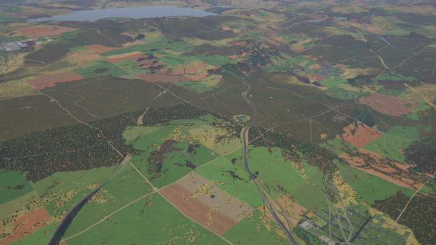
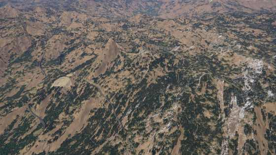

**Interchange** (−7.648, −16.632): a motorway × trunk crossing at a shallow angle, the ramps
running alongside, cleared verges; **switchbacks** on a snowy slope (−24.187, −33.361).
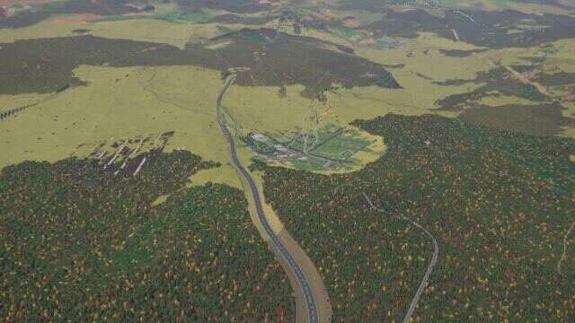
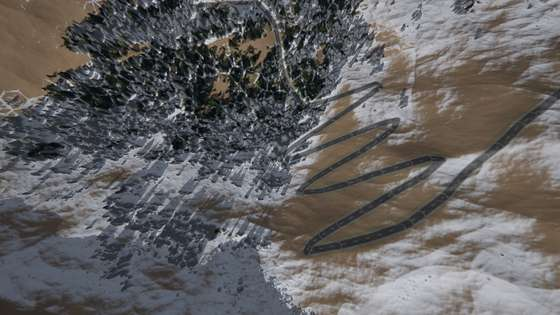

**Around a lake** (−7.486, −18.715): a major road bends round the lake's southern shore,
local roads end on the shore; **river crossing**
(−7.547, −18.796): two secondary roads cross a 134 m river side by side at the narrowest,
square-on reach.
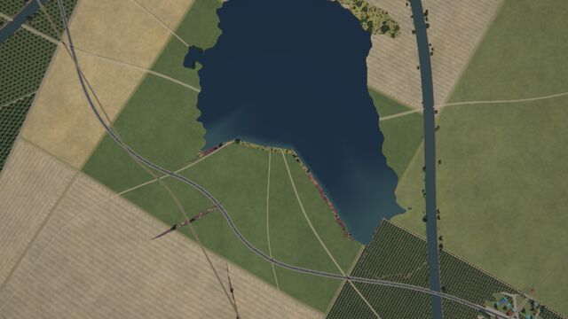
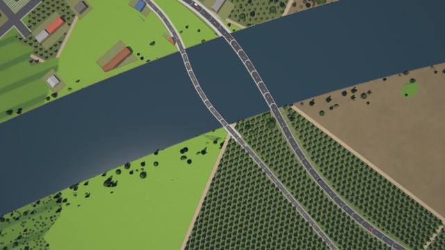

**River bridges** (−7.578, −18.746): a trunk road and a railway on decks over a 120 m river;
**power line** through forest (−7.832, −18.800): the cleared corridor and pylons.
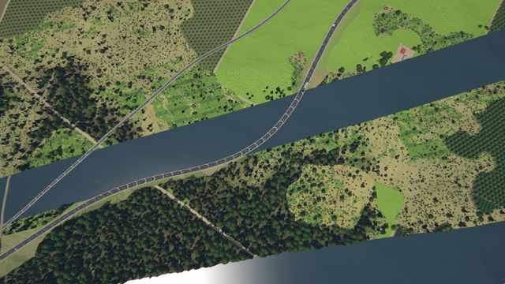
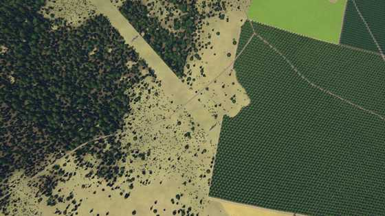

**Yard** (−7.746, −18.797): the ladder, wagons, a motorway through the city; **station**
(−7.730, −18.797): platforms with canopies next to a stadium (earlier renders, as the power
line and the night view).
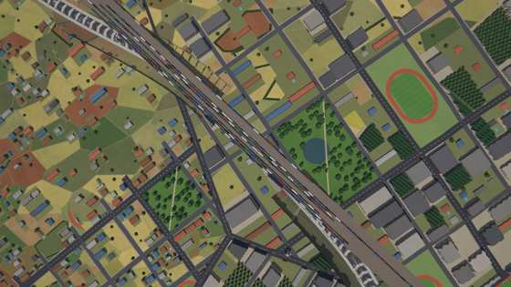
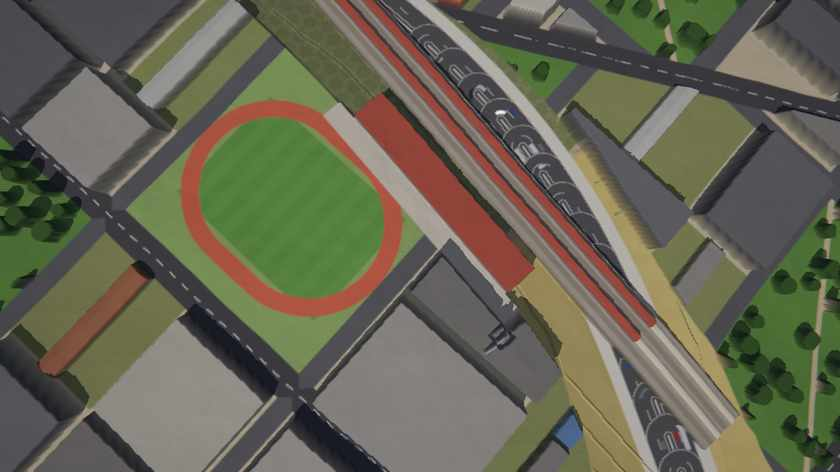

**Town edge** (−7.623, −16.605): a roundabout where a secondary road enters, cars; a trunk
road and a track through forest nearby (−7.619, −16.609) from 500 m.
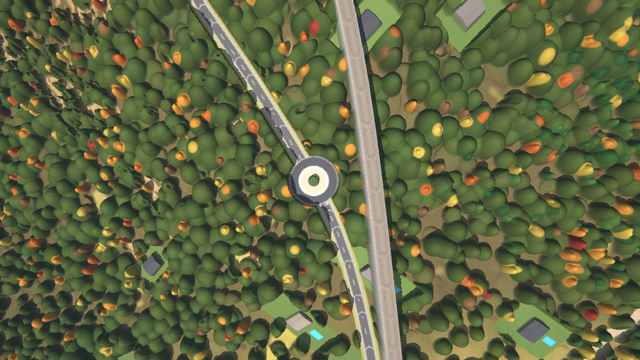
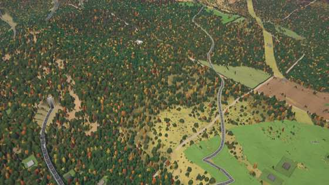

**Night** (emission, z13 near −7.70, −18.76): lit streets of the town and the lit road leaving it.
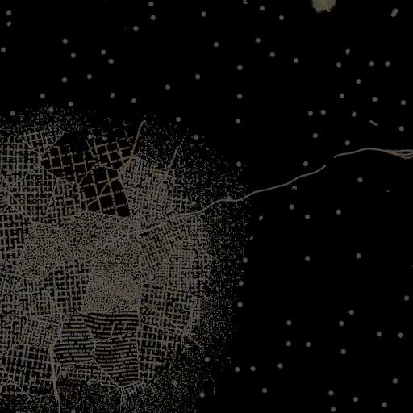

## Known limits

* Routing's water model is host knowledge, close to pass A but not identical: a lattice lake's
  existence comes from the values at its centre (pass A tests per pixel), the valley carve
  leaves out the kits' carve hooks (glacial troughs, fjords, canyons), the cold kit's lake mask
  is estimated from pass A's values and the relief's slope, the streams' (level 2) closed basins
  are known to minor roads only, mountain tarns and crater lakes not at all, and the route is
  checked every span / 6 (25–83 m). The verification finds no violation at its 20 regions; a
  shore can still be clipped by a few metres between samples.
* An edge whose corridor is blocked by water wider than the class bridges or by sites is
  dropped (the graph adds no alternative): 2–5 % of the edges in lake districts and around
  reservoirs, 0–2 % elsewhere (`routing_time`, `TR_WHY=1` lists them). Ends in water (a hamlet in a
  reservoir, a track end in a lake) move to the shore, leaving the road short of the place.
* Sites need point samples, so routes depend on them too; the settlements kit re-takes close
  site decisions with exact samples, and the profiles' samples are quantized (exact near a
  rounding boundary), so both backends build the same sites, routes and decks
  (`sites_and_routes_match_the_cpu`, decks and portals included). A sample at a discontinuity of
  pass A (a lake's shore, a channel's bank) can still differ by more than the 4 cm margin
  between the backends.
* River crossings are counted in each drainage level's meander-warped space between the grid
  nodes, an approximation of the drawn channel: crossings are near perpendicular (mean sin 0.87
  at the verification's crossings), but their number is mostly set by the network (a road
  between two banks has to cross).
* The grade limit is a local operator (±1.2 km): a climb steeper than the limit over a longer
  stretch keeps the terrain's grade (no detours); in rough terrain cuttings and tunnels are
  frequent. Tunnels need 30 m of cover over ≥ 200 m.
* Engineered profiles exist below 40 m pixels; coarser tiles draw every road on the ground (no
  tunnels or bridges there; sub-pixel). Secondary and smaller roads have no profiles: they follow
  the ground with a per-pixel deck 2.5 m above rivers.
* Embankments and cuttings change the DSM, not pass A's ground (DTM, drainage).
* Roads end on a town's arterials but are not re-aligned to its streets: between the edge and
  the arterial they still run over the blocks of the outskirts. Interchanges are left out inside
  towns, so cloverleafs (motorway × motorway away from places) stay rare.
* Interchange templates are fitted to the crossing roads' directions; on very oblique crossings
  loops and ramps look schematic.
* Bridge and tunnel decisions come from point samples (GPU f32 vs CPU f64 terrain); within a
  process the sample cache makes both backends share them, across processes a sample within
  centimetres of a threshold could flip.
* No substations, no thermal power plants (the settlements kit has none); power lines run from
  dams, solar and wind farms and between developed cities only.
* Classes vanish above their pixel thresholds (motorways at 600 m): motorway lights are missing
  from night views at zoom ≤ 7.
