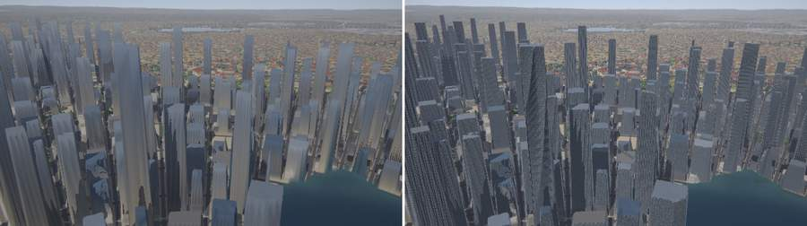
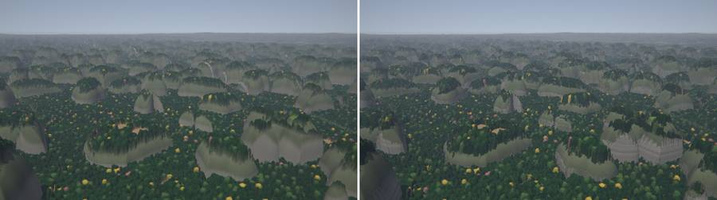
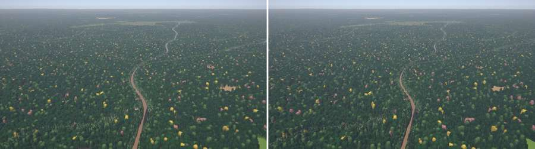
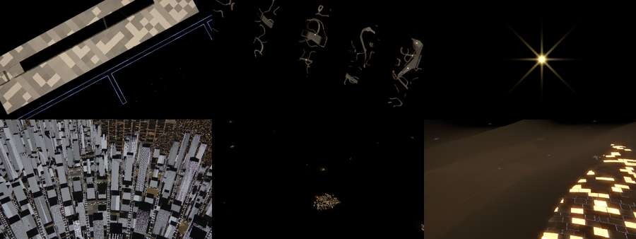
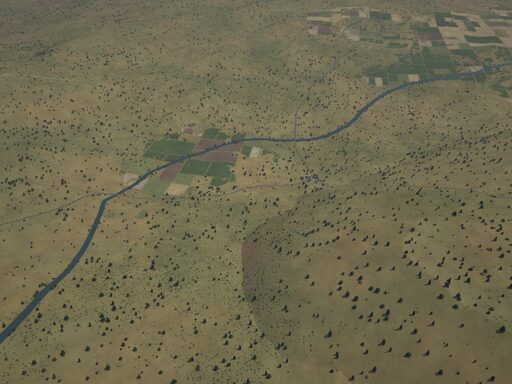
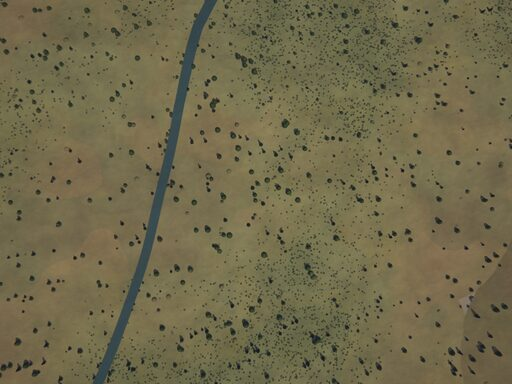

# The next generator (experimental)

`next` is a second, modular terrain generator: a planetary atlas drives the climate,
ecoregions pick biomes and cultures, and ten **landscape kits** draw deserts, volcanoes,
mountains, glaciers, coasts, tropics, temperate forests and wetlands, farmland, settlements and
transport networks. It is **experimental**: its worlds differ from v0.2.0's, have known flaws
(below) and may change between releases. The default generator, `classic`, is v0.2.0's,
unchanged; everything outside terrain generation (rendering, sensors, bindings, viewer) is the
same for both.

Everything about `next` is in this directory:

| | |
|---|---|
| this page | enabling it, status and limits, how it works (atlas, ecoregions, stack, GPU generator) |
| [`kit-guide.md`](kit-guide.md) | writing a kit: files, the stack, biomes, kernels, relief, instance families, host features, tests, budgets |
| [`kits/`](kits/) | one page per kit: what it draws, where, stills, tests, performance, known limits |
| [`ab/`](ab/) | A/B stills against v0.2.0 and the survey baselines ([below](#ab-against-v020)) |
| design | [`terrain-next.md`](https://github.com/shadymeowy/aerialsynth/blob/terrain-design/docs/design/terrain-next.md) on the `terrain-design` branch (the `docs/design/terrain-next.md §…` references in the code point there) |

## Enabling it

```sh
terrain run -c my.yaml --generator next          # or world.generator: next in the scenario
terrain view --generator next                    # (run, tiles, view, survey, config take --generator)
```

```python
# world.yaml:  tiles: { layers: [dtm, instance] }      (optional layers, below)
w = aerialsynth.World("out/next.h5", config="world.yaml", generator="next")   # C: as_open_generator
ndsm = w.tile(16, 39117, 25113, "elevation") - w.tile(16, 39117, 25113, "dtm")   # building / tree heights
ids = w.tile(16, 39117, 25113, "instance")                                       # 0: no instance
```

- **One generator per store:** a tile store records its generator (version 4 for `next`, 3 for
  `classic`) and refuses the other one's tiles; give each its own `tiles.file`.
- **Settings only `next` reads:** `world.ecoregions`, `world.biomes` (weight overrides),
  `world.atlas`, `world.relief.tectonic_mountains`, `world.relief.belt_mountains`
  (`terrain config --all` lists them with their defaults).
- **Optional tile layers:** `tiles.layers: [dtm, instance]` adds the bare ground (DTM) and
  instance ids (building lots, fields, forest stands) to a **new** store
  ([`formats.md`](../formats.md#tile-store-tilesfile)); about +50 % store size. The classic
  generator makes neither (it ignores `tiles.layers` with a note). The viewer then offers the
  map shadings *Height above ground* and *Instances*.
- **Atlas cache:** the atlas (below) is cached on disk in `$XDG_CACHE_HOME/terrain/atlas-*.bin`
  (58 MB per world); `TERRAGEN_ATLAS_CACHE=DIR` moves it, `=off` disables it.

## Status and known limits

Compared with v0.2.0 at the same poses ([`ab/`](#ab-against-v020)), `next` has more varied
landscapes but looks worse in places, which is why it is not the default:

- **Fields:** irregular field systems are four-sided cadastral parcels of about v0.2.0's size
  and texture; survey sections are rarer in wet climates and cut into forties (round 4), and
  streams in farmland carry tree lines; pasture regions are mixed farms with hedges, and wet
  climates have smaller parcels (round 6) and pastures are hedged on two thirds of their parcels
  (round 7), but wet patchworks are still greener than v0.2.0's; smallholder mosaics speckle at
  10 km.
- **Towns** draw one street grid each; town centres are v0.2.0's dense small lots of houses and
  low blocks with varied roofs (round 7), but industrial estates can sit in a small town's centre
  and towns can grow together into large built areas; **lakes** can look broken where rivers,
  basins and kits meet.
- **Deltas** are lobate with wandering distributaries, their silt in the land's hue (round 5);
  **canyons** have walls of strata at absolute elevations (cliff-forming beds and talus slopes of
  varied thickness), warped by spurs and gullies, over a narrow floor with a low-water river between
  bars (round 9), rills, rough rock and talus aprons on the walls, and a river that meanders with its
  canyon (round 10); badlands are red, dissected and banded where warm (round 12: `canyon@type` shows them, like
  v0.2.0's frame); a valley's capped carve depth tapers off over a notch (round 12: it rose in a scarp at
  the valley's rim, dark arcs along forest streams); desert floors and arid deltas are even
  (round 6), barchans only near the ergs of hyper-arid deserts (round 7); temperate forests have
  v0.2.0's crowns but render darker (the tints and rims of crowns of 1–6 pixels fade to their mean since
  round 11); round 13: trees stand in groves, clumps and closed stands with open ground between them
  (`noise::clumped`, a pixel-filtered clump density: a coarse pixel shows the mean of its finer
  ones), lone trees only in the savanna biomes; shrubs, tussocks, stones and the spires of open
  woodland are drawn one by one only where they span ~4–10 pixels (`kernels::resolve_size`), their
  mean otherwise; the gaps of a closed canopy show shaded lower crowns, not the pale floor: the
  isolated dark dots of the audit (`round13/tools/dots.py`) fell from 2.24× classic's to 0.92×.
  Dense forests keep their crowns' relief (at 2–4 pixels each crown still casts a small shadow:
  forest places count 10–26k dots/MP, like v0.2.0's own forest stills, 9–21k); the highest ranges (5–7 km)
  are as steep as the Himalaya (mean slope ~31° at 30 m, round 7); under perennial snow their gullies
  fill in (round 12), still greyer than v0.2.0's smooth snowfields under a low sun.
- **Ecotones:** the 10 km borders of ecoregions are a mosaic of the two biomes' crowns and
  landforms; their palettes, styles, vegetation densities and flat layers blend smoothly
  (rounds 7–8), so steppe and forest no longer draw a patchwork of patches there.
- **Cold lands** (round 8): glaciers only in mountain valleys and without contour stripes, open
  lakes in the summer datasets (frozen only below −3 °C at the ecoregion's date), no snowed-in
  ecoregion borders. Lakes and ponds have flat water and crisp shores without islets or pale
  halos (round 9); every thermokarst and kettle lake has one flat level, its spill point, and
  water only below it (round 10: no tilted sheets on slopes, fewer lakes on undulating ground);
  where summers are cold the season's snow lingers in snowbeds and over the glaciers (round 11), and
  polar land is a moss and lichen mosaic over polygons (round 12).
- **Towns** (round 9): a city's grid bends and its block size drifts over kilometres, the skyline
  fades out from the centre, estates in greys, trees on car parks, frayed town edges with gardens;
  round 10: one ring boulevard around big old cores (no concentric rings), curvilinear suburbs in
  big cities, estates on the town grid with green buffers; round 11: estates of matte halls,
  yards and car parks with light industry beside them, old cores on the town's grid (bent, lanes,
  terraced houses, fading into the grid), ribbons and scattered houses at town edges; round 12: old
  quarters of small blocks and single houses with an irregular outline fading into the grid (beside
  the CBD in big cities), streets that end at crossings, a town's grid turned to its relief (down
  the valley); the grid itself does not bend along a river.
- **Speed:** tiles cost about 2–3× classic's on a GPU (Tesla P4, 64 cold tiles at z12 / z14 /
  z16: 11.2 / 6.5 / 5.6 s against 3.8 / 3.4 / 2.9 s), mostly the kits' pass B and the host-built
  routes of a new area.
- Each kit page ends with its own *Known limits*.

Its tiles are not stable across releases: when `next` changes its output, its generator
version changes, and stores of the older version take no new tiles (reading them only warns).

## How it works

`next` keeps classic's foundations (continents, erosion-carved mountains, the three-level
river network, lakes filled to their spill level, tree crowns, towns, night lights;
[`simulation.md`](../simulation.md#terrain-cratesterragen)) and adds:

- **Planetary atlas** (`terragen::atlas`): world-scale fields precomputed once per world on a
  cube map (6 × 512² texels, ~20 km; `world.atlas.resolution`), sampled identically by both
  backends with a cubic B-spline and blended across face edges. Fields: smooth elevation, coast
  distance, prevailing wind (trades, westerlies, monsoons), annual precipitation from moisture
  advected along the wind (rain shadows, coastal deserts), sea-level temperature (currents,
  continentality), seasonality and precipitation regime, tectonic plates (`world.atlas.plates`)
  with boundary kind, uplift and volcanism (hotspots: `world.atlas.hotspots`), lithology,
  last-glacial glaciation, culture areas (`world.atlas.culture_cell_km`), development and
  population potential. ~3–4 s per world on 8 threads. Preview the fields with
  `cargo run --release -p terragen --example atlas_preview -- OUT_DIR [SEED] [CONFIG.yaml]`.
- **Relief from tectonics:** mountain ranges along plate boundaries (arcs, collision belts, rift
  shoulders) besides the noise belts (old orogens); kits add landforms on instance lattices
  (volcanoes, karst, atolls, …) and can reshape the valley carve (troughs, fjords, canyons).
- **Climate and biomes:** temperature from the atlas lowered by the lapse rate, moisture from
  its precipitation (Köppen's dry threshold). **Ecoregions** (~100 km, `world.ecoregions`) pick
  a biome from the climate at their site (Köppen class, envelope, lithology, weights) and draw a
  style (soil and rock colours, tints, tree density and species mix). Their **culture** (12
  archetypes) sets field systems, hedges, roofs, building heights, lamps and town density.
  Borders blend in a 10 km mosaic: each sample picks one of the two biomes (~220 m patches,
  their probability falling from ½ at the border to 0 at 10 km), while the two styles and
  palettes blend by that probability (round 7), and so do the vegetation densities and the
  other biome's flat kernel layers (grass, soil, mottling; round 8): only crowns and landforms
  stay the mosaic's.
- **Composite stack:** pass B is a fixed stack of layers (zonal ground, altitudinal zone,
  azonal overrides, disturbance, agriculture, canopy, linear infrastructure, built, water,
  seasonal). **Biomes are data** (`crates/terragen/biomes/*.yaml`) over a **kernel library**
  (scatter, rows, cells, stripes, contours, …) whose calibrated means keep coarse pixels equal
  to the mean of fine ones. The resolved registry is stored with the world.
- **Kits** add biomes, kernels, layer functions, relief operators, instance families and
  host-built features (road and rail graphs, sites) in their own files
  ([`kit-guide.md`](kit-guide.md)).

**GPU generator** (`terragen::gpu`; classic has its own, v0.2.0's): the CPU generator ported
to WGSL, agreeing with it to f32 precision (parity tests: < 0.1 % of pixels off by more than
2 DN or 5 cm). Per-site decisions (ecoregions, regions, towns, the kits' features) are made by
shared host Rust for both backends, so both build the same world. The drainage lattice lives
in a GPU hash table (~0.5 GB); pass B runs the stack in three pipelines whose state sits in a
~170 MB work buffer; batches are 16 tiles (~26 MB each). `TERRAGEN_PROFILE=1` prints pipeline
compile times, `=passes` times each kernel.

### Kits

| kit | draws |
|---|---|
| [agriculture](kits/agriculture.md) | field systems by culture and climate: section grids with pivots, open-field strips, bocage, smallholder mosaics, paddies and terraces, groves, greenhouses, ranches and feedlots |
| [coast](kits/coast.md) | cliffs, skerries, tidal flats, barrier islands, reefs, atolls, salt and aquaculture ponds, deltas |
| [cold](kits/cold.md) | tundra, polar desert, glaciers, thermokarst and kettle lakes, drumlins, sea ice, frozen lakes |
| [desert](kits/desert.md) | dune seas following the wind, barchans, playas, wadis, yardangs, inselbergs, qanats |
| [mountains](kits/mountains.md) | karst, folded ridges, fault blocks, canyons, badlands, glacial troughs, fjords, fans |
| [settlements](kits/settlements.md) | hamlets to metropolises with city morphology, airports, ports, dams, mines, solar and wind farms |
| [temperate](kits/temperate.md) | deciduous, mixed and taiga forests, maquis, steppe, heath, bogs and fens, managed stands |
| [transport](kits/transport.md) | road, rail and power networks routed over the terrain, with bridges, tunnels and interchanges |
| [tropical](kits/tropical.md) | rainforest, mangroves, cloud forest, savannas, miombo, fishbone deforestation, river colours |
| [volcanic](kits/volcanic.md) | stratovolcanoes, calderas, shields, cinder fields, lava and ash |

### Renders of next's terrain

The renderer's wall materials, reflections and night lights (both generators; `render.walls`,
`render.water_glint`, [`scenario.md`](../scenario.md#look-and-colour)) on `next`'s terrain,
before | after where paired: CBD towers 100 m above the ground; tower karst from 300 m; a river
in forest (600 m, 20° down) whose reflection was the bright horizon and now shows the banks;
night sources at 22:00 (airport lights, a port, a gas flare, lit CBD windows, wind-turbine
beacons, lit greenhouses).

Round 14 (`next` only, `RenderSettings::next_lights`, set from `world.generator`; classic's
renders are v0.2.0's, bit for bit): street light on walls and roofs falls off with the height
above the ground (a wall's foot; a roof's height above the DSM's mean over ~40 m), lit windows
are sparse (5–56 % per building, keyed on its roof colour), warm, neutral or cool and dimmer,
glass walls reflect the ground below the horizon and take more of their roof's tint, and water
near lit banks reflects their lights. The CBD's towers were flat white blocks at dusk (the
horizon's glow in their glass, street light to their tops) and pale grey ghosts at night
(gallery g29, g34).






The [camera-footprint example](../../examples/camera-footprint) at its pose (52.98° N,
16.41° W) in next's world (`cargo run --release -p camera-footprint -- DIR next 1529.4`): a
lowland at 629 m seen from 900 m above it, dry olive grassland with scattered trees and a few
fields at 53° N, and a hard, circular biome border in the oblique view (one of the known limits).

| | |
|---|---|
|  oblique camera |  nadir camera |

## A/B against v0.2.0

[`ab/v020/`](ab/v020/) holds the v0.2.0 showcase stills (640 × 360, one frame per scene);
`scripts/ab_v020/<scene>.yaml` are the same scenes with `generator: next`, and
`<scene>@type.yaml` the same camera at a place of the same landscape type in next's world.
[`ab/next_quality/`](ab/next_quality/) has the sheets of the latest comparison (columns:
v0.2.0, round 12, round 13) and their image statistics (`stats.md`). Scenes whose pose shows
another landscape in next's world (sea at `bank` and `coast`, farmland at `night` and `dusk`)
have an `@type` twin at a place of v0.2.0's landscape; `probe_px towns LAT LON R_KM` lists the
settlements near a point to find one.

**Audit** (round 7): the chosen places drift towards easy spots, so `scripts/ab_v020/audit_places.csv`
lists 30 deterministic pseudo-random land places of next's world (`probe_px audit 30 7`:
area-uniform within 70°, Köppen-group quotas A 6, B 8, C 7, D 6, E 3, at least 400 km apart, no
hand picking) with the nearest land point of the classic world (the same point at 27 of them).
`scripts/ab_v020.py audit` renders them with the `farmland` still's camera (700 m above the
ground, 42° down, 640 × 360, the still's local solar time 10:41, June; December south of the
equator) with either generator, and `sheet --audit` puts classic | next side by side
([`ab/next_quality/audit*.jpg`](ab/next_quality/): classic, round 12, round 13; `audit_stats.md`).
In round 7, 6 of the 30 places looked clearly worse than classic's typical quality (13 in
round 6), 5 of them cold (frozen lakes in snow-free forest, glacier stripes, snow nets over
tundra), 6 more borderline (ecotone patchworks, autumn and burn colours, paddy terraces). In
round 8 none is clearly worse; 7 are borderline (plain brown tundra and polar plains, a rusty
high-mountain snow melt, barchan crescents, a textured but bare semi-arid plain, a steppe
mottle, a lowland ice field), the rest equal or better (fields, forests and towns where classic
draws plain ground). `volcano@type` and `boreal@type` moved to like-for-like places in round 8
(a forested volcanic upland, needleleaf forest hills). In round 9 the lake with a pale halo (a26),
the steppe camouflage (a18) and the pale lake rims (a15) are gone; a lowland ice field (a29) shows
a lake lying tilted on a slope (cold lakes no longer shrink on the micro relief's slopes), and the
plain tundra, snow melt, barchan and semi-arid places stay borderline (a02 a07 a11 a16 a30).
`desert_coast@type` moved to a hot desert coast with the sea in view and `volcano@type` looks up its
valley in round 9. In round 10 the tilted lake of a29 is gone (one flat level per cold lake): no place
is clearly worse; plain tundra (a02 a30), a rusty snow melt (a07), pale barchans (a11) and a bare semi-arid
plain (a16) stay borderline. In round 11 the snowbeds of cold summers put a29 and a07 under snow like
classic (a07 no longer rusty); a16 has tussocks and larger shrubs but its far half stays a soft bare plain;
plain brown tundra (a02 a30, warm summers in next's climate), fewer and sandier barchans (a11) and a16 stay
borderline; none is clearly worse. In round 12 polar land (a30) is a moss and lichen mosaic over faint
polygons and a28 is snowed in like classic; a11 has a few barchans left (about equal); plain tundra (a02),
the polar plain without classic's snow (a30) and a16's far half, now in clumps but still soft, stay
borderline; none is clearly worse. The clutter (mean high-frequency energy 20.8 against classic's 12.1)
is the crowns' steep sides in the surface model (see above), not reduced. In round 13 the "bunch of
small trees scattered" look is gone from open land (steppe, tundra, desert scrub, lichen woodland:
groves and clumps, shrubs in the ground's texture; isolated dark dots 0.92× classic's on average,
2.24× in round 12, places above twice classic's 13 of 30, were 20; mean high-frequency energy
13.8, was 20.8, classic 12.1); the land has a macro tone over
600 m – 1.5 km (soil moisture, vigour, drainage) on the ground and inside fields, and the night's
lamps are less orange (part C of round 13; the tonal contrast of the like-for-like scenes moved
little: it is set by what the scenes show).

```sh
scripts/ab_v020.py audit --terrain target/release/terrain --generator classic --out /tmp/audit_c
scripts/ab_v020.py audit --terrain target/release/terrain --generator next --out /tmp/audit_n
scripts/ab_v020.py sheet --audit --run classic=/tmp/audit_c --run next=/tmp/audit_n --out sheets/
scripts/ab_v020.py render --terrain target/release/terrain --out /tmp/ab [SCENE ...]   # on a GPU machine
scripts/ab_v020.py sheet --run after=/tmp/ab [--run before=/tmp/ab0] --out sheets/      # numpy, h5py, Pillow
scripts/ab_v020.py refs --showcase out/showcase      # rebuild the references from a v0.2.0 showcase run
```

`ab/survey_places.csv` and `survey_places_seed2.csv` are 24 places each of worlds 1 and 2 as
v0.2.0's generator made them (`terrain survey --places FILE`): the redesign's "before" places.
`probe_px info LAT LON` (`cargo run --release -p terragen --example probe_px`) names a point's
biome, Köppen class, culture, field system and relief instances.
