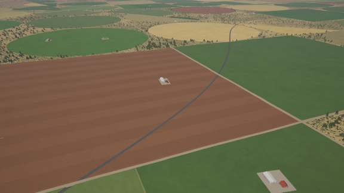
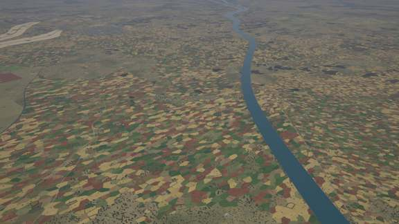
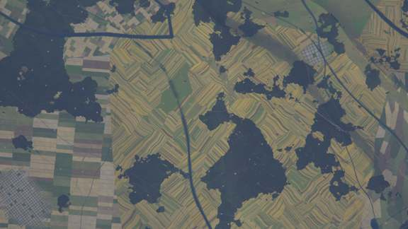
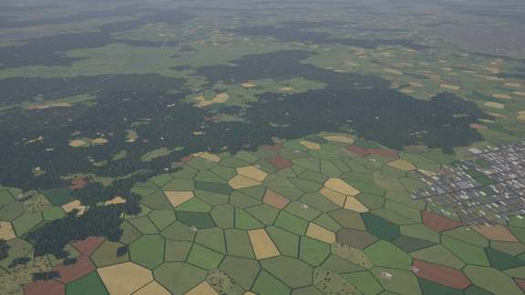
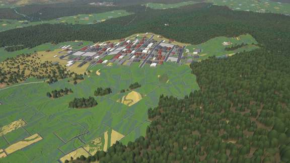
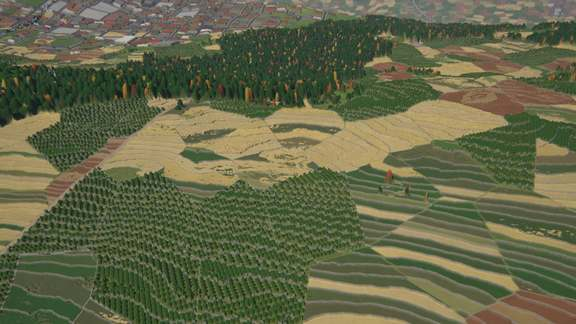
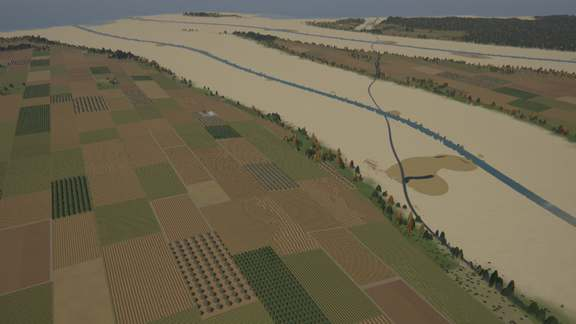
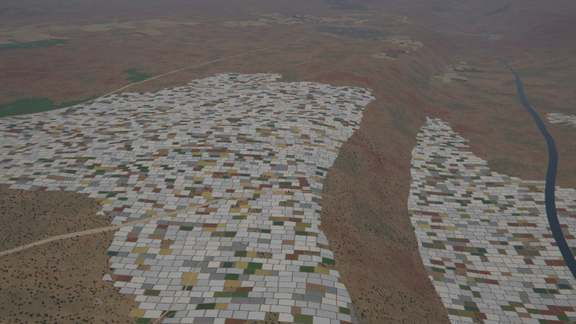
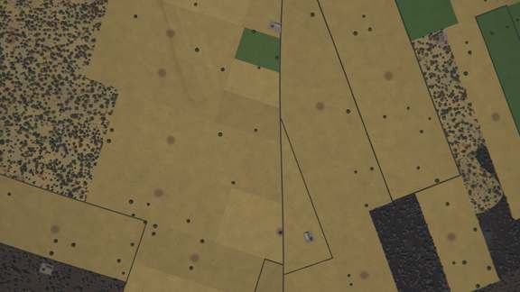
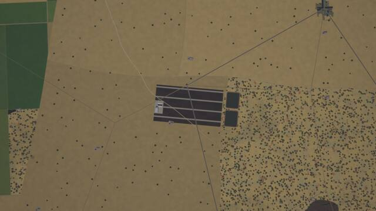

# Agriculture kit

A kit of the experimental [next generator](../README.md) (`world.generator: next`). *The default
world* on this page is seed 1 of the next generator.

`crates/terragen/src/kits/agriculture.rs` (catalogue, shading, tests), its WGSL twin
`src/gpu/wgsl/kits/agriculture.wgsl` (the tables are generated from the Rust file) and
`biomes/agriculture.yaml` (empty: the systems are code). Design:
[terrain-next.md §5.8](https://github.com/shadymeowy/aerialsynth/blob/terrain-design/docs/design/terrain-next.md), contract: [kit-guide.md](../kit-guide.md).

## What it draws

The core drew one field look everywhere. Now every land-use region (~7 km) draws one **field
system** of a catalogue, weighted by its ecoregion's culture archetype, Köppen class and
development (one dominant system per ecoregion), in place of the core's fields; the weights keep a
share for the core's fields. Systems change at region and ecoregion borders, never per sample.

| system | look |
|---|---|
| section grid | 1-mile sections, quarter sections (90 % cut into halves or forties: square 40-acre fields or strips), centre pivots where dry, farmsteads, section-line roads; rarer in wet (> 900-1400 mm) and oceanic climates |
| shelterbelt steppe | huge fields bordered by tree belts, strip-fallow stripes |
| open-field strips | furlongs of long narrow strips, each its own crop, reverse-S curves |
| bocage | irregular pastures and fields (cadastral blocks of ~260 m parcels) inside hedgerows on about half their borders, trees in the hedges |
| smallholder mosaic | tiny irregular plots (~64 m), scattered trees, homestead compounds |
| rice paddies | bunded plots, flooded / transplanted / green / ripe by season (stages spread ±0.225 around it); contour terraces on slopes; canals, a few fish ponds |
| dry terraces | stone-walled benches with grain, olives and orchards on contours |
| vineyards | parcels of vine rows along the field axis or the contours |
| groves | olive, almond, citrus groves; date palms in deserts, apples in cool climates |
| plantations | oil palm, rubber, tea on contours, cane; estate roads |
| greenhouse seas | white plastic bays in different states, irrigation ponds; at night an orange glow of grow lights through 20 % of the roofs (`emission`; the system's mean where parcels are unresolved, none at pixels > 300 m) |
| pastures | mixed farms: paddocks (34 %), hay meadows (16 %, up to 60 % of them mown pale from early summer), crop fields (48 %), hedges on ~45 % of the parcels, a few field trees, livestock trails to troughs, farm dams, savanna trees in warm climates |
| irrigated pivots | centre pivots in the desert |
| ranches | huge fenced paddocks (2.2 × 1.5 km), stock trails converging on troughs, farm dams, savanna trees where warm; feedlots |

**Ranches and feedlots** (design §5.8, P2). Ranches weigh most in semi-arid steppe climates (BSh,
BSk × 3), on tropical savannas, in the survey-grid, steppe and pastoral cultures; never in oceanic
or polar ones. Some ranch regions (20–65 % by development) hold a **feedlot** (slot 6,
`feedlot`, in the region frame): a lot of 440–960 × 280–600 m of pens (40 × 60 m) in double rows
along 12 m feed alleys with concrete bunks, dark manure, cattle; a feed mill with silage bunkers,
a shed and silos at one end; two manure lagoons in embankments beyond the other. No pivots.

Parcels are crisp units with hashed ids (their crops are the parcel's instance in the optional
`instance` tile layer; borders, yards and ponds are not); rows, furrows, crowns and trails are
band-limited and blend to the system's mean at coarse pixels. Field tracks only: roads are the transport kit's.

**Around the fields** (core and kit): the farmland's woodlots (the most forest-prone patches,
about a sixth of the land by the biome and culture) are forest whatever the climate's forest
share; streams carry gallery trees wherever the moisture is above 0.18 (a belt 7 m + 0.6 × the
channel's half width, box-filtered by the pixel); hedges have gaps (gateways, missing
stretches) and hedgerow trees bulging out of them every few tens of metres (shelter belts are
continuous); tilled soil is a dull brown of the biome's soils, 40 % towards v0.2.0's ploughland
brown. Neighbouring parcels often grow the same crop (70 % draw it from a 700 m cluster cell);
cereals show v0.2.0's ~1 m drill rows at low altitude; pastures stay green down to a moisture of
0.15–0.5 (managed grass); idle parcels (4 %) are rough grass. Farmed floodplains carry fewer reed
marshes (the temperate kit's marsh amount × 0.2 where the agricultural intensity is above 0.6).

## Stills

GPU-generated (`terrain survey`, `AERIALSYNTH_GPU_STRICT=1`), default world, 10:30 local on the
equinox. Lat, lon in brackets.

**Section grid with pivots** (35.871, 51.847): oblique 300 m, nadir 10 km. **Before / after
(10 km nadir, the core's fields without the kit, then the kit)**:

**Smallholder mosaic** (15.229, 58.043), the same 10 km without and with the kit, and 1.5 km:

**Open-field strips** (55.645, 28.069): oblique 300 m and nadir 10 km.

**Bocage** (-51.817, -103.984), **rice paddies** (18.420, 160.804), **dry terraces**
(-38.496, 176.292), **groves** (29.000, 107.235), **greenhouse sea** (27.783, 172.016),
**pasture** (34.443, 147.270, nadir 1.5 km):

**Ranch with a feedlot** (16.294, 149.333), nadir 2.5 km: pens along feed alleys, the feed mill
at the west end, two manure lagoons east of the lot; ranch paddocks with savanna trees around.

## Tests

* `registry_compiles`, `wgsl_tables_are_current` (`AERIALSYNTH_BLESS=1` rewrites the tables),
  `systems_vary` (every archetype draws several systems, every system appears);
* `tiles_match_the_cpu` (GPU): the 13 places at z12, z14, z16, at most 0.5 % of the pixels off;
* `lod_seams_determinism`: parent vs mean of children (albedo, class histogram) at z12 and z15,
  determinism with a fresh generator, the E-W seam;
* `places_stay_on_the_gpu`: the places at z6 to z16 without a CPU fallback;
* `find_places`, `bench_places` (ignored).

## Performance

`bench_places` (ignored test, GPU, 13 places x 8 x 8 tiles per zoom), the same build with the
kit's `KITS` entry commented out (mean of two runs, tiles/s; shared machine, +-3 % noise):

| zoom | without | with | cost |
|---|---|---|---|
| z8 | 17.0 | 15.5 | 9 % |
| z10 | 65.1 | 64.3 | 1.3 % |
| z12 | 114.7 | 112.9 | 1.5 % |
| z14 | 111.6 | 108.4 | 2.9 % |
| z16 | 116.8 | 113.5 | 2.9 % |

## Known limits

* Irregular systems (bocage, smallholder plots, terraces, groves, the core's irregular style)
  are cadastral blocks (~2.6 parcel sizes, turned by up to ±13°) cut by up to five recursive
  splits: four-sided fields of varied size, straight borders; no curved field edges following
  streams or contours (terraces follow the contours inside their parcels only). (They were
  Voronoi cells: a honeycomb.)
* Field colours are muted 25 % towards their grey and mottled per parcel (24 m, 35 m, 55 m
  growth zones); at 1 km and above many parcels still read flatter than v0.2.0's fields, whose
  core texture had more octaves.
* Smallholder mosaics read as a fine speckle at 10 km: their 20–60 m plots are just above the
  pixel there, so each pixel takes one plot's colour (salt and pepper) instead of a smoother mean.
* Bright parcels (greenhouses, fallow, fresh stubble) read as white quadrilaterals in high
  oblique views (10 km and above) where the region's system has large parcels.
* One field system per land-use region (~7 km): systems change at region and ecoregion borders,
  along the region lattice's (warped) cell edges, not along roads or rivers.
* Parcels are laid out in the region's frame and do not follow the transport kit's roads: field
  edges and road verges cross at arbitrary angles; only the kit's own field tracks belong to
  the parcels.
* Crop states come from the ecoregion's season, not from a date (paddies flooded, green or ripe
  per ecoregion); the renderer's seasons are not yet wired to the fields.
* Terraces are contour stripes of pass B (colour and DSM height), not steps of the DTM.
* Ranches and feedlots are drawn only in the semi-arid grazing systems (see *Ranches and
  feedlots*); there is no aquaculture inland (salt and aquaculture ponds belong to the coast).

Leftovers round B: cotton in autumn is (182, 170, 138) instead of near white; parcel colours fade to the system's mean
sooner (`k` of the colour uses 10 pixel² instead of 4: small plots no longer read as speckle at 10 km; cover and height
keep the old `k`, the elevation LOD test of the airport place failed with the new one).
Polish round 6: parcels up to 35 % smaller where it is wet (1000–1600 mm a year); pasture parcels 320 × 230 m
(were 420 × 300), plantations 360 × 270 m with more crops (were 480 × 360); greenhouse seas only in warm climates
(13–18 °C and up) and with more open fields; the survey culture grows the temperate crop mix in oceanic climates.
Polish round 7: pastures hedged on two thirds of their parcels (were 45 %), field trees 0.07 (were 0.03).
