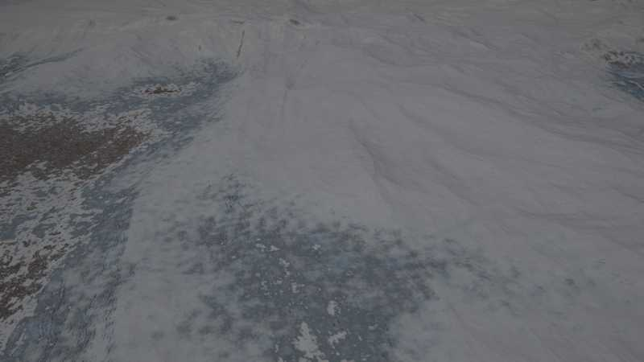
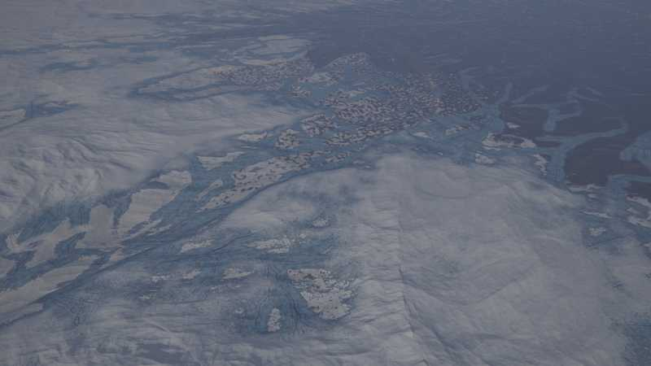
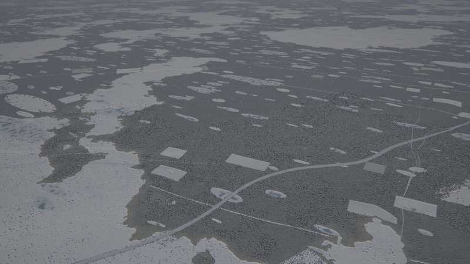
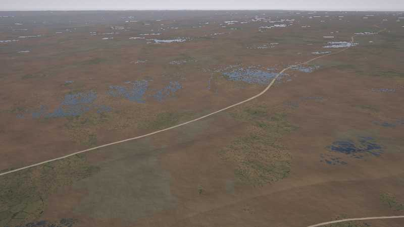
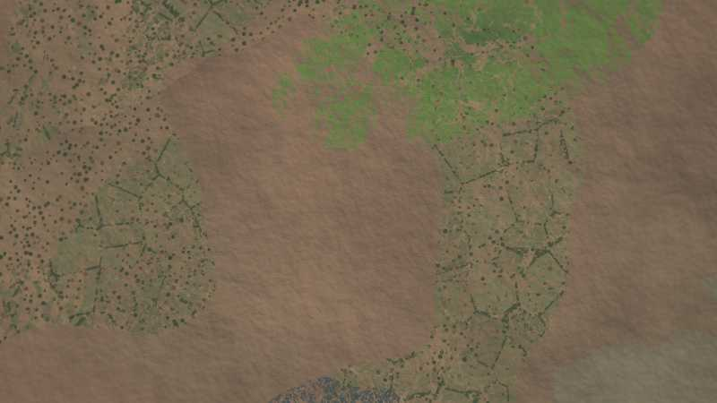
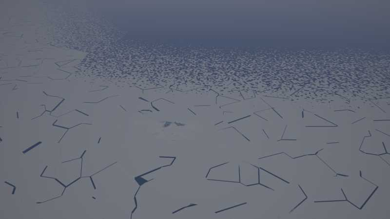
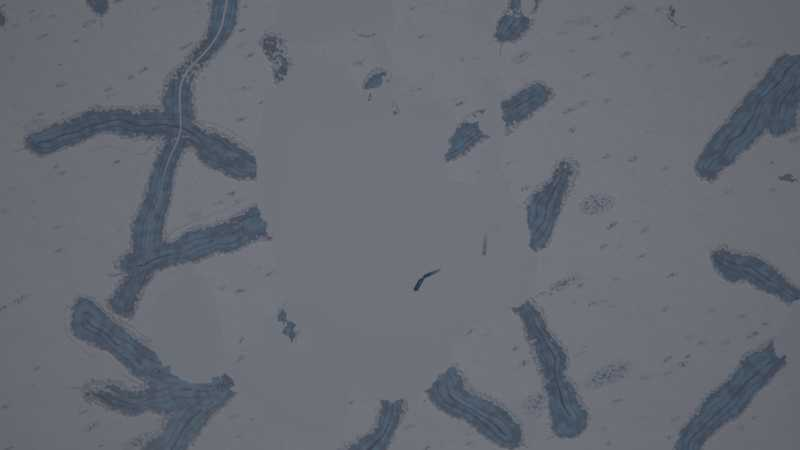

# Cold kit: glacial, periglacial and ice

A kit of the experimental [next generator](../README.md) (`world.generator: next`). *The default
world* on this page is seed 1 of the next generator.

`crates/terragen/src/kits/cold.rs` (layer functions, kernel, drumlin family, tests), its WGSL
twin `src/gpu/wgsl/kits/cold.wgsl` (+ `cold_relief.wgsl`), and its biomes
`crates/terragen/biomes/cold.yaml` (design: [terrain-next.md §5.4](https://github.com/shadymeowy/aerialsynth/blob/terrain-design/docs/design/terrain-next.md),
contract: [kit-guide.md](../kit-guide.md)). Taiga, lichen woodland, krummholz and alpine
meadow belong to the temperate kit.

## What it draws

**Biomes:** `polygon_tundra` (ice-wedge polygons, sorted circles, wet sedge), `shrub_tundra`,
`polar_desert` (frost-shattered gravel, patterned ground), `forest_tundra` (tundra with scattered
stunted spruce).

**Layer functions** (climate: warmest-month temperature for snow line and glaciers, temperature at
the ecoregion's date for seasonal snow and frozen water):

| slot | draws |
|---|---|
| 1 zonal | perennial snow mask by the summer temperature (snow line lower on shaded, steep ground by aspect) |
| 3 azonal | thermokarst and kettle lakes, drained lake basins (sedge meadow), pingos (some collapsed) |
| 8 water | sea ice (fast ice, floes, leads, pressure ridges), frozen lakes, seasonal (frozen) rivers |
| 9 seasonal | glaciers (firn, bare ice, crevasses), lateral and terminal moraines, seasonal snow and névé |

**Drumlin fields with eskers** (instance family `cold_drumlins`, pass-A relief): glaciated lowlands
(atlas `glaciation`) get streamlined hills along one ice-flow azimuth per field and sinuous esker
ridges.

**Kernel** `cold_polygons` (3D Worley lattice, calibrated mean). The kernel's parameters and
calibrated means are generated into the WGSL file; `AERIALSYNTH_BLESS=1` rewrites it.

## Tests

`registry_compiles_with_the_cold_biomes`, `class_ids_are_the_v2_table`, `lakes_stay_within_reach`,
`lake_means_match_explicit_averages`, `polygon_mean_matches_explicit_average`, `dates`,
`lod_consistent_at_cold_places`, `seamless_at_cold_places`, `kernels_match_the_cpu` and
`tiles_match_the_cpu` (GPU), `places_stay_on_the_gpu` (z6 to z16 of the nine places under
`GPU_STRICT` semantics), `bench_places` (ignored; GPU tiles/s).

## Performance

`bench_places` (RTX 6000 Ada, 9 places x 8 x 8 tiles per zoom), tiles/s, same build with the
`KITS` entry commented out vs the kit:

| zoom | without | with | change |
|---|---|---|---|
| z10 | 124.4 | 116.6 | -6 % |
| z12 | 125.2 | 114.1 | -9 % |
| z14 | 131.4 | 115.7 | -12 % |
| z16 | 109.1 | 124.6 | noise (+14 %) |

(z8 is dominated by shader compilation and is not meaningful.) Within the 15 % budget where the
kit draws.

## Stills

GPU-generated (`terrain survey`, `AERIALSYNTH_GPU_STRICT=1`), default world, 10:30 local on the
equinox (glacier and polygon tundra: 12:00 at the December solstice). Lat, lon in brackets.

**Valley glacier** (-66.095, 123.288, oblique 1.5 km, summer solstice noon): firn, dirty ice, crevasse
fields, flow lines. The stills' grey snow is the sensor's fixed exposure, not the albedo.

**Ice field** (-72.199, -89.333, oblique 10 km): outlet streams, moraine bands.

**Late-melt polygon tundra** (-72.339, -102.499, oblique 1.5 km): the bare patches are fragments
with a polygon net of snow in the troughs, not blobs.

**Kettle lakes and snowy taiga** (58.609, -92.893, oblique 1.5 km); the pale rectangles are the
temperate kit's boreal clear-cuts (this is taiga at 2 C, not forest tundra).

**Forest tundra** (-71.075, -168.603, oblique and nadir 300 m): ice-wedge polygons, thermokarst
ponds.

**Sea ice** (-71.842, -70.019, oblique and nadir 10 km): fast ice, leads, floes.

**Drumlin field under snow** (57.314, -26.177, nadir 10 km): the relief is subtle under the snow.

## Notes

* Seasonal snow's date fades to the annual mean over 10 km towards an ecoregion border (the
  mosaic of two ecoregions with different dates drew snow-free blobs next to snow). The melt edge
  is ragged with fine noise and a snow net along ~18 m polygon troughs.
* The temperate kit's `forestry` is zero where the biome's trees are below 0.6 (forest tundra,
  tundra, polar desert): no managed stands there.

## Known limits

* Every ecoregion's date lies in the warm season (mid May to late September, by its season):
  seasonal snow lies only where that date is still cold (high mountains, the polar regions),
  lakes freeze only there. Winter landscapes need render-time seasons (35 % of the ecoregions
  were dated in winter: snowy taiga and frozen grey lakes in summer datasets, with hard borders
  to their summer neighbours).
* Kettle lakes are lobed ellipsoid slices (shore noise 0.24 at 2.6 per radius): bays and points,
  but no islands, no chains along eskers.
* Glaciers, moraines and seasonal snow are pass-B surfaces (colour, class, height in the
  seasonal slot): the DTM and the drainage keep the valley below them; troughs and cirques come
  from the mountains kit's carve hook, not from the glaciers drawn here.
* Sea ice is a function of the atlas' temperature at the ecoregion's date and of the depth: no
  drift, no polynyas tied to winds or coasts; leads and pressure ridges are noise patterns.
* Kettle and thermokarst lakes are host-built stamps with a flat level (round 10): their mask is
  still tested per pixel, and the transport kit's routing only estimates it from pass A's values
  and the relief's slope (it avoids the whole outline, not only the water below the level).
* Drumlin fields take one ice-flow azimuth per field (no fanning around obstacles); eskers are
  sinuous ridges independent of the drainage.
* Pingos and polygons ignore the drainage: polygons continue across small streams.
* The snow line uses the warmest-month temperature and aspect, not avalanche paths or wind
  redistribution: snow fields have smooth edges on steep ground.

Polish round 6: perennial snow holds on slopes to ~45° and 40 % of it on walls steeper than ~60° (the cut was
35°–50° to 15 %).
Polish round 7 (random-place audit): grey-brown polar soils (the core `polar` biome had the default palette's red-brown
soils: orange polar land), greyer bare ice (172, 184, 192) and blue ice (160, 180, 196), crevasses grey (62, 72, 80) at
60 % and 2.5 m deep, muted sedge in drained basins (lime blobs), a faint snow net in the late melt (a white polygon net
over brown tundra); tundra, lichen and polar-desert mottling soft (`soft: 0.3`).

Polish round 8 (audit): valley glaciers only in the mountains (the valley term × smoothstep 0.15–0.4 of `mountain`:
ice tongues lay along every stream of a tundra plain, a29); crevasses short dashes (the 7 m firn noise) at 40 % of
(70, 82, 92) and 1 m deep, from slopes 0.18–0.4 (long dark lines along the contours read as a contour map, a07); medial
moraines faint (50 %) and only in the mountains; no snow net or per-cell patchwork in the late melt (a02); lakes and rivers
freeze below −3 °C at the ecoregion's date (`FREEZE`; was −1.5: frozen lakes in snow-free forest, a15 a26); ecoregion
dates late May … mid September, and at an ecoregion's border the date fades to midsummer, not to the annual mean (the
10 km borders of cold ecoregions were snowed in: a17 a02); no lakes on perennial snow and ice; silty lakes (44, 62, 64),
sedge basins olive-brown (104, 104, 78), a narrow shallow margin (rn 0.86–1), and a gentle slope limit on the lake mask
(0.03–0.12, was 0.03–0.07: the lakes' size follows the mask by pixel and frayed into grey patches with islands of forest).

Polish round 9: the thermokarst and kettle lakes shrink with the pixel's slope only on steep ground (0.15-0.35, at most 70 %; at fine zooms the gentle slopes are mostly the
micro relief's: lakes frayed into glittery patches with hundreds of wooded islets, taiga_river@type, and changed with
the zoom); their water is flat (the pixel's ground less its micro relief, `Terrain.micro`: water draped over the
ground's bumps reflected banks and sky in a speckle); the shallow margin is 4 m wide, not the outer seventh of the
lake (a pale halo 20-50 m wide, a26); drained basins darker (72, 76, 52 / 60, 66, 46) and mottled at 35 m, silty
lakes (34, 48, 52).

Polish round 10: every thermokarst and kettle lake (both lattices) is a host-built stamp (template 160 + lattice,
shared by both backends) with one flat water level: its spill point, the lowest ground (pass A without lakes, less
its micro relief) on its widest outline, at most 15 m above its centre; open water only where the ground lies below
it, its surface at the level (water at the pixel's ground less its micro relief lay tilted as a grey sheet on a
slope, a29; the analytic relief before the drainage carve put levels hundreds of metres above the valley floors).
Lakes are fewer on undulating ground and none on slopes. The darkest lake colours are at ~2 % albedo (28, 42, 56;
44, 48, 38; 42, 58, 62: black holes in the tundra, a29); the forest closes in on drained basins from their rims (bare
sedge to the rim drew pale ovals, taiga_river@type). Glaciers have no ogives (bands along the ground's contours) nor
medial moraines (dark lines along the drainage under the ice): both drew contour-like arcs (mountains@type, a29).

Polish round 11: where the warmest month is below ~8 °C the season's snow lingers (snowbeds and late snow): the
date's temperature is lowered by up to 5 °C, more in the hollows and in patches of the snow noise, and the glaciers
lie under that snow too (glacier ice no longer counts as a crown). High mountains read as snowfields instead of brown
slopes (mountains@type), the snowed-in land around a glacier no longer frames bare grey ice (a29), and the alpine snow
melt of a07 is grey and white.
