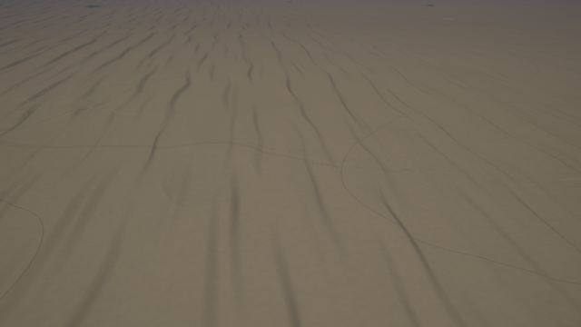
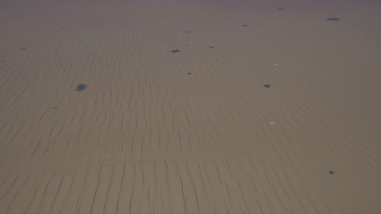
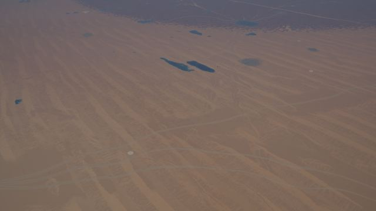
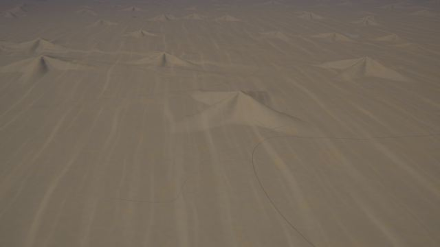
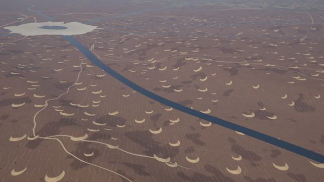
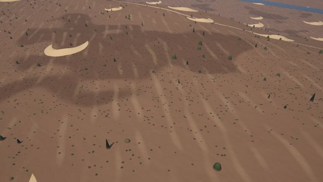
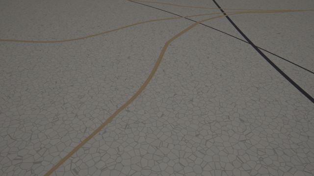
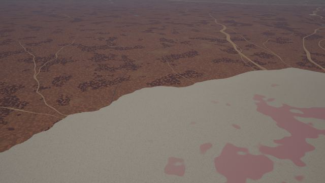
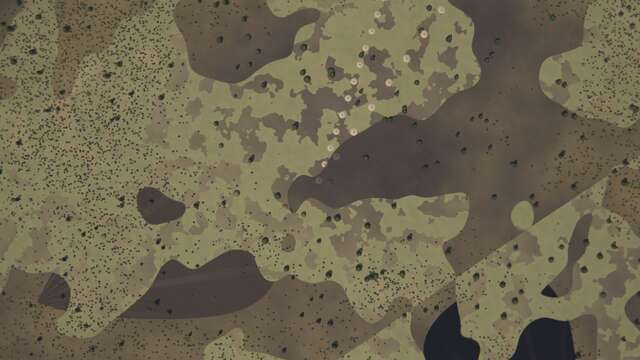

# Desert kit

A kit of the experimental [next generator](../README.md) (`world.generator: next`). *The default
world* on this page is seed 1 of the next generator.

Hot and cold deserts from 100 m to 10 km above the ground: sand seas whose dunes follow the
wind, the stony deserts between them, playas and dry lakes, wadis, yardangs and inselbergs.
Design: [terrain-next.md §5.1](https://github.com/shadymeowy/aerialsynth/blob/terrain-design/docs/design/terrain-next.md); contract:
[kit-guide.md](../kit-guide.md).

| file | content |
|---|---|
| `crates/terragen/src/kits/desert.rs` | the kit: proxies, ridge fields, slab lattices, relief, layers, families, tests |
| `crates/terragen/src/gpu/wgsl/kits/desert_relief.wgsl` | WGSL of the relief, the families' existence tests and the shared helpers (every module with pass A) |
| `crates/terragen/src/gpu/wgsl/kits/desert.wgsl` | WGSL of the layers (tile module) |
| `crates/terragen/biomes/desert.yaml` | six biomes and the kit's textures on the core's `desert` and `desert_red` |

## What it draws

**Dunes by wind regime (relief, pass A).** Where the core's sand-sea mask is, the core's
transverse dunes are taken out and the kit's put in, by the direction and the variability of
the wind:

* direction: the atlas' annual wind, sampled at the pixel (its cubic B-spline is smooth; the
  tile's grid-interpolated value kinks at the grid lines, which ridge phases turn into creases),
  with a trade / westerly belt where it is calm (`desert::wind`);
* variability ρ: high where the annual wind is weak (it comes from changing directions), with
  continental-scale noise (the atlas keeps no seasonal winds);
* ρ < 0.36 **transverse** ridges across the wind (λ 600 m, gentle stoss, a lee face of 14 % of the
  wavelength, sinuous crests); 0.36–0.68 **linear (seif)** ridges along the wind (λ 1.7 km, up to
  65 m, sharp crests, flat corridors, Y-junctions and terminations); ρ > 0.68 **star dunes**
  (3–5 sinuous arms, 750–1150 m radius, 100–300 m high) on a network of transverse ridges;
  **small dunes** over all of them: the core's (v0.2.0's) dune network of ridged noise in three
  rotated frames (λ 520, 172, 69, 27 m) at half its height (the kit's own small transverse
  ridges, λ 240 m, drew a regular comb in the corridors). Barchans (density 0.5) take half the
  pavement's tone in their sand.

The ridge fields (`desert::ridges`) are oriented plane waves carried by the points of a jittered
3D lattice with anisotropic kernels and per-point phases (no direction or wavelength is
modulated at ECEF coordinates, R-wave), a smooth phase warp for sinuous crests, and a calibrated
mean where unresolved (`band(λ, gsd)`; `tests::ridge_means`). The relief keeps the core's dune
amplitude (`relief.dune_height_m`).

**Barchans (pass B, height added).** On the sand-poor fringe of the sand seas (sand mask
0.02–0.58), most where the wind is steady: crescents 70–190 m wide, 6–25 m high, horns
downwind, on a darker stony pavement with desert varnish and sand streaks along the wind.

**Playas and dry lakes.** Playas are an instance family (`desert_playas`, cell 36 km): they exist
at arid, warm, flat sites (no mountains, low hills, outside sand seas and mesas; the atlas and
the macro fields at the site), flatten their floor towards the smooth relief and are drawn as
white to beige salt crust with polygonal cracks (8–20 m), a darker wet floor, pink or green
brine pools in some, and pale paleo-shorelines on the slopes around. Lakes in arid climates
(the water-slot layers run on standing water) dry out from their margins inwards into salt
pans at the lake's level (`solid`: the sample is land again).

**Inselbergs.** An instance family (`desert_inselbergs`, cell 16 km) at dry sites off the
mountains and sand seas, mostly on crystalline rock (atlas lithology): domes 1–5 km across and
up to 600 m high, elongated and lobed, with a pediment; bare granite streaked by varnish;
widened with their volume kept where below the pixel.

**Yardangs.** Streamlined ridges along the wind (λ 180 m, 12 m) on hyper-arid, warm plains
outside the sand seas.

**Washes.** Dry channels in arid land wider than the channel (up to 2.4 × its half width), with
braided threads of gravel and sand bars parallel to the banks that merge and split; acacia and
tamarisk along them, oasis gardens and date palm groves on some stretches (biome layers).

**Qanats.** Underground channels from a mother well at the foot of the mountains down to an
oasis, seen as dotted lines of shaft mounds: rings of pale spoil 8–13 m across around a dark
shaft every 30–55 m. Host-built (`qanat_group`, shared by both backends): a lattice of 9 km
cells holds a group where the culture digs them (desert oasis, highland, steppe and
Mediterranean archetypes, fewer with development), the climate is arid and warm and the ground
a piedmont (the smooth relief's slope 0.8–6 % with mountains near); 1–3 lines fan out upslope
from a common outlet, each 3–8 km long with a bend, as segments of kind 64. The layer (slot 6,
`qanats`) draws the mounds, or their mean along the line where they are below the pixel; not
in sand seas. Listed below 60 m pixels.

**Colour and biomes.** Sand takes the biome's sand palette by the regional style, tinted by the
ecoregion's lithology: iron-red on crystalline rock, pale on carbonate, yellow on unconsolidated
sediment, dark grey to black (class `volcanic_ash`) on volcanic rock. Biomes (by Köppen class,
envelope and lithology at the ecoregion site): `hot_desert_erg` (Sahara and Arabia),
`hot_desert_hamada` (varnished rock pavement), `basalt_harrat` (black boulder fields),
`gypsum_desert` (white sands), `desert_scrubland` (BWh / BSh margins), `cold_desert_gobi` (BWk
gravel plains, black gravel, saxaul); the core's `desert` and `desert_red` get the kit's
varnish, gravel mottling, scrub, wash vegetation and oases.

Land-cover classes: `sand`, `gravel` (stony fringe, varnished pavement), `salt_flat`,
`dry_riverbed`, `volcanic_ash` (black sand), `rock` (inselbergs, hamada), `desert_scrub`,
`orchard` (palm groves), `crop` (oasis gardens).

## Instances without families

Barchans (cell 380 m) and star dunes (cell 2.6 km) are too dense for the per-block family
lists at coarse zooms (≤ 8 per block); they are sites of jittered 3D lattices kept within half
a cell of the ellipsoid (`desert::slab_sites`: about one site per cell² of surface, seamless,
decided by integer hashes), enumerated per sample (≤ 27 cells, ~6 on average) where their zone
is, and their calibrated mean where unresolved (`tests::shape_constants`).

## Stills

GPU renders of the default world (`terrain survey`, 10:30 local solar time, equinox).

| | |
|---|---|
|  transverse dunes, 1.5 km (−19.92, 40.02) |  the same erg from 10 km |
|  linear (seif) dunes and dark corridors, 10 km (23.54, 43.23) |  star dunes, 1.5 km (−31.15, −166.35) |
|  barchans on the stony fringe of an erg, 1.5 km (20.84, −50.06) |  a barchan, varnish and sand streaks, 300 m |
|  salt crust and cracks of a playa, 300 m (−11.86, −162.15) |  a lake dried into a salt pan with brine pools, 1.5 km (−12.41, −155.10) |
|  two qanat lines of shaft mounds converging downslope, nadir 800 m (27.049, 34.401) | |

## Performance

`zoom_bench`-style GPU timing (RTX 6000 Ada, 4 × 4 tiles per place, best of 5 batches, best
of 2 runs; kit registered vs not), tiles/s:

| zoom | default places, without | with | the kit's places, without | with |
|---|---|---|---|---|
| z4 | 128 | 128 | 114 | 115 |
| z8 | 121 | 115 | 85 | 97 |
| z12 | 146 | 145 | 158 | 157 |
| z14 | 156 | 136 | 147 | 144 |
| z16 | 147 | 145 | 149 | 148 |

Differences are within the run-to-run noise of the shared machine (z8 and z14 vary by ±10 %
between identical runs); the families' existence tests read the atlas before the macro fields,
so they cost little outside deserts.

## Tests

`cargo test --release -p terragen desert` (CPU) and with a GPU (`-- --test-threads=1`):

* `registry_compiles`, `class_ids`;
* `ridge_means`, `shape_constants`: the hard-coded means and shape integrals (Rust and WGSL
  constants) against their numerical values;
* `lod_consistency`: parent ≈ mean of children (elevation, albedo, the kit's classes) at the
  kit's places;
* `seamless_and_deterministic`: tile borders at z11 / z15 and the same tile twice;
* `tiles_match_the_cpu` (GPU): tiles at z10, z13, z16 of the kit's places, at most 0.5 % of the
  pixels off;
* ignored tools: `desert_places` (places of the default world by landform),
  `desert_previews` (`DESERT_PNG=dir`, nadir rgb and hillshade at the kit's places or
  `DESERT_AT="lat,lon;…"`, `DESERT_Z`, `DESERT_CPU`), `desert_probe`.

## Known limits

* Desert varnish and gravel mottling are noise patches (`patches` kernel layers): from 1.5 km up
  they read as blotches of uniform size rather than varnish streaks following the slope.
* The core's drainage still runs through the sand seas: where the sand mask is high the kit
  takes the dunes over but not the channels, so a regular grid of straight washes can cross an
  erg (the core does not yet skip drainage carving where `sand` > 0.5).
* Lakes inside ergs are drawn as water in humid-enough cells (the dry-lake layer dries them
  only where the climate is arid); an erg with an open lake can result at its wetter margin.
* Playas and inselbergs are families of 36 km and 16 km cells: at zooms 8–9 a few blocks list
  more than 8 instances and the generator warns (both backends keep the first 8 by id; deeper
  zooms are unaffected).
* Dunes are relief of pass A, barchans a height added in pass B (not in the DTM or the
  drainage); yardangs are colour and pass-B height only.
* Star dunes are 100–300 m high and up to 1.15 km in radius, smaller than the largest real
  ones (Badain Jaran); linear dunes do not branch around obstacles (inselbergs, playas).
* No stills yet of inselbergs, yardangs or the gypsum and basalt biomes.
* Oases, palm groves and qanats are drawn by the agriculture kit (groves) and this kit
  (qanats, below the oasis fields); see their sections.

Leftovers round B: desert varnish patches are 240 m (was 520 m), 3 octaves, lighter (140, 112, 86): less blotchy.
