# Mountains kit: karst, folded ridges, fault blocks, canyons, badlands, glacial troughs, fjords, fans

A kit of the experimental [next generator](../README.md) (`world.generator: next`). *The default
world* on this page is seed 1 of the next generator.

`crates/terragen/src/kits/mountains.rs` (zones, relief, carve hook, fan family, layer, tests), its
WGSL twins `src/gpu/wgsl/kits/mountains_relief.wgsl` (fields, zones, relief, carve hook, fan family;
in every module with pass A) and `mountains.wgsl` (the layer). No biomes and no kernels (design:
[terrain-next.md §5.3, §5.4](https://github.com/shadymeowy/aerialsynth/blob/terrain-design/docs/design/terrain-next.md), contract:
[kit-guide.md](../kit-guide.md)). The kit is also the first to use a **core hook**, the
*carve hook* (below), because glacial troughs, fjords and canyons change how the drainage carves
its valleys, and that happens after the relief operators have run.

## What it draws

Where a landform lives is a **zone** (0..1) from smooth fields only (`zones`): the atlas'
lithology, the climate (moisture, temperature at the smooth elevation), the mountain mask, the
tectonic uplift, the continent value, the coast distance and the glaciation. The lithology is the
atlas' dominant rock at the texel nearest to the pixel, looked up at a position warped by two
noises (14 and 11 km, up to 4 km), so the 20 km texel borders are ragged; two more noises of the
same wavelengths cut patches out of the karst and badland zones. A zone is crisp where it
matters (a tower is there or not); only its extent is smooth.

| landform | where (zone) | pass A (relief) | pass B (slot 6) |
|---|---|---|---|
| tower karst | carbonate × humid (moisture 0.42-0.58) × warm (15-21 °C), off high mountains, on the shelf | floors flattened (88 %) towards the atlas' smooth elevation; 3D Worley lattice of 420 m cells, 70 % of the cells carry an oval, ragged tower `H (1 - F1/R)^0.6` (H 110-300 m, R 0.4-0.7 cell, profile `H sqrt(1 - x^2.5)`: a round top and steep walls), clipped at the bisector; the calibrated mean (31.5 m) where the cells are below the pixel | dark forest paint over the core's rock on the walls, bare pale cliffs only on slopes > 3.5-6 (cockpit cones: 0.8-1.4) |
| drowned towers (islands) | the same, near the coast | the plain falls to -11 m within 10 km of the coast (the coast retreats a few km): the towers stand in the sea; no towers beyond 30 km at sea | the core's shallow water and beaches |
| cockpit karst | carbonate × humid, cooler or drier (moisture 0.28+, 4-12 °C+) | a cone hill in every cell (H 60-160 m, linear flanks), the star-shaped depressions lie between them (mean 15.24 m subtracted: zero-mean) | pale cliffs on the steepest flanks |
| folded ridges | old orogens (mountain mask with little tectonic uplift) and foreland belts (uplift 0.04-0.5), in the provinces where a 180 km noise is positive (about 45 % of them) | ridges `t^1.6` on an 8-corner lattice of 140 km cells (below), λ 6.3-11.7 km, 700 m, striking in a direction shared by 560 km blocks; the old relief is 85 % blended into the atlas' smooth elevation first | the core's rock on slopes |
| fault blocks | extensional provinces (negative uplift, inland) | tilted sawtooth (flat basin floor on 30 % of the period, the tilted block, a scarp on a fifth), λ 11-21 km, 1150 m, the same lattice (where fold and fault zones overlap the two profiles blend: no switch); basins between the blocks fill with long lakes where they are below the drainage | |
| badlands | soft sediment (sedimentary, unconsolidated) × arid (moisture < 0.14-0.28) × not in sand seas | three octaves of creased noise (300, 130, 55 m; `|perlin|^0.7`, zero mean; 25-55 m deep) | pale clay floors, strata bands of 9 m (cream, rust, brown) on the gully walls |
| alluvial fans | family `mountains_fans` (cell 18 km, reach 7.2 km, 40 % of the sites): the atlas' uplift 0.12-0.55 falling by 0.03 over 24 km, dry (moisture index < 0.33), > 5 km from the coast; the fan points down the gradient | a cone `H (1 - r/R)^1.3` (R 2.6-5.6 km, H 1.6-3 % of R) blended 70 % over the smooth elevation in a ±60° sector, a lobed outline | pale gravel with radial streaks, 85 % of the vegetation cleared |
| glacial troughs, hanging tributaries | glaciation 0.3-0.6 × mountain mask 0.25-0.55 | *carve hook*: U profile (`t^1.5`), walls 25 % steeper than the core's, floors 1.5 × wider and over-deepened by 90 m (rivers) / 40 m (tributaries), the depth cap × 2 (rivers 400 → 800 m) and × 8 (tributaries 35 → 280 m): the side valleys end above the trunk valley | scoured pale rock on slopes > 0.75-1.1 |
| cirques and tarns | the head (a spring piece) of a glaciated tributary | a round floor of 240 m at the head, 130 m lake (a bowl 4 m deep, level 1.4 m above the floor), fading over the first 6 % of the piece | |
| fjords | glaciated coastal mountains, the river's floor within 20-70 km of the coast | a narrow trough (floor ~1 km wide: floodplain half width capped at 450 m, walls 0.34 x the core's extent, the river's wide valley no longer sets the extent: `Carve::narrow`); floor from -70 m at the mouth to -330 … -550 m (the deeper the higher the mountains) 12 km inland and up to 0 at the head 30-70 km from the coast (longer with the glaciation index); the flood plain no longer clamped above the sea (`fp_min`), so the ocean fills the valley; fades with the land mask into the open sea | |
| stepped canyons | arid (moisture 0.15-0.45 fading) × plateau (100-700 m) × the mesa field (> 0.05) × inland, rivers (tributaries 35 %) | floor lowered by 400-1500 m by province (the atlas' uplift and the plateau field; not below 30 m), walls 3.3 × steeper (their width wanders: 2.2 × wider in side canyons where a creased 900 m noise crosses them, ± 30 % spurs at 1.7 km), floors 0.3 ×, walls steepening to the rim (U profile) over a talus foot, the valley no wider than the walls need, depth cap 1500 m; strata at absolute elevations (`noise::strata`: 0.2-1.8 × 46 m thick; cliff-forming beds rise from a ledge in a steep riser, soft beds in a concave talus slope; faded out towards the rim and where the strata are below ~160 m); spurs and gullies: the distance to the channel warped in the walls (1.3 km spurs, 700 / 260 / 110 m gullies, ~a fifth of the walls' extent) | strata bands = the same strata (cliff-forming sandstones cream, orange, red; shales darker reds), cliff faces 20 % darker than ledges |

**Ridges (`ridges`).** The stripes of folds and fault blocks must keep their phase at any zoom
(R-wave): the lattice has 8 corners around the point, each with its own strike (a random
direction in the tangent plane of the corner), wavelength (0.7-1.3 × λ0) and phase; a corner's
stripe coordinate is `dot(p - corner, strike)/λ` (anchored at the corner, so f32 keeps its
precision), the profile of every corner is blended by its trilinear weight squared. A 38 km noise
bends the stripes (up to 1.4 cycles), a 26 km noise makes the amplitude plunge (a fold nose ends
where it fades). Folds and fault blocks share the lattice: each corner evaluates both profiles
(λ 9 / 16 km) and the result blends by the fault share of the zones (no switch where the two
overlap). The strike is a direction shared by blocks of 4 x 4 x 4 corners (560 km) with a little jitter, so belts are coherent over
hundreds of km. (A strike from the gradient of the atlas' uplift was tried: the 140 km lever arm of the anchored stripe
coordinate turns the f32 noise of the atlas sample into metres, and the CPU/GPU tile parity failed.)

**Carve hook (core).** `Kit::carve` (`kits::{CarveIn, Carve}`, WGSL `kits_carve`) is called once
per channel that reaches a pixel (levels 0 and 1; `ReliefIn`-like inputs plus the position along
the piece, `spring` for the first piece of a channel). The kit changes the core's profile
parameters: floor, floodplain half width, wall extent per metre of depth, depth cap, U profile,
benches (bench height and share) and a small lake at the channel's head. The core's water rules
(river levels, perched water, lakes, the ocean at `h < 0`) are untouched; the carve stays bounded
by the piece's reach (`RiverHit::reach`; a no-op in the core). The hook costs nothing where no
kit sets it.

**Places** (default world; `PLACES` in the tests, `docs/next/kits/mountains_places.csv`): tower karst
(-0.714, -96.231), karst islands (4.857, -93.234), cockpit karst (41.958, -21.188), folded ridges
(27.899, 42.870), fault blocks (31.739, 137.721), badlands (-21.410, 36.504), canyon (21.245,
-121.297), glacial troughs (49.423, -162.365), cirque and tarn (40.874, 174.741), fjords (63.382,
-81.127), (56.253, 161.268), alluvial fans (28.597, 67.059; the stills 3 km south-east). Find more with the ignored tests `find_places` (zones and fan
instances over 200 k points), `find_fjords` and `probe` (zones and ground along a line;
`MT_PROBE=lat,lon MT_STEP=km`), `tile_stats` (`MT_TILE=name,z`).

## Tests

`class_ids`, `means_match_explicit_averages` (the tower, cockpit and crease means of the explicit
functions), `ridges_are_zero_mean_and_continuous`, `zones_are_weights` (bounded; the lithology
decides the kind), `carve_hook` (unchanged where nothing applies; a fjord only on a glaciated
coast; streams untouched), `relief_is_continuous_and_bounded`, `fans_exist_at_the_fan_place`,
`lod_consistent_at_places` (parent ≈ mean of children at 11 places: elevation 0.1-5.2 m, 11.9 m
at the steep tarn place, 2.3-3.5 m at the karst places; albedo 0.8-12.6 DN), `seamless_at_places`
(E-W and N-S albedo and elevation; across ≤ half of the inside change), `deterministic_at_places`,
`tiles_match_the_cpu` (19 tiles at z12-z16: at most 0.009 % of the pixels off), and
`places_stay_on_the_gpu` (z6-z16 of the eleven places). No kernels: no kernel parity test. Debug
tools (ignored): `find_places`, `find_fjords`, `probe`, `strike_scan`, `seam_debug`, `tile_stats`,
`tile_diff`. The full CPU `cargo test --workspace --release` and the full GPU `cargo test -p
terragen --release` (P4) pass; the kit changed one other kit's test (see Decisions).

## Performance

Cold compile, Tesla P4 (`compile_times`, one pipeline at a time, no shader cache, farm quiet):
`pass_a1` 20.4 s, `eval_points` 22.5 s, drainage `lat_heights` 17.2 s, `instance_lists` 3.8 s,
`grid_nodes` 8.6 s, `pass_a2` 2.6 s; pass B 29.9 / 28.5 / 18.3 / 24.4 s (`PB_STAGE_STEPS` is
unchanged; the kit's layer is in the third stage, the other stages do not contain the kit). The
same run with the kit's relief, carve hook and fan existence test stubbed
(`TERRAGEN_COMPILE_DROP=mountains TERRAGEN_COMPILE_STUB='mountains_relief=;mountains_carve=;mountains_fans_exists=…'`)
and its layer dropped: 18.3 / 22.5 / 17.6 / 3.6 / 17.8 s (`pass_a1`, `eval_points`, `lat_heights`,
`instance_lists`, `pass_b2`): the kit costs ~2 s in `pass_a1`, nothing measurable in the others
(±1 s), 0.5 s in the pass-B stage of its layer. Inlined size (`inlined_sizes`, deterministic):
`pass_a1` 104.8 k → 114.5 k instructions (+9.3 %), `eval_points` 122.0 k → 132.5 k (+8.6 %),
`lat_heights` 101.4 k → 111.1 k (+9.5 %), `instance_lists` 41.6 k → 42.4 k (+2 %), `pass_a2`
+3.8 % (the carve hook), `pass_b` 445.1 k → 450.3 k (+1.2 %). The first version cost +37 % in the
pass-A pipelines: two call sites of `macro_at` (15 k each) in the fan existence test; it reads
the atlas now. What remains: four perlins for the patches and ridges, one Worley query, eight
lattice corners, an atlas sample, a handful of smoothsteps; every heavy helper has one call site
(`cone_h` twice: it is small).

CPU: the kit adds a few noise evaluations per pixel (two patch noises and a regional one on land
and on the shelf; the zones gate the Worley query, the ridges, the atlas sample and the badland
octaves); the tests run at the same speed as before. No with / without-kit bench (as agreed).

## Stills

GPU-generated (`terrain survey --generator next --places docs/next/kits/mountains_places.csv`, default world, 10:30
local on the equinox except the folds and the fault blocks, which need a low sun (08:00 / 16:30);
oblique views 1.5 km above the ground, 25° down; `cruise` 4 km, 30° down; `high` 10 km, 30° down;
the stills come from the build before the last relief edit (the plains' flattening target moved
to the atlas' smooth elevation: the same looks at slightly different heights)).

**Tower karst** (-0.714, -96.231, 1.5 km): forest-clad oval towers over a flat floor; **karst
islands** (4.857, -93.234, 1.5 km): the same drowned (turquoise shoals, beaches).
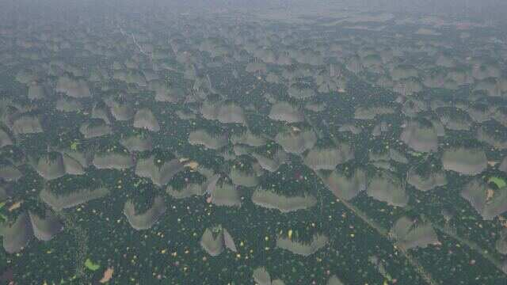
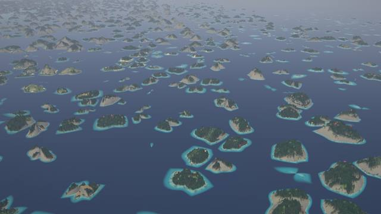

**Cockpit karst** (41.958, -21.188, 1.5 km): cone hills and star-shaped depressions with fields in
the hollows.
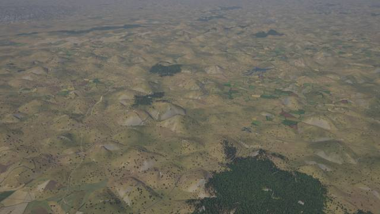

**Folded ridges** (27.899, 42.870, 10 km, 08:00): ridges and valleys of an old belt, the river in
its valley; **fault blocks** (31.739, 137.721, 10 km, 16:30): tilted blocks with long lakes in
the basins between them.
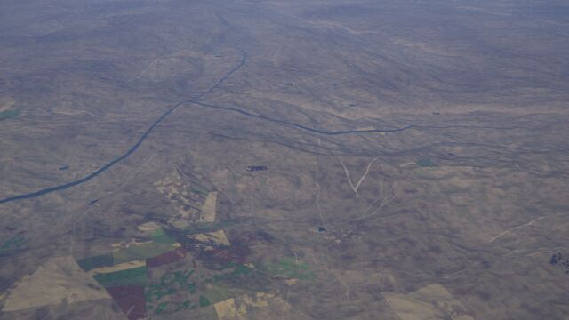
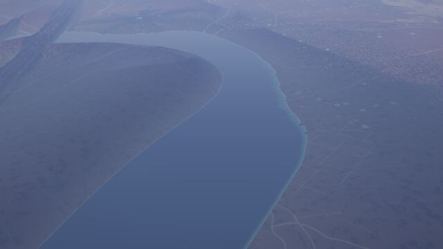

**Stepped canyon** (21.245, -121.297; 10 km and 900 m, 08:00): benches of 55 m on both walls of a
canyon in a red plateau, barchans of the desert kit on the rim.
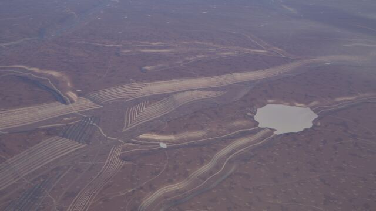
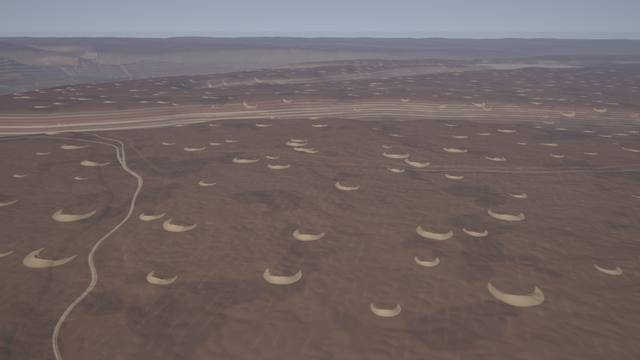

**Badlands** (-21.410, 36.504, 1.5 km): pale clay floors, gullies with rust and cream strata
bands.
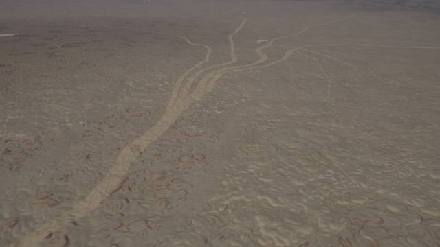

**Cirque and tarn** (40.874, 174.741, 4 km): a funnel of steep valleys around a tarn at the head
of a tributary; **glacial troughs** (49.423, -162.365, 4 km): flat floors between steep walls on
a snow plateau, tarns, hanging side valleys.
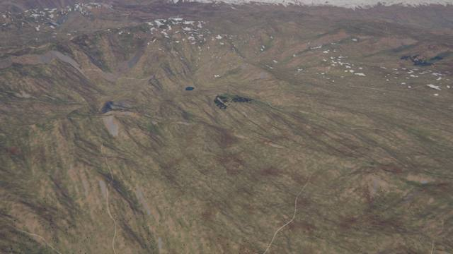
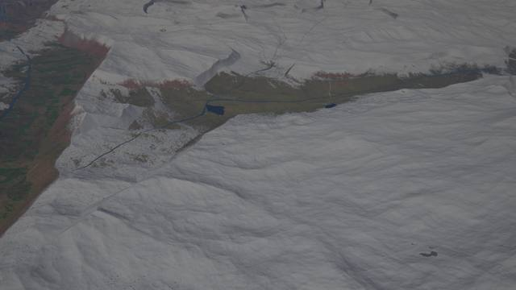

**Fjords** (63.382, -81.127, 4 km: two flooded troughs around a spine; 56.253, 161.268, 1.5 km:
steep walls, scoured rock above the water).
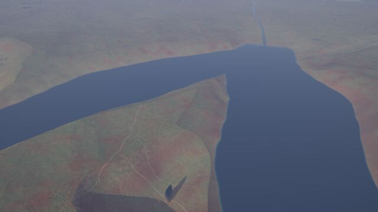
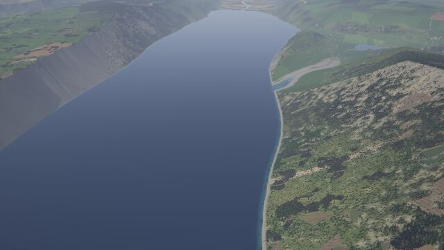

**Alluvial fans** (28.575, 67.085, 3 km above the ground, 30° down; the fan's apex is 3 km
north-west of the camera): a pale gravel apron with a straight flank and drainage lines across
it, a lake at its foot, the old relief blended into a smooth cone.
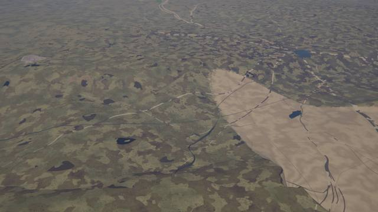

## Decisions

* **Zones, not biomes.** A biome would take the lithology and climate of the ecoregion's site; the
  zones read the pixel's smooth fields, so a karst or badland zone has its own, noise-cut border
  and the relief and the colours agree. The kit therefore has no biomes (and no variety budget).
* **One Worley lattice for both karst types**, one call site (the relief is in every pass-A
  pipeline). The towers and the cockpit hills are the same function with two parameter sets.
* **Fans from atlas fields only.** An existence test that sampled the macro fields cost 15 k
  inlined instructions per call site in every pass-A pipeline (the first version: +37 % in
  `pass_a1`); the atlas' uplift and its gradient (five samples in one loop) give the same
  information. Fans are sparse (cell 18 km, 40 %): at 12 km and 55 % up to nine of them reached
  a tile's area and the first eight by id were kept, which cut fans at tile seams.
* **The carve hook instead of a relief operator.** The relief runs before the drainage; a trough,
  a fjord or a canyon needs the channel's distance and floor, which only the carve knows.
* **The flattening target is the atlas' smooth elevation**, not `ReliefIn::smooth`: the pixel's
  low-passed relief comes from the tile's coarse grid, and blended 85 % over the ground it made
  steps of ~10 m between neighbouring tiles. The atlas' elevation is the same everywhere.
* **CPU / GPU float noise.** The same input differs by millimetres between the two backends
  (macro fields, the drainage lattice's f32 floors); a deep feature multiplies it. The canyon's
  depth is therefore a constant (450 m) under wide weights, its benches are counted from a
  height above the floor (not from the ground: a rounded or ground-dependent number of benches
  jumped with the height), and no style channel of the macro fields enters a hook. Angles are
  polynomial harmonics of `(cos, sin)`, not `atan2` and `sin` (good to ~1e-4 on the GPU: 5 cm on a
  tower).
* **The canyon has no lithology**: the nearest-texel lithology is a step function, so a canyon
  would end in a cliff at a texel border (the strata colours of the layer do read it).
* **Pass B in slot 6** (linear): the only stage with compile headroom (the stages of slots 1-5
  are over the ~30 s budget already). The layer is composited after the canopy, which suits rock
  and sediment, and runs before the transport kit's roads.
* **Strike of the folds**: random per 140 km corner (the macro fields give no gradient of the belt
  field); a belt shows ridges that turn at the corners. Folds exist in ~45 % of the old belts
  (a 180 km noise), so that mountain belts keep their variety.
* **Drowned karst**: the lowering of the plain is a function of the atlas coast distance at the
  pixel (smooth), so the islands have the same sea level at every zoom.
* **Other kits' tests.** The relief changes the ground at other kits' places: the volcanic kit's
  seam test (`cinder_field`: its margin for a step across a tile seam is 16 m instead of 8 m: the
  flattened plateau around its cinder cones is flatter than the old hills that hid them) was
  adjusted; no other kit file changed.

## Core changes

`kits/mod.rs` (`CarveIn`, `Carve`, `Kit::carve`, `has_carve`, `carve`, the WGSL glue
`kits_carve`), `hydro.rs` (`RiverHit::{u, spring, reach}`), `world.rs` and `gpu/wgsl/world.wgsl`
(the hook in the drainage carve: profile parameters, U profile, benches, a head lake; the carve
bounded by the piece's reach), `kits/example.rs` (`carve: None`), the volcanic kit's seam test.
The registration lines in `kits/mod.rs`.

## Known limits

* Fold and fault ridges are gentle for the camera (slopes of 0.05-0.1): at noon and from a
  few km above they look flat; they show under a low sun or at grazing angles.
* Folds turn where two lattice corners meet (140 km); there is no belt normal. Fault blocks are a
  plain sawtooth (no flat basin floors), and only extensional provinces of the atlas (negative
  uplift, 74 of 200 k land samples at the default seed) get them. A fold zone is blended 85 % into
  the atlas' smooth elevation first: old belts lose their small relief (and the core's ridged
  mountains), keeping the mass; where the fold noise is negative the core's mountains stay.
* The lithology is 20 km texels with a 4 km warp: karst and badland zones have ragged but
  rounded borders; a carbonate texel under the sea is needed for drowned towers.
* Badlands are creased noise, not a dendritic network: from 1.5 km they show meandering gully
  lines and strata bands (they read like marbling where the zone is big); the colours are
  fixed (cream, rust, brown), not per ecoregion.
* Troughs, cirques, fjords and canyons exist only along drainage channels of levels 0 and 1
  (30 and 8 km lattices): a fjord needs a river within reach of the coast, and glaciated mountain
  coasts are rare in the default world (about 20 of 200 k samples).
* A canyon is 450 m deep below the drainage lattice's floor (not below 30 m), 2-3 km wide, with
  benches of 50 m; tributary canyons are 35 % as deep. Mesas on the rims are the core's. There is
  no lithology in the carve (see Decisions): a canyon cuts granite as well.
* Tarns are 130 m lakes at the head of tributaries: they vanish when the pixel is wider than
  about 330 m. Cirque headwalls are round, not scalloped.
* Towers are oval cones of a 3D lattice: their size varies with the height of the lattice site
  above the surface (some are small peaks); the pale skirt of the cliff layer is a band, not
  streaks. No dolines in pass B (the cockpit relief is the doline field), no rice paddies
  (the agriculture kit decides the floors).
* Fans are blended into the smooth elevation (70 %): their apex is the instance's site, not the
  mouth of a valley; they do not follow drainage channels; their pale gravel is close to the
  soil colour of many deserts, so they show best on dark ground.
* CPU and GPU tiles differ by up to ~5 cm in a few tenths of a percent of the pixels where a
  zone or the carve is in transition (the desert kit's parity test, which allows 0.5 %, is the
  tight one).
* The layer paints over the canopy (slot 6): karst cliffs and rock walls cut through forest
  crisply.

Leftovers round B: the tower walls still read pale grey in the still although the kit paints forest over the core's rock
there and bare rock only above slope 3.5 (the cause of the grey is not found: another layer or the lighting; the tops
are green). The folds are hazy in the 08:00 still (low sun, 10 km); the fjord at 4 km is still wide (2 km), the 1.5 km one
is a trough with high walls. A canyon is as deep as the plateau allows (the floor is not lowered below 30 m).

Polish round 7: each canyon bench has its own ledge (15–65 % of the step, hashed by the bench in the core's stepped
profile) and the benches are strong along some stretches of a canyon and faint along others (a 1.4 km noise, 0.45–1):
equal ledges drew a staircase. In the core, the fine ridged octaves (< 1.8 km) and the erosion gullies of the highest
ranges saturate at ~3 km of mountain amplitude (`world::ridged_fine`, 3000 / amplitude, 0.55–1): the 5–7 km ranges at
48–50° N had a mean slope of 37° at 30 m and a fifth of the ground steeper than 50° (steeper than the Himalaya); now 30–32°
and 6–9 % (`probe_px slopes LAT LON KM STEP_M [classic]`; v0.2.0's alpine places 17–20°).

Polish round 9: canyon walls of strata at absolute elevations instead of 50 equal benches counted from the floor (a
regular layer cake of flat terraces), warped by spurs and gullies (benches along isolines of the distance to the
channel drew contour lines), a narrow floor and U walls (a wide flat floor between smooth S walls read as a toy
trench); the colour bands follow the strata. The zones read the lithology's shares bilinear over the four nearest
texels (`LitW`): a zone switched on at a texel border (karst flattening by 0.88) cut straight cliffs of 300 m through
a volcanic upland (volcano@type).
