# Settlements kit: hamlets to megacities, airports, ports, dams, mines, energy

A kit of the experimental [next generator](../README.md) (`world.generator: next`). *The default
world* on this page is seed 1 of the next generator.

`crates/terragen/src/kits/settlements.rs` (the kit, host function, slots 7 and 8, tests),
`settlements/places.rs` (the central-place hierarchy), `settlements/town.rs` (the settlement
pixel model), `settlements/sites.rs` (infrastructure placement and looks), and the WGSL twin
`src/gpu/wgsl/kits/settlements.wgsl` (`st_*`, same names and order of operations). No biomes.
Design: [terrain-next.md §5.9, §6.1, §6.2, §6.4](https://github.com/shadymeowy/aerialsynth/blob/terrain-design/docs/design/terrain-next.md); contract:
[kit-guide.md](../kit-guide.md).

## What it draws

**Places (host, analytic).** Five levels, each a 3D jittered lattice: metropolis (300 km cells,
13–32 km radius, 2–25 M people), city (90 km, 3.5–13 km), town (25 km, 1–3.6 km), village
(6 km, 180–800 m), hamlet (1.6 km, 45–150 m). Every cell has K hashed candidates (1–8 by level)
scored by the atlas' population potential × climate × coast access, then flatness on a ring of
smooth-elevation samples (Mediterranean and highland villages prefer hilltops) for the best
three; scores are quantized to 1/64 with the candidate hash as tie-breaker. Existence by level
density × population potential × culture (per archetype: hamlet, village and town multipliers,
e.g. many hamlets in dispersed cultures) × `landuse.towns`. Suppression is top-down and
bounded: same-level sites by priority (level, score, id) within the spacing or overlapping;
lower levels inside a larger place's footprint are removed, except towns and cities within 0.8
of a larger radius, which become **sub-centres** (their own core and districts: polycentric
conurbations). Population (Zipf-like per level) sets the radius; culture sets sprawl, form
and street orientation (survey-grid cultures keep north-south streets). Everything uses the
atlas and the smooth relief only, so `settlements_near(world, center, radius)` is the same on
both backends, cheap (memoized per lattice cell) and independent of tiles.

**Towns and cities (per pixel, `town.rs`).** A place stamp (centre, street frame, radius, form,
culture, development, population, downwind direction) drives:

| step | how |
|---|---|
| footprint | relative distance in the elongated frame / (R (1 + two noise octaves)); density 1 → 0 over its outer half |
| zones | CBD (cities: 7–16 % of R), inner, outer, suburb, peri-urban; industrial wedges: 1–2 angular sectors around the downwind direction |
| districts | W2 cells in the place frame (400 m villages … 1.4 km metropolises); their edges are arterials (3.5–7.5 m half width) where the layouts differ (industrial estates, informal fringes); one street pattern, layout and orientation per town (v0.2.0's one grid per town), the zones differ by their buildings; streets and city lots end where the density falls below ~0.42; density multiplier 0.8–1 per district |
| patterns | grid / rotated grid (jittered lines, main streets every fourth), radial-concentric (rings, spokes doubling per band), organic (warped W2 at 40–90 m; medinas narrow), superblocks (280–390 m, slab and point towers in rows, green and parking), informal (W2 at 7.5 m: tiny corrugated roofs, alleys, thinning with the footprint), industrial (230–340 m blocks). By culture: organic medinas (desert oasis), radial-concentric (30 % of Mediterranean, temperate and highland towns), superblocks (half the steppe and boreal towns), else grids; the peri-urban ring of 65 % of poor towns is informal |
| lots | hashed BSP of the block, depth 1 (CBD) … 4 (suburbs); a lot exists by the density at its centre (lots stay whole); within the streets 80-90 % of the lots are built, beyond them few |
| buildings | by zone × culture × lot: detached houses with setbacks (pools in rich suburbs, yard trees, porch lights), row houses, perimeter blocks with courtyards of gardens and trees (European, Mediterranean, monsoon cultures), mid-rises, towers on podiums (40–440 m, by population), warehouses with tanks; gable or flat roofs, roof palettes by culture (terracotta, slate, metal, shingles, thatch, corrugated, whitewashed) |
| parcels | parks (paths, tree clumps, ponds), plazas, parking (stall lines; cars belong to the transport kit), sports fields with athletics tracks, cemeteries, stadiums (stands, pitch, floodlights; cities), construction sites |
| trees | yard and park trees, street trees every 11 m in tree-lined cultures |
| shadows | a 3-step march toward the sun through the same pixel model (one copy in WGSL) |
| lights | lamps along the nearest street (sodium / warm / white LED by zone, culture and development), thinned with their energy kept where they would merge, their mean where blocks are unresolved; lit window rims (white in CBDs); floods in industry and stadiums |

Below ~22 m pixels the district's mean (zone colour, built fraction, height) replaces the
explicit blocks, below ~6 m the lot means replace sub-pixel buildings, so parents match their
children. The kit publishes the town masks (`town_urban`, `town_cov`) and clears natural
vegetation where it builds (the canopy is not drawn there).

**Villages by culture.** Nucleated (organic lanes, 52 m cells), perched hilltop villages (34 m
cells, dense, stone lanes; Mediterranean, highland), street villages (farms along one street,
house in front, barn behind; the street follows the valley), **forest-strip villages**
(Waldhufen: a street village in the temperate hills whose every farm owns a 40–60 m wide strip
up the valley side, 0.5–1.4 km long, fields in segments with hedges between the strips, the
forest beyond the strip ends), dispersed farms (yard, house, barn, shelter trees), kraals (a
ring of round huts around a cattle enclosure, a thorn fence; savanna pastoral), survey-grid
villages. Villages have a plaza with a church (nave and tower), a mosque (dome, minaret) or a
temple by culture. Lanes are paved or dirt by development.

**Sites (host placement, `sites.rs`).**

| site | placement | look |
|---|---|---|
| airports | cities (developed), metropolises, large towns: 16 candidates on 8 bearings beyond the edge, the flattest by 5 point samples; runways along the atlas wind ± hashed | 1 runway (towns), 2 parallel (cities > 1 M), 2 parallel + crossing (metropolises): markings, piano keys, touchdown bars, taxiways and connectors, apron with aircraft, terminal, hangars, car park, mown grass, perimeter road; the graded area flattened to the plane with a 120 m cut-and-fill margin; edge, approach and taxiway lights, apron floods |
| ports | coastal towns and cities: the nearest ocean along 8 bearings by point-sample rays (rivers crossed), the coast direction from two lateral rays | land: container stacks, warehouses, gantry cranes, quay; water (slot 8, solid): piers every 260 m, ships alongside, a breakwater; floodlights |
| dams, reservoirs | 15 % of towns, 50 % of cities, 20 % of a 55 km mountain lattice: the narrowest valley cross-section among 6 level 0–1 drainage pieces (point samples), the crest below the lower bank (25–150 m) | the reservoir is the upstream drainage (≤ 40 pieces of the same level) within a reach of 35 × the dam height, upstream of the dam line, below the water level: dendritic by the ground; a pale bathtub ring up to the crest; the concrete wall across the valley (slot 8) |
| quarries, mines | a 16 km lattice near towns (32 %) or in the hills: lithology picks limestone quarries, granite quarries, other quarries, open-pit mines (hard rock, 30 %) | an irregular stepped bowl (benches 10–15 m, faces, a spiral haul road), a pit lake, a spoil heap, tailings ponds with beaches (mines); DSM only (pass B) |
| solar farms | up to 2 per town in sunny, dry, developed regions, beyond the edge, flat by 5 point samples | panel rows facing the equator (resolved below the row pitch, their mean above), service roads, fence |
| wind farms | a 45 km lattice: windy (atlas wind 3.5–7 m/s), developed, by culture, away from towns | turbines on a jittered grid (rows across the wind): white tower and blades, a long shadow, gravel pad and track, red aviation lights |
| gas flares | a 30 km lattice: arid sedimentary basins | well pads and tracks, a scorched ring, a bright orange flare at night |

Greenhouse seas are drawn by the agriculture kit (§5.8); roads, rail, bridges, power lines and
cars belong to the transport kit.

## Placement and levels of detail

Places of a level are listed (as stamps) for tile areas whose pixel is below 150 m (hamlets),
800 m (villages), 3 km (towns), 12 km (cities), 50 km (metropolises). At coarser pixels the
level's **glow** takes over (`glow`, WGSL `st_glow`, slot 7): the places expected at the pixel
(`places::expected_places`: the existence draw of `base_place` by population potential, culture
and `landuse.towns`, its population and radius draws integrated over their hashes, calibrated
against the final places by `GLOW_CAL`) times the place model's mean over a footprint (street
light emission and built cover per R², `GLOW_K*`, `GLOW_J`): a grey urban tint and the street
lights' mean, so the mean of a coarse pixel matches the finer zooms' and night views from
altitude keep their lights (a smooth glow following the population instead of discrete spots).
`glow_keeps_the_mean` (GPU) compares a parent tile's mean emission with its four children's at
the zooms where a level drops, over eight populated places: 0.99 (z10, hamlets), 1.06 (z7,
villages), 0.83 (z5, towns), 0.99 (z3, cities). Sites: airports and ports below 600 m, dams below 1.2 km,
quarries and solar farms below 300 m, wind farms below 150 m, flares below 2.5 km. All host
results are memoized per lattice cell or place (pure functions of the world).

## Decisions

* **Host stamps, not instance families.** The hierarchy needs neighbour suppression and the
  sites need terrain samples; both are host Rust shared by the backends. Pass B reads a place
  stamp per bin and evaluates one place (the most central) per sample.
* **The core's grid towns are off with the kit** (`Kit::replaces_towns`, `kits::legacy_towns()`,
  WGSL `KITS_LEGACY_TOWNS`): no town site in pass A, no town requests, no town code in pass B.
  The core's farmsteads stay (dispersed farmsteads between the hamlets).
* **Water in the scores** (hamlets and villages): a candidate whose centre lies in open water
  (pass A at the point, `World::terrain`: the sea, lattice and closed-basin lakes, the kits'
  lakes, a level 0–1 river channel) is dropped; water on a ring of 4 points at 0.8 × the level's
  smallest radius lowers its score (× 0.3–1), a level 0–1 river within 2.5 km raises it (up to
  × 1.3: crossings, mills, river ports). Host Rust, analytic, the same for both backends. At
  villages and hamlets the test costs ~7 % of a survey view's generation. (The transport
  routing's `Scene` was tried first: a scene per block costs ~70 ms.)
* **Lakes** (towns, cities, metropolises): the transport kit's networks visit every town of a
  continent at low zooms (some 6 700 per 1500 km view), where pass A at a point costs 1–10 ms
  (tens of milliseconds where a lake's level must be found first). So the best candidate gives
  way to the next one only where a lake *can* reach its centre (`places::lake_free`): within
  1.5 radii of a lattice lake that can exist at the centre's climate
  (`World::lattice_lake_near`), or within 1.6 radii of the largest lake a possible closed basin
  of the major rivers (drainage level 0) can hold (`World::sink_near_level`: an active lattice
  point above the sea without a lower neighbour, sized by the widths of all the neighbours that
  could drain into it). The screens visit a few lattice points (~0.05 ms per town), no
  drainage pieces; the tributaries' and streams' closed basins (ponds of a few hundred metres)
  would cost 0.4 ms per town and are not screened. Test `towns_avoid_lakes`: 3 of 3000 town
  and city centres in pass A's water, all in streams' ponds (7 before). Reservoirs come after
  the places (dams are placed near towns): hamlets and villages whose centre a reservoir floods
  (> 1 m) are drowned (not drawn; `sites::drowned`), and a dam whose reservoir would flood a town
  or a city is not built.
* **Sites are the same on both backends**: their decisions take the backend's point samples where
  they are clear by a margin (`sites::TIE_H` = 0.5 m) and re-take close ones with exact samples
  (`World::terrain`, the CPU backend's own): airports evaluate their candidates in the order of
  their backend range until the next cannot beat the best exact one, dams likewise by score (a
  candidate near a threshold first), ports re-sample the ray samples near sea level or a lake's
  level, quarries, wind farms, flares and solar farms near a threshold; the heights a site keeps
  (airport grade, dam crest, wall ends, quarry floor) come from exact samples.
  `sites_and_routes_match_the_cpu` (GPU) checks the stamps and segments of six places bit for
  bit (the decks of engineered road profiles aside).
* **Quarries change the DSM only** (pass B): the drainage does not see the pits.
* **Pass B in four stages** (`[0, 3, 5, 7]`): the kit's built layer is in the linear–built stage,
  its water layer (reservoirs, dams, port piers) in the canopy–seasonal stage.

## Places

Places of the default world (`PLACES` in the tests): metropolis (30.35, 128.849) and its outer
districts (30.45, 128.95), survey-grid city (−6.177, −114.240), desert town with a medina
(−12.198, −21.454), city with informal fringes (−20.865, −142.615), forest-strip village
(20.715, −22.646), street village (−9.162, 96.553), kraal village (−15.971, 62.836), perched
village (−38.778, −166.808), airport (−10.539, 115.357), port (−11.717, −173.520), quarry
(−20.458, −152.138), solar farm (40.497, 46.920), wind farm (42.418, 33.345), gas flares
(24.031, −57.483), dam (−0.699, −17.687). Find more with the ignored tests
`find_settlement_places` (places by level, form and culture), `find_sites` and `debug_ports`.

## Tests

`places::tests` (determinism and tile independence, the hierarchy's counts, no overlaps except
sub-centres), stamp encoding, BSP partition, legacy towns off, LOD consistency, seams E-W /
N-S, determinism (fresh generators and caches), `tiles_match_the_cpu` (22 tiles at z11–z17),
`places_stay_on_the_gpu` (z2–z16 at every place), ignored `bench_places`. No kit kernels (no
kernel parity test).

## Compile time and performance

Host work (after the perf round, Tesla P4, 6 host threads): the kit's `prepare` hook resolves a
batch's places once per lattice cell, in parallel and top-down by level; sites list towns only
below 1.2 km pixels (`sites::DAMS_GSD_MAX`); hamlets' and villages' water tests take their
drainage from per-query-cell piece lists. `places_stay_on_the_gpu` (z2–z16 at every place)
takes 73 s (over an hour before: a zoom-2 tile resolved every town of a continent for its
sites, one core), `glow_keeps_the_mean` 181 s (12 min; now bound by the core's land-use regions
of the z5–z6 tiles on the GPU), `towns_avoid_lakes` 38 s.

After the leftover round (water, exact sites, glow; all kits): P4 cold pass B 31.4 / 28.6 / 19.7
/ 26.0 s (the glow adds ~1.4 s to the linear–built stage; the first stage, unchanged, varies
±1.5 s with the farm's load), points 22.7 s, drainage heights 17.3 s. The water test costs ~7 %
of a survey view's generation (59.6 s vs 55.7 s for a 2.5 km nadir view).

Cold compile on a Tesla P4 (`compile_times`, one pipeline at a time, all eight kits): pass B
31.2 / 29.1 / 16.7 / 25.3 s in four stages (the first two stages do not contain the kit); pass
A1 18.8 s, points 21.9 s, drainage heights 15.9 s. With the old three stages the last one took
45.3 s with the kit (28.9 s with `TERRAGEN_COMPILE_DROP=settlements`), hence the fourth stage. One
copy each of the heavy helpers: the place model is evaluated inside the shadow loop, the site
looks inside the stamp loop, one W2 for districts and one for all cellular layouts, one roof
colour evaluation per sample. Gates: no stamps in the bin, no place within 1.62 R, the district
mean below ~22 m pixels (no block evaluation), lot means below ~6 m.

## Stills

GPU-generated (`terrain survey --places`, default world, 10:30 local on the equinox; nadir from
800 m, oblique from 1.5 km, high from 10 km), rendered before the last fixes (cars in parking
lots removed: the transport kit's; natural vegetation cleared also between unbuilt lots).

**Metropolis** (30.35, 128.849): a radial CBD with towers on podiums and parks; districts of
the temperate culture from 1.5 km and 10 km (the far districts at their mean).

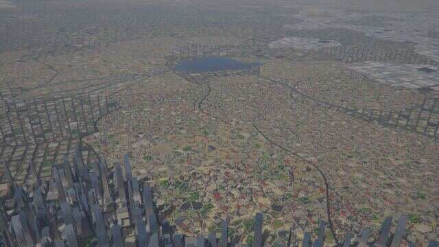
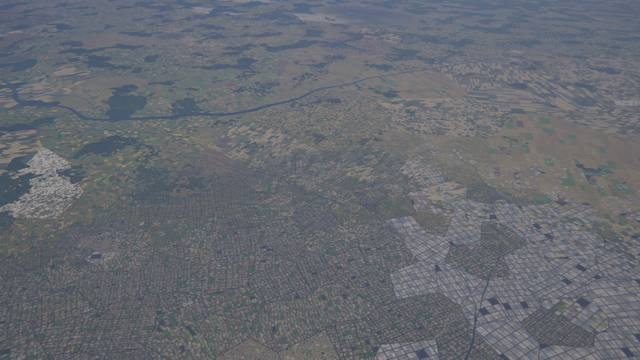

**Survey-grid city** (−6.177, −114.240): long grid blocks, warehouses, a parking lot, a
school track; **desert town** (−12.198, −21.454): the medina's organic lanes and whitewashed
roofs (stills of round B: grid districts beside the medina are gone since).
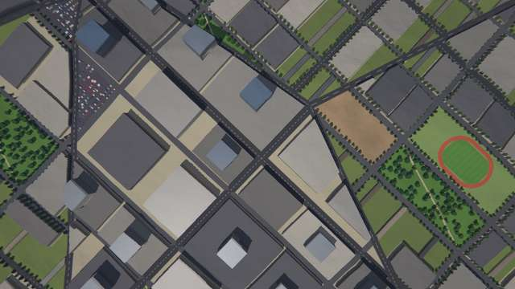
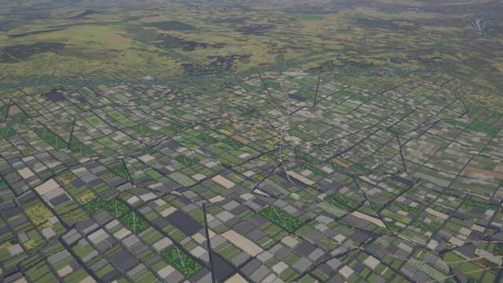
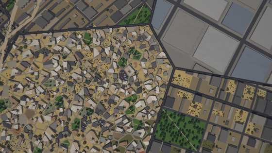

**Forest-strip village** (20.715, −22.646): farms along the valley street, each with its strip
of fields and hedges up the slopes.
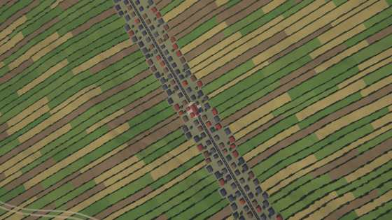

**Airport** (−10.539, 115.357): apron with aircraft, terminal, taxiway, runway; **dam**
(−0.699, −17.687): the wall and the reservoir; **quarry** (−20.458, −152.138): benches and the
haul road; **solar farm** (40.497, 46.920).
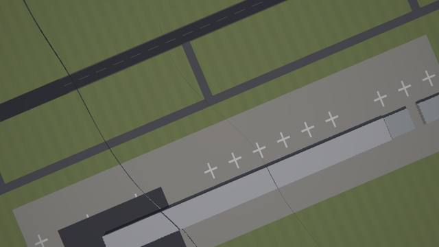
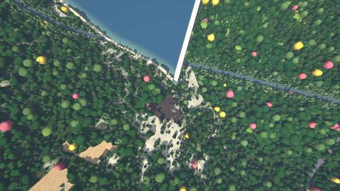
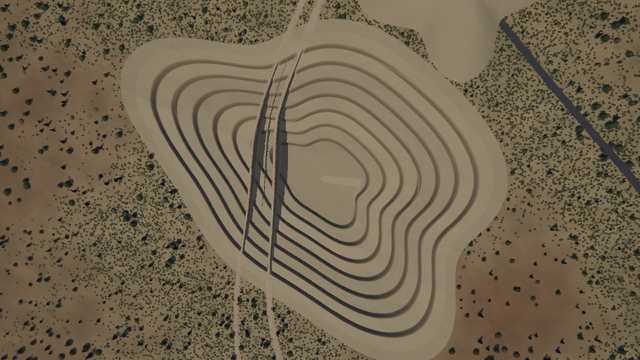
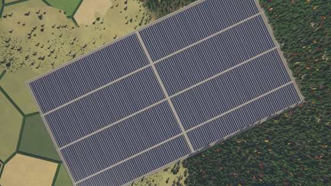

**Night** (emission layer, z10, square-root scale): the metropolis glows by zone (white CBD),
villages and farmsteads as points.
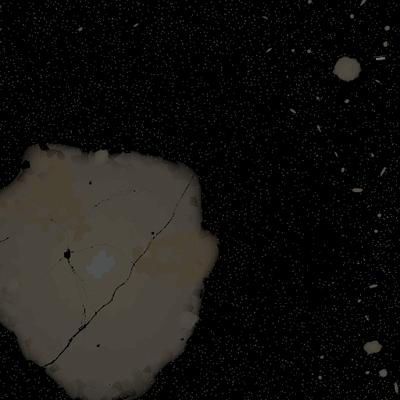

## Known limits

* Only hamlets and villages test their centres against pass A's water and score rivers; towns,
  cities and metropolises avoid the reach of possible lattice lakes and major rivers' closed
  basins (conservative screens: they also give way where the lake turns out not to exist) and
  keep the smooth-relief sea test, so a town's centre can lie in a wide river or a stream's
  pond (0.1 % of them). A town's
  lots do not follow the terrain beyond the slope gate and the river banks; its footprint may
  still reach into a lake or river.
* Confluences and river mouths get no extra bonus beyond the river's proximity (the coast bonus
  is the atlas coast distance).
* A town draws one street pattern (its blocks run on across district borders); industrial
  estates (each its own layout) and the informal fringe of poor towns are the exceptions, with
  arterials along their borders: buildings next to such an arterial are cut by its verge, and
  the pattern changes there abruptly. No old organic core in grid towns, no curvilinear
  suburbs (rings of different patterns read as pieces of different towns). City lots end where
  the streets do (density 0.42). Streets are not connected to the core's rural roads.
* Towers cast shadows only within their own block (3 steps of 3.5 m); tall towers' long shadows
  across streets are missing.
* Reservoirs fill every ground below the water level within their reach upstream of the dam,
  also a neighbouring basin; the drainage and rivers in pass A do not know them (a river is
  drawn below the water, the reservoir over it). Dams use point samples, so a dam can sit on a
  wide valley floor where the banks are far.
* Airports flatten the DSM, not pass A: rivers and lakes inside the graded area stay; a river
  can cross a runway.
* Ports exist where a point-sample ray finds the ocean within R + 12 km (10 of 13 coastal towns
  in `debug_ports`); estuaries and lakes have no ports.
* Quarries are pass-B pits; their floors are not drainage sinks.
* Hamlets below 150 m pixels, villages below 800 m, towns below 3 km are drawn as the expected
  glow, not as places: the mean matches (statistically, over many places), the texture does not
  (a smooth glow following the population field instead of discrete spots, also where the
  actual places of a region happen to be few).
* Reservoirs drown hamlets and villages (they are not drawn) instead of moving them; the
  transport kit's graph still routes to them and ends its roads at the shore.
* Night lights: no interchange lighting (transport kit). The renderer lights the windows of
  facades (`render.walls`: hashed per window, warm, white on glass towers); the tiles hold only
  the window rims seen from above.

Leftovers round B: districts are looked up at a position warped by two sines (16 % and 4.5 % of the cell), so their borders
wander, and 60 % of the edges are arterials (the others are ordinary streets); the metro is still the same pattern mix to
the horizon (the far districts are still at their mean).
