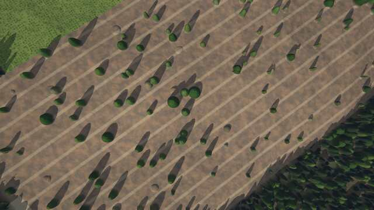
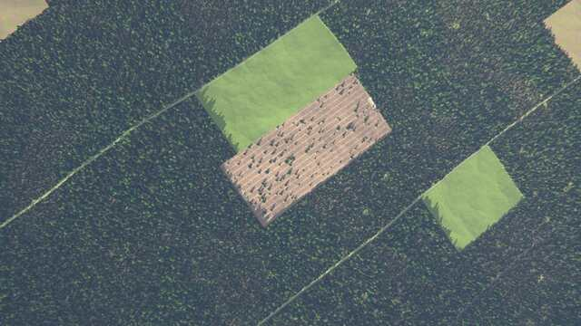
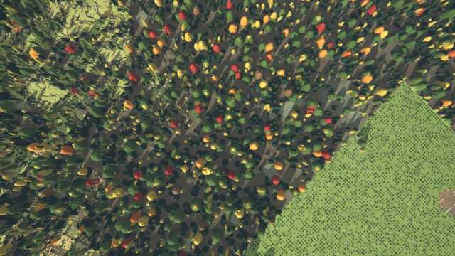
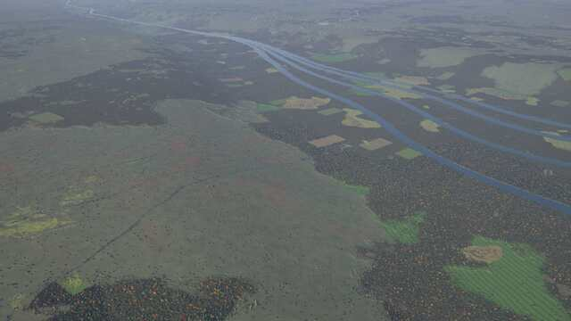
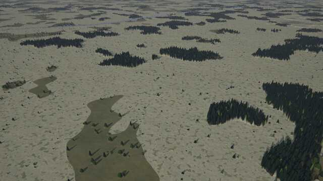
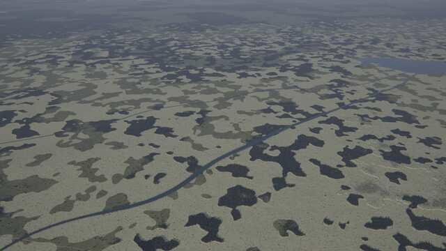
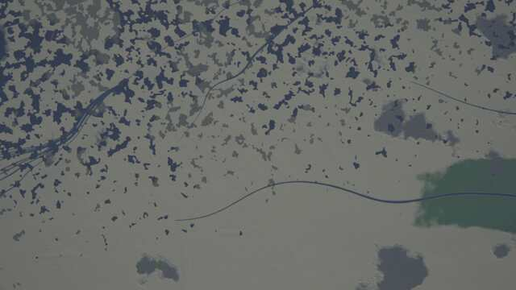
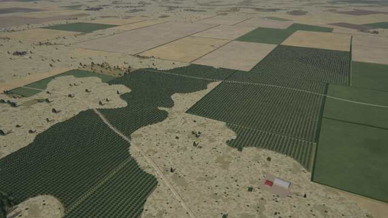
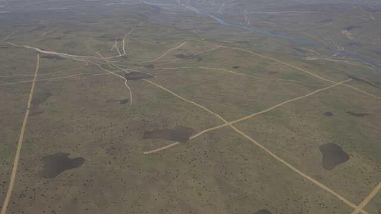
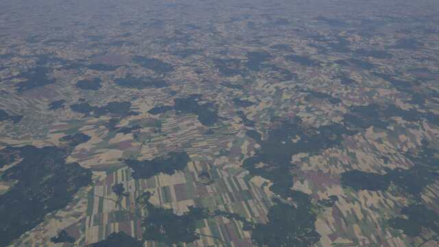

# Temperate, boreal and wetland kit

A kit of the experimental [next generator](../README.md) (`world.generator: next`). *The default
world* on this page is seed 1 of the next generator.

`crates/terragen/src/kits/temperate.rs` (layer functions, tests), its WGSL twin
`src/gpu/wgsl/kits/temperate.wgsl`, and its biomes `crates/terragen/biomes/temperate.yaml`
(design: [terrain-next.md §5.7](https://github.com/shadymeowy/aerialsynth/blob/terrain-design/docs/design/terrain-next.md), contract:
[kit-guide.md](../kit-guide.md)).

## What it draws

**Biomes** (data; picked per ecoregion by Köppen class, envelope, lithology, weight):

| biome | Köppen | look | classes |
|---|---|---|---|
| `broadleaf_deciduous` | Cfa Cfb Dfa Dfb Dwa Cwa | oak / beech / hornbeam crowns (three crown layers of different size and green), few conifers | broadleaf forest |
| `mixed_forest` | Dfb Dwb Dsb Cfb | stands of spruce, pine, birch and oak side by side (needleleaf, broadleaf and mixed stands) | needleleaf / broadleaf / mixed forest |
| `taiga` | Dfc Dfd Dwc Dwd Dsc | dark narrow spruce spires, lighter pines, birch, a pale moss and lichen floor; open spire taiga where it is too dry for closed forest (the canopy's moisture window shifts down to 0.10–0.32 below 8 °C, also on part-mountain terrain: v0.2.0's closed taiga) | needleleaf forest |
| `lichen_woodland` | Dfc Dfd Dwc Dwd, < 560 mm | widely spaced spires on cream reindeer lichen | woodland, needleleaf forest |
| `maquis` | Csa Csb | dense mottled olive-grey and dark green scrub, stone pines and holm oaks, terracotta soils, limestone outcrops | maquis |
| `garrigue` | Csa Csb on carbonate | low grey-green cushions on white limestone | maquis, rock |
| `chaparral` | Csa Csb | dense dark brush with burn scars of different ages | maquis, burn scar |
| `feather_grass_steppe` | BSk Dfa Dfb Dsa Dsb Dwa, 200–560 mm | silvery-buff tussock grass on black chernozem | steppe |
| `heathland` | Cfb Cfc Dfb on acid rocks | purple-brown heather, scattered birch and pine, blown sand | shrub, sand |
| `moorland` | Cfc Cfb Dfc (and above heathland) | heather burnt in strips of different ages, grass moor, peat hags | shrub, grass, bog |
| `subalpine_krummholz` | zone | dwarf pine mats, stunted spruce, meadows | shrub |
| `alpine_meadow` | zone | bright meadows with flowers, boulders and cattle terracettes | alpine meadow |

Zonation (by the sample's temperature): the temperate and Mediterranean biomes (also the core's
`temperate`, `temperate_broadleaf`, `temperate_conifer`, `mediterranean`, patched) climb through
mixed forest to krummholz (below 1 °C) and alpine meadow (below −1.5 °C). The core `steppe`
gets the steppe class.

**Layer functions** (code, in every biome where the climate and terrain fit):

* **Wetlands** (azonal slot): raised bogs — ochre, red-brown and green sphagnum, a darker wet
  margin, pools on concentric rings near the dome's top, a few stunted pines; string bogs (aapa
  mires, cold boreal) — narrow strings along the iso-lines of a slow flow field with flark pools
  between them; fens near streams and in water tracks — green sedge, willow and birch scrub;
  reed marshes on floodplains and river banks — two greens and last year's straw in clonal
  patches, open water in the core and a network of creeks; beaver ponds on small streams — a
  lens-shaped pond, a ring of dead grey trees, the beaver meadow; floodplain meadows with
  swales parallel to the channel. Pools and ponds are class *lake*; mires *bog*, reed *marsh*.
* **Managed forest** (disturbance slot): stands (a brick pattern of columns 150–300 m wide in
  the land-use region's frame, warped by ~25 m) where the culture manages its forests (boreal,
  survey-grid and temperate archetypes, by development and a per-ecoregion draw; only within reach
  of people: habitation 0.02-0.25), about 0.5 %
  of them cut a year (at most 9 % within 16 years; most cuts years old) with ragged edges (seed
  trees and uncut corners along the border) — fresh dark slash with skid trails, a landing and a
  few seed trees, then grass and fireweed, then dense young plantations in rows — with logging
  roads along the column edges
  (class *clear-cut*, roads *track*); windthrow — patches of fallen trunks lying in the storm's
  direction; firebreaks — straight cleared strips with a track through the forests and scrub of
  dry-summer climates (and the managed boreal forest).
* **Autumn** (canopy slot): deciduous crowns in yellow, gold, orange, red and brown by the
  ecoregion's season (the red share is the ecoregion's: maple-red or beech-gold regions);
  larches in the cool forests, light green, gold in autumn.

Kernels: the core `scatter` with the kit's own parameters (autumn crowns, larches, young trees,
fallen trunks, dead snags); their parameters and calibrated means are generated into the WGSL
file (`wgsl_consts`, checked by `wgsl_consts_up_to_date`; `AERIALSYNTH_BLESS=1` rewrites it).

## Stills

GPU-generated (`terrain survey`, `AERIALSYNTH_GPU_STRICT=1`), default world, 10:30 local on the
equinox. Lat, lon in brackets.

**Managed boreal forest** (48.760, 120.806): rectangular stands in the land-use frame, one cut
recently (skid trails, a landing, seed trees), one regrown to grass, one a dense young plantation in
rows, logging roads along the stand edges.

**Autumn and raised bog** (53.943, 131.837): mixed forest in muted yellow, gold, orange and red
crowns with a young plantation (lime green); the pale-red boggy plain beside it.

**Lichen woodland** (61.335, 115.374): cream lichen floor, scattered spires, dark spruce islands
and mire ponds.

**Steppe** (51.427, 160.549) and **maquis** (38.467, 5.375); **forest and farmland mosaic**
(45.877, -2.573, oblique 10 km).

The reed marshes and beaver ponds are small (tens of metres) and need a dedicated close view; the
stills above do not show them.

## Tests

* `registry_compiles`, `wgsl_consts_up_to_date`;
* `tiles_match_the_cpu` (GPU): five places (raised bog, reed marsh, maquis, managed forest with
  clear-cuts, lichen woodland) at z16, z14, z12, z9 — at most 0.5 % of the pixels off;
* `lod_seams_determinism`: parent vs mean of children (albedo, class histogram) at z12 and z15,
  determinism with a fresh generator, the E-W seam;
* `places_stay_on_the_gpu`: the five places at z6 to z16 with `AERIALSYNTH_GPU_STRICT` semantics
  (`Backend::Gpu` returns errors; no CPU fallback);
* `find_places` / `find_features` (ignored): where the kit's biomes and classes are.

## Performance

`bench_places` (ignored test, GPU, 5 places x 8 x 8 tiles per zoom), the same build with the
kit's `KITS` entry commented out (mean of two runs, shared machine, so +-3 % noise):

| zoom | tiles/s without | with | cost |
|---|---|---|---|
| z8 | 18.1 | 19.1 | within noise |
| z10 | 67.5 | 68.3 | within noise |
| z12 | 120.3 | 117.5 | 2.3 % |
| z14 | 116.5 | 112.4 | 3.5 % |
| z16 | 123.4 | 116.8 | 5.4 % |

## Known limits

* Up to 18 % of the managed stands are cut within 16 years (42 % before: the taiga was a
  patchwork of bright rectangles); regrowth is a muted green and the young rows close within 7
  years, but a cut still reads as a flat rectangle from 1.5 km up; there is no gradient of ages
  within a stand.
* Managed stands are a brick pattern of rectangles in the land-use region's frame: their edges
  are straight and axis-aligned within a region, regardless of slope, streams and roads.
* Bogs, string bogs and fens are drawn by masks on the drainage and the relief (no peat
  hydrology): a raised bog can sit on a gentle slope, and string-bog strings follow a slow flow
  field rather than the real slope.
* Autumn colours follow the ecoregion's season, not a date: two ecoregions with different
  seasons meet in a 10 km mosaic band.
* Windthrow and firebreaks are rare by design and never cross towns or fields; firebreaks are
  straight in the region frame.
* Heathland burning strips and moorland peat hags are colour only (no relief).
* Cast shadows of the kit's crowns come from the renderer's DSM only (the core bakes `lit` for
  its own crown layers).

Leftovers round B: the regrowth's grass colour differs by stand (two olive greens) and has a 40 m patchwork; the kettle
lake place's white rectangles are the boreal clear-cuts under snow (kept).
