# Tropical and savanna kit

A kit of the experimental [next generator](../README.md) (`world.generator: next`). *The default
world* on this page is seed 1 of the next generator.

The wet and dry tropics from 100 m to 10 km above the ground: rainforest canopies with emergent
and flowering crowns, floodplains with meander scars, cloud forest and páramo on the mountains,
mangroves on low coasts; savannas in dry-season colours with umbrella acacias, baobabs, palm
groves, termite mounds, burn scars, waterholes and gallery forests; monsoon, dry deciduous and
miombo woodland; slash-and-burn frontiers. Design: [terrain-next.md §5.6](https://github.com/shadymeowy/aerialsynth/blob/terrain-design/docs/design/terrain-next.md);
contract: [kit-guide.md](../kit-guide.md).

| file | content |
|---|---|
| `crates/terragen/src/kits/tropical.rs` | the kit: seven kernels, the instance lattice on a reference sphere, tests |
| `crates/terragen/src/gpu/wgsl/kits/tropical.wgsl` | the WGSL twins of the kernels |
| `crates/terragen/biomes/tropical.yaml` | eleven biomes (two of them patches of the core's `tropical_moist` and `tropical_dry`) |

The kit is data over kernels: no layer functions, no relief, no host features. Every feature is
a biome layer (`layers:` in the YAML) over one of the kit's kernels or a core kernel, so each is
evaluated identically on both backends, crossfaded with its calibrated mean where it is below
the pixel, and placed by the biome envelopes, the ecoregions and the masks.

## Kernels (kinds 144–150)

| kernel | draws | notes |
|---|---|---|
| `tropical_crowns` | tree crowns on a jittered grid: dome, umbrella, star (palms; leafless baobabs), per-crown hue, a second colour and a flowering colour by hash, leaf mottling | groves: a crown exists where the clump noise *at its centre* is below `clump_fraction` (crisp per crown); a mask thins crowns by shrinking them to nothing at the density threshold, never by clipping |
| `tropical_fire` | burn scars: a crisp threshold of 3-octave lobate noise at ECEF `p`; `ages` crisp age classes from a smoother noise (a younger fire over an older one): charred black with grey ash streaks and a dark fire front, brown, green regrowth | seamless (ECEF noise, f64 wavelengths) |
| `tropical_swidden` | slash-and-burn plots: a warped Worley partition; a share `fill` of the cells holds an irregular clearing inside a forest margin, burnt, cropped or in bushy fallow | local frame |
| `tropical_waterhole` | waterholes: a lobate pond (`part: pond`, class lake); a dark mud rim, trampled bare ground and 6–12 wavy, tapering game trails radiating out (`part: ground`) | instance lattice; the two parts share the `seed` |
| `tropical_meander` | meander scars: the horseshoe of a cut-off channel, open water over part of it (`part: lake`, an oxbow lake) and silted elsewhere; scroll bars (ridges and swales of young forest or grass) filling the loop (`part: scroll`) | instance lattice; bars band-limited to their mean duty |
| `tropical_mangrove` | mangrove forest: a crisp lobate extent moved by the mask, dense dark crown clumps of two species tones, lower along the creeks (`part: canopy`); tidal creeks along the edges of two warped Worley lattices, each edge its own width, some missing (`part: channels`) | ECEF lattices: seamless |
| `tropical_grass` | savanna grass in dry-season colours: golden and grey-straw tones, bare (laterite) patches, tussock mottling at metres | its extent a crisp threshold by the mask |

**Instance lattice.** Waterholes and meander scars are instances of a jittered 3D lattice in
ECEF coordinates on a reference sphere (`sphere_frame`, `sphere_site`): a site exists if it lies
in the slab of half a cell around the sphere (a decision of the site alone, one site per cell²
of surface), and the instance is drawn in the tangent frame of the sample. They are seamless on
the planet and independent of the land-use regions (whose frames the per-pixel kernels use).
The core's instance families (milestone 2) arrived after the kit; the lattice needs no host
lists and costs ~5 cell hashes per sample after the bound test.

## Biomes

| biome | Köppen / envelope | what it shows |
|---|---|---|
| `tropical_moist` (core, patched) | Af, Am | lowland rainforest: broad flat-topped crowns of stands, emergent giants (pale, some flowering yellow or pink-red), treefall gaps, a band of pale pioneer crowns along the rivers, meander scars on the floodplains, a slash-and-burn frontier where farming begins; agriculture × 0.2 |
| `flooded_forest` | Af, Am, ≥ 1800 mm | várzea / igapó: lower canopy with swamp palms, black-water pools, many meander scars, river-edge forest |
| `monsoon_forest` | Am, Aw, ≥ 1300 mm, 2–7 dry months | semi-deciduous forest: leafless crowns among green ones, flame-of-the-forest flowering orange, small burns, swidden |
| `tropical_dry_forest` | Aw, 800–1900 mm, 4–9 dry months | dry deciduous forest: grey-brown leafless and green crowns tree by tree, yellow flowering, fires, swidden, evergreen gallery forest in the gullies |
| `tropical_dry` (core, patched) | Aw | savanna: golden grass, umbrella acacias, burn scars, termite mounds, gallery forests along drainage lines and rivers, mangroves on its coasts |
| `savanna_acacia` | Aw, BSh, 300–1100 mm | acacia savanna with waterholes and game trails |
| `savanna_baobab` | Aw, BSh, 350–1000 mm | baobab savanna: wide leafless crowns, a few in leaf |
| `palm_savanna` | Aw, Am, 900–2400 mm | llanos: palm groves, gallery forests, meander scars with grassy scroll bars |
| `miombo_woodland` | Aw, Cwa, 650–1500 mm | open woodland with bronze new leaves, large wooded termitaria, dambos (treeless grassy drainage lines), fires, swidden |
| `tropical_cloud_forest` | zone below 17.5 °C | dense low mossy canopy (dark green), tree ferns, a few taller crowns, clearings of green montane grass, landslide scars on steep slopes |
| `tropical_paramo` | zone below 10 °C | tussock grass, silvery frailejón rosettes, tarns |

**River water** (slot 8, `rivers`; design P0): tropical lowland rivers take the colour of their
water. Major rivers (half width > 25 m) are white-water (café au lait, lighter where wide); the
smaller ones are black-water (tea-black) in the very wet lowlands (moisture > 0.62) of a
regional style channel's provinces, else muddy; so black tributaries meet a muddy main stem. The
colour takes over from the core's between 18 and 21 °C and below 600–900 m.

**Fishbone deforestation** (canopy slot, `fishbone`; design P3): colonization projects in the
rainforest lowlands (22 km blocks of the tangent plane of a 200 km anchor, 30 % of them by a
hash; the climate gates the forest, development ≤ 0.65): a trunk road through the project,
feeder roads every 4.4 km at right angles, and along every road lots of 250 m each cleared from
the road to a depth of its own (to 3 km, deeper near the trunk road: older) — pasture, fresh
burns, red soil, crops, regrowth — so the clearings form fishbones from altitude. Red laterite
tracks; the clearings reset the canopy's height and shadows. The kit's own spines, not the
transport kit's roads.

Laterite: red soils (`laterite` palette, `vegetation.laterite`) in every lowland biome. Cloud
forest and páramo are the altitudinal zones of the forest and savanna biomes (`zonation`); they
are never picked by an ecoregion (an impossible envelope keeps them out of the nearest-envelope
fallback too). Mangroves are two layers of the coastal biomes: on the sea where it is
shallower than ~5 m (water slot; the bed below sea level, so no inland lakes) and on the coastal
and delta flats below ~3 m (canopy slot), not on arid coasts. The default world has few such
places inside tropical ecoregions (its coasts rise quickly, and near-shore water often belongs
to an ecoregion whose site lies at sea), so mangroves are rare there; no still shows them yet.

Classes (v2): `tropical_rainforest`, `mangrove`, `broadleaf_forest`, `woodland`, `savanna`,
`burn_scar`, `clear_cut` (swidden), `lake` (oxbows, ponds, pools, tarns),
`bare`, `marsh`, `grass`.

## What needs the core

* **River geometry per pixel.** Point bars, cut banks and live meanders need the river's
  along-coordinate `s`, its curvature sign and the bend's inner side in `Local`; meandering
  channels need the drainage to meander. The kit draws meander *scars* beside the rivers
  (a mask on `river_dist` and `floodplain`), not the river's own bends.
* **Coast distance at pixel resolution.** `coast_km` comes from ~20 km atlas texels and can miss
  the pixel coast by hundreds of km (237 km at a beach of the default world), so the mangroves
  use the height near sea level instead.
* **Water-slot layers that become land** (`solid` for YAML layers): mangroves over shallow sea
  keep the sample a water surface (the class is mangrove, `is_water` stays true).
* **Ecoregions at sea.** Near-shore water whose ecoregion site lies at sea gets that site's
  biome, not the coast's, so coastal water layers (mangroves, plumes) miss many coasts.
* **Envelope by latitude or temperature range** so a highland ecoregion in the tropics (Cwb,
  Cfb) can pick tropical montane biomes; today cloud forest is only a zone of lowland biomes.
* **Shadows of kit crowns.** The core canopy bakes cast shadows (`lit`) of its own crown layers
  only; kit crowns (emergents, baobabs, palms, gallery forests) rely on the renderer's DSM
  shadows.

## Stills

GPU-generated (`terrain survey` with `AERIALSYNTH_GPU_STRICT=1`), default world.

**Savanna** (22.50, −27.79): golden dry-season grass, umbrella acacias, burn scars of three ages
(charred with ash, brown, green regrowth), gallery forests along every drainage line.

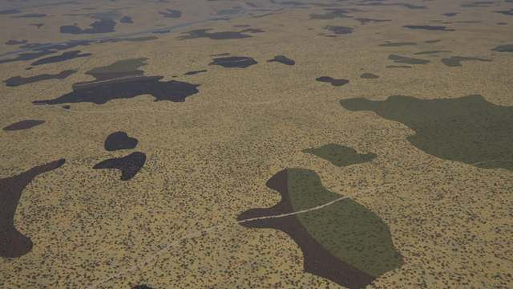
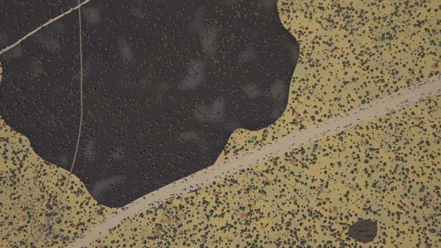
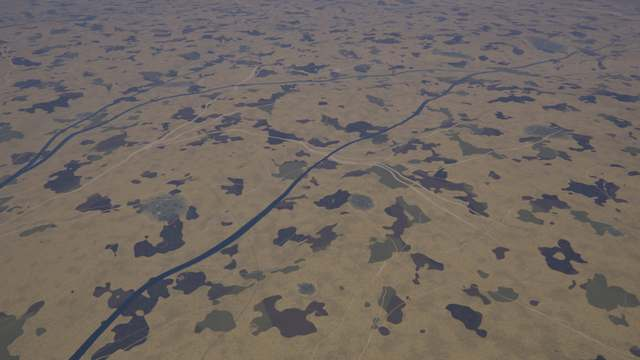

Before (the same place without the kit, generator version 4 core):

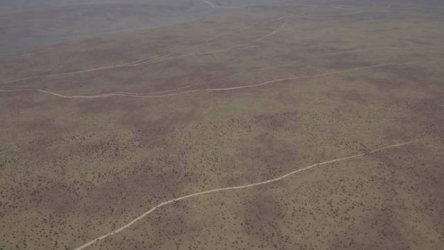

**Rainforest** (12.20, −28.59): closed canopy with emergent crowns, yellow and pink-red flowering
crowns, the pale pioneer band along the streams, treefall gaps, meander scars on the
floodplain (in the core alone this place was mostly fields).

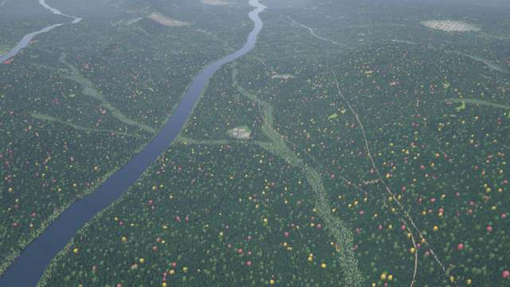
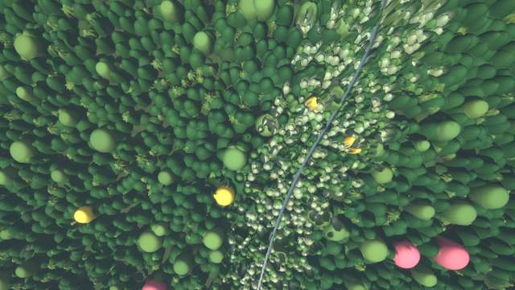

**Oxbow lake** (6.39, 150.99): a cut-off meander beside the river with its gallery forest.

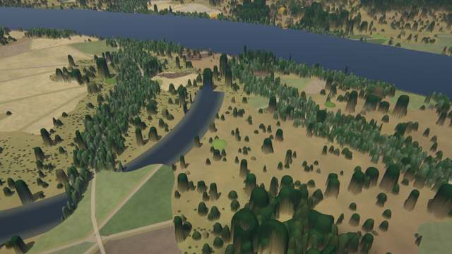

**River water**: a white-water river (21.212, −20.262), nadir 800 m; a muddy and a black-water
river side by side (4.628, 5.338), nadir 800 m (rendered before tributaries joined at an angle:
the black-water river now joins the muddy one south of this frame).

**Confluences** (4.628, 5.338; nadir 4.5 km), before and after: tributaries joined the main
stem tangentially and ran beside it; now they meet it at 35–80°.

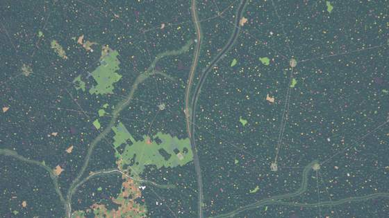
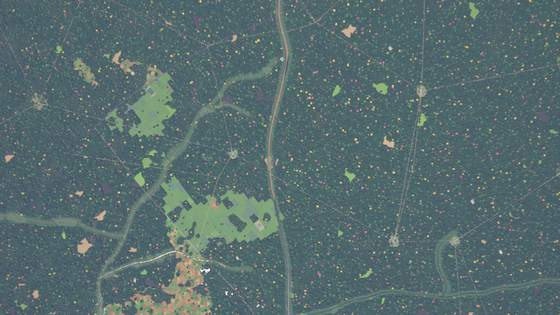

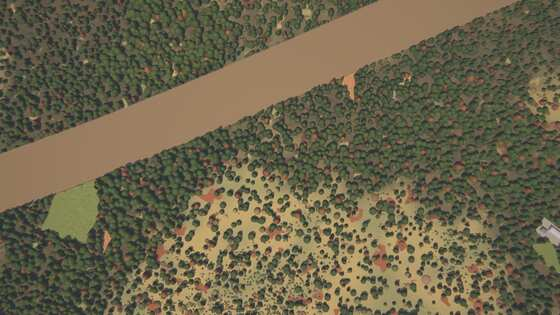
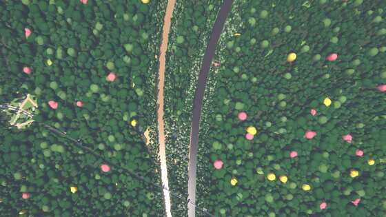

**Fishbone deforestation** (−5.520, 111.780), nadir 12 km: ribs of cleared lots along the
feeder roads of two colonization projects in the forest.

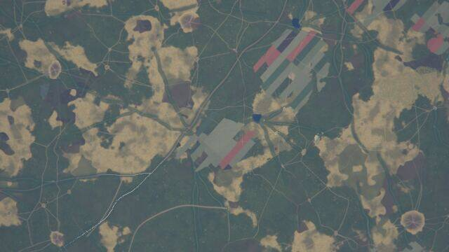

**Monsoon forest mosaic** (−17.95, −128.59): semi-deciduous forest and savanna glades, small
burns and swidden plots.

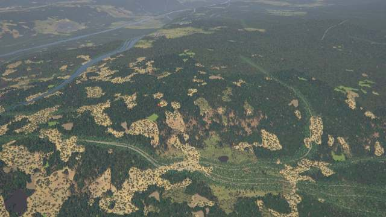

## Tests and performance

* `cargo test --release -p terragen` (CPU): registry, kernel means vs explicit averages, masks
  thin instances continuously, the instance lattice ignores the land-use frame, invariants,
  variety. With a GPU (`rrun --gpu`): `kernels_match_the_cpu` (12 cases, 0.000 % of samples
  off), `tiles_match_the_cpu` (7 places, z12–z16, ≤ 0.021 % of pixels off), `places_stay_on_the_gpu`
  (the places at z6–z16 with `Backend::Gpu`: no fallback).
* `kits::tropical::tests::bench_places` (ignored; GPU, RTX 6000 Ada, 448 tiles per zoom over
  the 7 places, two runs each, the baseline with the kit's `KITS` entry commented out):

  | zoom | with the kit (tiles/s) | without (tiles/s) | cost |
  |---|---|---|---|
  | z8 | 10.0–10.4 | 10.0–10.3 | ~0 % |
  | z10 | 55.6–57.4 | 59.2–59.7 | 4–6 % |
  | z12 | 115.8–118.4 | 123.6–123.8 | 4–6 % |
  | z14 | 105.9–108.7 | 115.5–116.9 | 7–9 % |
  | z16 | 109.6–114.5 | 120.5–120.6 | 5–9 % |

  Within the 15 % budget where the kit draws. On the default `zoom_bench` places (its
  "rainforest" and "savanna" places are no longer tropical biomes in the atlas world) the
  difference is within the run-to-run noise (±2 %).
* `places` and `find_places` (ignored) list where the biomes and features occur.

## Known limits

* Burn scars are large blobs of one age with a uniform charred interior (ash streaks aside) and a
  lobate edge: from 1.5 km they read too uniform; fires do not stop at roads, rivers or fields.
* Flowering crowns (yellow, pink-red) are saturated and evenly spread: from altitude the canopy
  shows confetti-like dots.
* Meander scars, oxbows and scroll bars are drawn beside the rivers (a mask on `river_dist` and
  `floodplain`), not as the river's own bends: the live channel keeps the core's smooth
  meander, so oxbows lie next to a river that does not meander at their scale.
* Mangroves are rare in the default world (most of them grow on the coast kit's deltas of
  tropical rivers): they need low tropical coasts below ~3–5 m inside
  tropical ecoregions, and near-shore water whose ecoregion site lies at sea takes that site's
  biome (see *What needs the core*). Still: the tropical delta in the coast kit's doc.
* River water by type (white-water, black-water) is a per-pixel choice by the river's width,
  the moisture and a regional style channel: a tributary can change colour where the style
  channel crosses its threshold, not only at its confluence.
* Fishbone projects follow their own spines (a grid in the plane of a 200 km anchor), not the
  transport kit's roads, and end at their 22 km block's edges; their feeder roads are 6 m tracks
  (invisible from 12 km, where only the ribs of clearings show); red bare-soil lots read
  saturated; the clearings ignore rivers and slopes below the 0.3 gate.

Leftovers round B: burn scars have a 0.2-scale mottling (±22 %), flowering crowns and the fishbone lots are less saturated
(laterite lots 40 % towards grey).
Polish round 6: fishbone projects clear forest only (agri ≤ 0.55), not farmland.
Polish round 7: gallery forests thin out up the valley sides (gully mask −0.75…0.05: a crisp edge at the valley rim cut
pale savanna blotches out of the dark forest, the volcano scene); savanna grass with a soft extent (threshold width
≥ 0.15), paler and less golden (196, 176, 120 / 176, 166, 122), fading out from moisture 0.45–0.62; tropical_dry's dry
grass (178, 156, 104); the miombo's spring flush muted (128, 98, 70).
