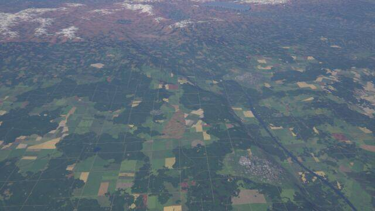
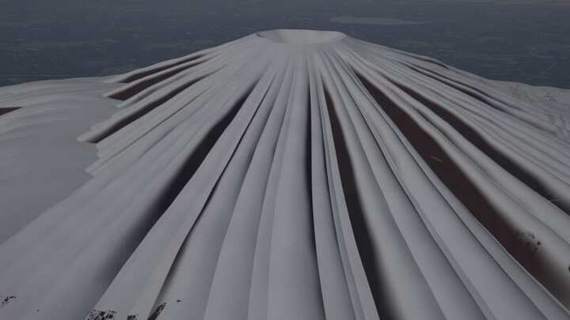
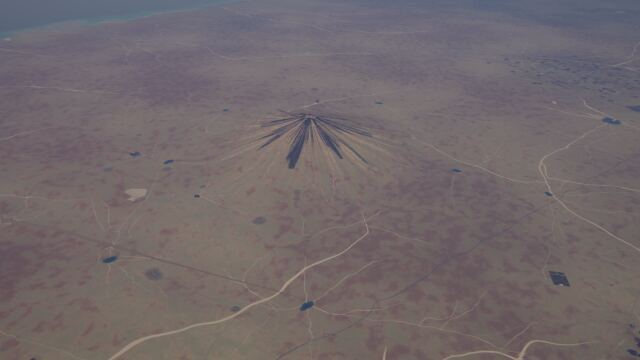
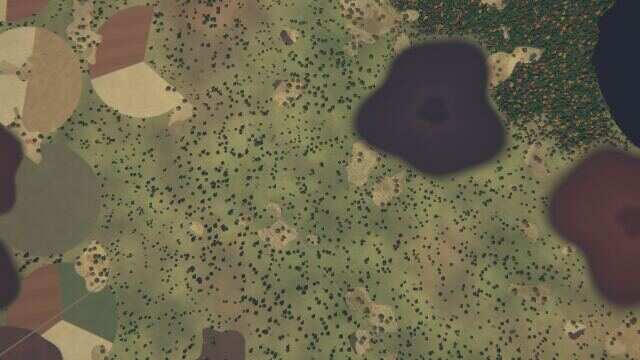

# Volcanic kit: volcanoes, calderas, shields, cinder fields, lava and ash

A kit of the experimental [next generator](../README.md) (`world.generator: next`). *The default
world* on this page is seed 1 of the next generator.

`crates/terragen/src/kits/volcanic.rs` (families, relief, layer, tests), its WGSL twins
`src/gpu/wgsl/kits/volcanic_relief.wgsl` (families, shared geometry, pass-A relief) and
`volcanic.wgsl` (the layer), and its biomes `crates/terragen/biomes/volcanic.yaml` (design:
[terrain-next.md §5.2](https://github.com/shadymeowy/aerialsynth/blob/terrain-design/docs/design/terrain-next.md), contract: [kit-guide.md](../kit-guide.md)).

## What it draws

**Three instance families** (existence from the atlas' volcanism at the site, plus its plate
boundary and hotspot flags; a cheap nearest-texel volcanism test runs before the full sample):

| family | cell | draws |
|---|---|---|
| `volcanic_volcanoes` | 40 km | stratovolcanoes (summit crater) and calderas (flat floor, ring wall, lake) on arcs, rifts and hotspot tracks; R 6-25 km. A few per 100 km of arc. |
| `volcanic_shields` | 110 km | shield volcanoes on hotspot tracks and in continental rifts, R 22-45 km, summit pit |
| `volcanic_fields` | 28 km | cinder-cone fields: inside one instance a per-pixel lattice of cones with craters, maars and lava tongues (dense objects are never a family) |

**Relief (pass A, so the DSM, drainage and lakes follow).** A volcano is an absolute shape: its
summit is E + H above the atlas' smooth elevation E at the site, so oceanic volcanoes grow from
the sea floor and make islands. Flank E + H (1 - r/R)^1.6 (shield ^1.3), blended over the
ground by a smooth max that fades at the foot; the rim is ragged by three azimuth harmonics.
The crater (bowl) or caldera (flat floor, steep wall) overrides the ground; its radius is widened
to 1.5 pixels with the volume kept, and a volcano smaller than 2 pixels is widened with its
volume kept. Radial gullies: three tiers of 14, 30 and 62 ravines, random depth per ravine,
zero mean, band-limited; flank noise.

**Pass B (slot 3).** Black-sand beaches (the core's beach, recoloured on volcanic coasts and
by the biome palette); ash and scoria on the upper cone (dark, streaked down the summit cone)
and an ash-fall apron around active volcanoes (paler weathered ash in soft blotches); lava tongues down the flanks (fresh black, weathered brown,
old moss-green by age; no trees, no fields on them); hydrothermal sulphur, rust and clay patches
at the crater; crater and caldera lakes at one flat water level of the instance; in fields the
cinder cones (dark crater, pale rim), tephra rings and lakes of maars, an ash apron, short lava
tongues. Snow caps come from the climate (lapse rate; the cold kit's snow model). No fields
in craters, on lava, ash or lakes (`Masks::natural_ok`), and no town on a cone (`Stack::no_town`,
set in slots 1-5: the town is not selected there; the active cone's ash apron counts).

**Biomes** `volcanic_scrub` (warm and temperate volcanic country; black beaches) and
`volcanic_barren` (cold and high), with old and fresh lava fans from the `lobes` kernel. Arid
volcanic land stays with the desert kit's `basalt_harrat`.

Land-cover classes: `lava`, `volcanic_ash` (also black sand), `lake`, `bare`.

## Tests

`registry_compiles_with_the_volcanic_biomes`, `class_ids_are_the_v2_table`, `cone_shape`,
`crater_volume_is_kept_when_widened`, `gullies_have_zero_mean`,
`field_means_match_explicit_averages` (also: the relief skips only cells that cannot reach the
point), `lod_consistent_at_volcanic_places`, `seamless_at_volcanic_places` (E-W and N-S, albedo
and elevation), `deterministic_at_volcanic_places`, `tiles_match_the_cpu` and
`places_stay_on_the_gpu` (GPU; z6-z16 of the places), `bench_places` (ignored). The kit has no
kernel of its own, so there is no kernel parity test; tile parity (rgb, elevation, landcover)
was at most 0.04 % of pixels off at nine places and zooms.

## Performance

`bench_places` (Tesla P4: the farm's RTX 6000 Ada cards were taken by other jobs; all six kits, 9
places x 8 x 8 tiles per zoom, median of three blocks), tiles/s, the same build with the `KITS`
entry commented out vs the kit (farm noise +-10 %):

| zoom | without | with |
|---|---|---|
| z8 | 7.1 | 7.1 |
| z10 | 13.6 | 12.9 |
| z12 | 17.1 | 16.5 |
| z14 | 14.9 | 14.7 |
| z16 | 16.0 | 16.1 |

A sample reads only the instances there are (`inst_count` / `inst_get`; an `InstList`
zero-initialises 512 bytes per list). No "more than 8 instances" warning appears at z8-z16 of the
places.

Cold compile (RTX 6000 Ada, all six kits): pass B 24 / 26 / 26 s (three pipelines), pass A1 17 s,
point evaluation 19 s, drainage heights 15 s.

## Stills

GPU-generated (`terrain survey`, default world, 10:30 local on the equinox, all six kits). Oblique
views stand off from the cone along the view direction.

**Crater lake** (11.850, -106.320): oblique 300 m, nadir 1.5 km, oblique 1.5 km from 3 km.

**Caldera lake** (-44.677, 9.339, oblique 10 km from 13 km): fields on the farmland around the ring.

**Snow-capped cone** (56.885, -101.647, oblique 1.5 km): gullies show as ridges in the snow.

**Active cone with ash apron** (14.069, -13.412, oblique 10 km); **island** (27.069, -174.181,
oblique 1.5 km); **cinder field** (21.948, 71.408, nadir 1.5 km: cones, ash apron).

## Known limits

Black-sand beaches need a flat coast (steep cones meet the sea in cliffs), so they are rare.
Islands of oceanic ecoregions have no vegetation. Lava follows radial lines, not the drainage.
At globe zooms (z < 6) more than 8 instances reach a block and the first 8 by id are kept.

Leftovers round B: the ash edge is azimuth harmonics (7, 17, 41 per turn, band-limited by the radius) plus a 90 m noise, so
the ash lies in rays down the ravines instead of blobs; the cinder cones are 2.0 x higher than at first (`K_CONE` 0.0085816; no light baked into their
albedo: the renderer shades them), their lower flanks blend into the ground around them. Not found: the road up the cone, the river line across a caldera lake (not
visible in the places re-rendered).

Round 4 (polish): the azimuth harmonics only on the summit cone (u < 0.06-0.22), their azimuth
shifted sideways by up to ~100 m; lower down three octaves of noise (90, 320, 900 m) and a soft
edge, paler ash (112, 104, 94) from u 0.08-0.35: the rays across the whole apron drew a dark star
from above and dark spikes in oblique views (volcano@type).

Round 8 (polish): maar lakes have a crisp shore (rho 0.66–0.71) and their tephra rings are grown over (40 % of the ring
colour over the ground, clearing 40 % of the trees): a bare pale ring and a shore blurred over 13 % of the radius drew a
halo around the lakes (audit a26).

Polish round 9: the cinder fields' lava tongues widen from the vent to a blunt toe (`w0 √(s(1 − s⁴))`, half width
55–115 m; a lens of sin(πs)^0.6 with half widths of 110–230 m drew round black discs, braided), are mostly weathered
(age +0.35) and fresh basalt is 66 DN (24 read as a hole); cinder cones have a faint scoria apron to 1.6 radii
(25 %) and their foot weathers into the ground (an outline ending at the foot looked stamped on). Means:
`MEAN_LAVA` 51, `MEAN_CINDER` 0.219.

Polish round 10: in humid climates (moisture 0.2–0.45 up) nine cinder cones in ten are grown over (no scoria; their
steep flanks keep the plants instead of the rock of steep slopes) and the ash apron and tephra rings fade: bare cones
drew a pink rash over the rainforest (volcano@type). Lava tongues are narrower (`w0` 40–80 m), lobate (margin noise
0.4 at 90 m and 30 m), rough and a third of the way to the ground's colour (dark smooth paddles, braided);
`MEAN_LAVA` 36.
