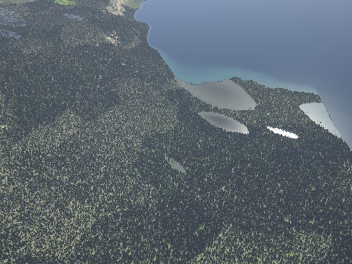
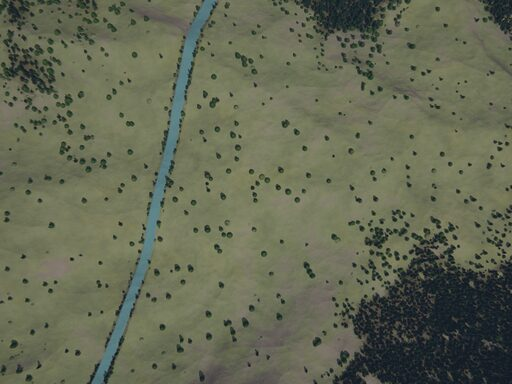
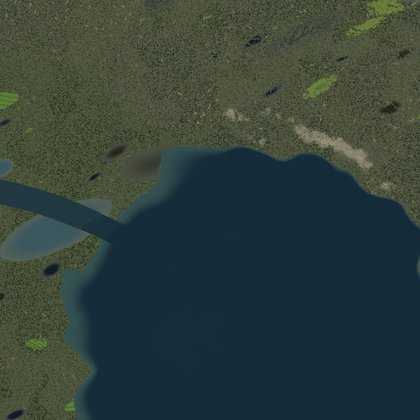
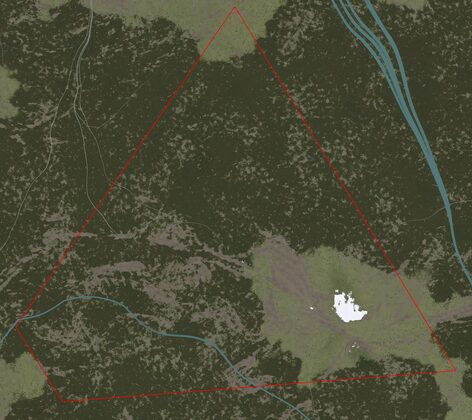
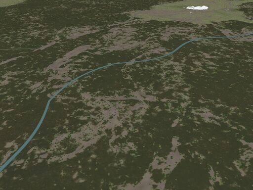
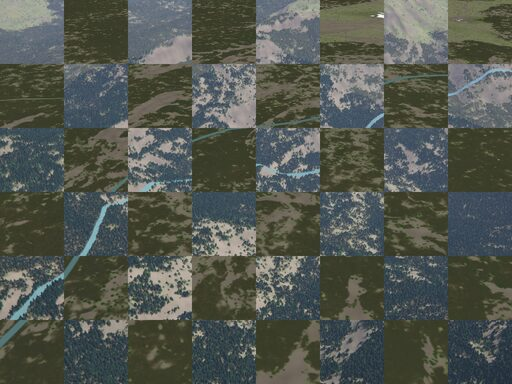
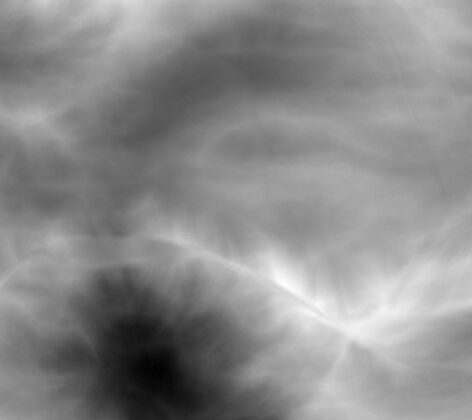
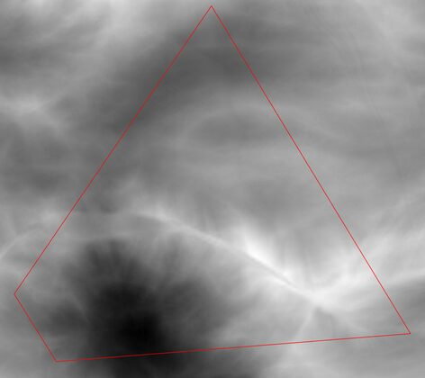

# Camera footprint: camera ↔ geodesy ↔ XYZ tiles

A teaching example in one file ([`src/main.rs`](src/main.rs)), read top to bottom. It takes one
camera position and

1. renders an **oblique** pinhole image (32° below the horizon, heading 60°),
2. renders a **nadir** image from the same position (straight down, north up, east right),
3. casts the rays of the oblique image's 4 corners onto the terrain,
4. converts the 4 ground points to fractional Web-Mercator **XYZ tile** coordinates,
5. stitches the tiles under them (albedo and elevation) and draws the camera's **footprint**,
6. solves the **homography** between the 4 map pixels and the 4 image corners and warps the map
   into the oblique camera's view.

Every step prints what it computes.

```sh
cargo run --release -p camera-footprint            # images in out/camera-footprint/
cargo run --release -p camera-footprint -- DIR     # ... or in DIR
cargo run --release -p camera-footprint -- DIR next 1529.4   # the experimental next generator (docs/next/)
cargo test --release -p camera-footprint           # conversions and homography
```

The tiles are generated on first use into `out/camera-footprint/world.h5` (the default world,
seed 1, with the default terrain generator, `classic`; the second argument picks `next`, the
third sets the camera height above the ellipsoid instead of `ALT`), on the GPU when there is one. The scene is set by the constants at the top of
`main.rs`: `TIME`, `LAT`, `LON`, `ALT`, `YAW`, `PITCH`, `ROLL`, the image size and focal length,
the map zoom `LOD`, the zoom of the elevation used for the corner rays, and the seed.

## Frames

```text
geodetic (lat, lon, h) ──▶ ECEF (x, y, z) ──▶ ENU (e, n, u) at the camera ──▶ camera (x, y, z) ──K──▶ pixel (u, v)
(lat, lon) ──Web Mercator──▶ fractional tile (x, y) at zoom LOD ──▶ stitched-map pixel
```

| frame | convention | in the code |
|---|---|---|
| geodetic | WGS84 latitude, longitude, height `h` above the ellipsoid (not sea level) | `geodesy::Geodetic` |
| ECEF | Earth-centred, Earth-fixed metres; x to (0°, 0°), z to the north pole | `geodetic2ecef`, `ecef2geodetic` |
| ENU | east, north, up at the camera; up = the ellipsoid normal | `CameraPose::enu` (`geodesy::LocalFrame`) |
| camera | OpenCV: x right, y down, z = optical axis | `CameraPose::r_enu_cam`, `r_ecef_cam` |
| image pixel | (0, 0) = centre of the top-left pixel; the image spans [-0.5, w-0.5] × [-0.5, h-0.5] | `Intrinsics` (`K`) |
| fractional tile | `(x, y) = (u, v)·2^z`, `u = (lon+π)/2π` east, `v = ½ − asinh(tan lat)/2π` south; integer part = the XYZ tile `z/x/y` | `TileXY` |
| stitched-map pixel | `((x − x0)·256, (y − y0)·256)` for the block of tiles starting at `(x0, y0)`; pixel (i, j) covers [i, i+1) × [j, j+1) | `MapGrid` |

**Orientation.** `(YAW, PITCH, ROLL) = (0, 0, 0)` is the nadir camera: optical axis down, image
top north, image right east. Other angles rotate away from it like an aircraft carrying the
camera in its belly with the image top towards the nose: aerospace Z-Y-X angles of the body in
north-east-down, so YAW is the heading of the image top (clockwise from north), PITCH (nose up)
tilts the view from nadir towards the image top (58° = 32° below the horizon), ROLL (right wing
down) tilts it to the left:

```text
R_enu_cam = R_enu_ned · Rz(yaw) · Ry(pitch) · Rx(roll) · R_body_cam
```

Both cameras share the position: `CameraPose::new(position, r_enu_cam(YAW, PITCH, ROLL))` and
`CameraPose::new(position, r_enu_cam(0, 0, 0))`. They are rendered with the bindings' camera
(`aerialsynth_core::Camera`, the renderer of `terrain run`) with the `nadir` mount, whose pose
angles mean the same; the example checks that the renderer's camera pose equals the one it
computed.

## Steps

**Corner rays ∩ terrain.** A corner pixel's ray is `R_ecef_cam · normalize(K⁻¹ (u, v, 1))` from
the camera centre. Along it, f(t) = (the ray's geodetic height − the terrain's height below it)
at distance t (elevation tiles at a coarser zoom, bilinear). The example **marches** t = 0,
s, 2s, … with s a quarter of an elevation pixel (2.9 m here) until f ≤ 0, so the first ridge the
ray meets is found even on steep ground (no ridge fits between two samples), then **bisects** that
step until |f| < 1 cm. It prints the steps, the bracketing step and the final residual per corner.

**Tiles.** The ground points become fractional tile coordinates at `LOD`; the integer parts give
the block of whole tiles to fetch (`World::tiles_into`, generated if missing), stitched with tile
`(x0, y0)` at the top left. Albedo is the unlit surface colour; elevation (a DSM: ground, trees,
buildings, metres above the ellipsoid) is drawn as grey from its minimum (black) to its maximum
(white), printed. The footprint is drawn through the 4 corners' map pixels.

**Homography.** `H` maps the 4 map pixels onto the 4 image corners: the direct linear transform
with `h33 = 1` (two equations per point pair, an 8 × 8 linear system, Hartley-normalised points).
The warped map takes, for each image pixel `p`, the map at `H⁻¹ p`. A homography maps a plane
exactly; the ground is only nearly one, so the example measures how far: the rendered depth
gives every pixel's true ground point, which goes through tile → map pixel → `H` back into the
image; the printed offsets come from relief, trees and buildings standing off the plane through
the 4 corners. `8_check_oblique_vs_warped.png` alternates squares of the render and the warped map.

## Output

All in `out/camera-footprint/` (PNG, full size; the images here are small JPEG copies).

The scene: the pose of the v0.2.0 showcase's "boreal" shot in the default world (classic
generator, seed 1): 52.979° N, 16.414° W, 2651.7 m above the ellipsoid (900 m above the ground
at 1751.7 m), midsummer noon; the oblique camera heads 60° (east-north-east), 32° below the
horizon, level; 1024 × 768 pixels, f = 900 px (59° wide); map tiles at zoom 15 (2.6 m pixels).
A spruce upland: conifer forest, bare and rocky clearings, meadows with scattered trees, rivers
and a late snow patch.

| | |
|---|---|
|  **1** oblique camera |  **2** nadir camera, same position: north up, east right |
|  **3** stitched albedo, tiles 15/14890..14898/10670..10677 |  **4** with the oblique camera's footprint |
|  **5** the map warped into the oblique camera by the homography |  **8** check: squares of 1 and 5 alternating |
|  **6** stitched elevation, 1290 m (black) .. 2116 m (white) |  **7** with the footprint |

**Steep ground.** This upland is rough: the far corners' rays graze slopes and cross 1300–2000 m
of relief on their way, which a fixed-point iteration (point at height h → terrain height → new
h) did not settle on (the earlier version of this example: the top-left corner oscillated between
1575 and 1992 m); marching and bisection find the first crossing to a centimetre. The homography
is still only an approximation here: the plane through the 4 corners stands in for terrain of
1300–2010 m, so the warp is off by a median 33 px (over the level lowland of an earlier
scene: 1.4–18 px).

What it prints (excerpt):

```text
== 2. Extrinsics: one position, two rotations
position  geodetic lat 52.979240°, lon -16.414260°, h 2651.70 m  (900.0 m above the ground at 1751.7 m)
          ECEF     (3693204.37, -1087968.03, 5071269.96) m
nadir     camera axes in ENU: x(right) (+1.000, +0.000, +0.000)  y(down) (-0.000, -1.000, +0.000)  z(optical) (+0.000, +0.000, -1.000)
oblique   camera axes in ENU: x(right) (+0.500, -0.866, +0.000)  y(down) (-0.459, -0.265, -0.848)  z(optical) (+0.734, +0.424, -0.530)
...
oblique   renderer's pose vs ours: position 0.00e0 m, rotation 1.11e-16
...
== 4. Corner rays of the oblique camera ∩ terrain (elevation tiles at zoom 13: steps of 2.88 m, bisection to 0.01 m)
top-left     pixel (   -0.5,   -0.5)
             marched 2211 steps to 6356.9 m (ray 0.98 m above the terrain) .. 6359.8 m (0.06 m below), 4 bisections: residual +0.0065 m
             GPS  lat 53.027173°, lon -16.364389°, h 1783.65 m
             ECEF (3689559.56, -1083405.08, 5073787.83) m
             ENU  (3347.03, 5336.98, -871.16) m  (range 6360 m)
top-right    pixel ( 1023.5,   -0.5)
             marched 2270 steps to 6526.6 m (ray 0.23 m above the terrain) .. 6529.5 m (0.30 m below), 4 bisections: residual -0.0004 m
             GPS  lat 52.981323°, lon -16.318077°, h 1760.76 m
             ECEF (3694333.05, -1081563.91, 5070698.23) m
             ENU  (6462.05, 236.21, -894.21) m  (range 6528 m)
...
== 5. Ground corners -> fractional XYZ tiles at zoom 15
top-left     tile (x, y) = (14894.4769, 10670.1251)  -> in tile 15/14894/10670 at (122.1, 32.0) px
top-right    tile (x, y) = (14898.6924, 10677.0605)  -> in tile 15/14898/10677 at (177.3, 15.5) px
bottom-right tile (x, y) = (14891.1930, 10677.6534)  -> in tile 15/14891/10677 at (49.4, 167.3) px
bottom-left  tile (x, y) = (14890.3009, 10676.2240)  -> in tile 15/14890/10676 at (77.0, 57.3) px
coverage at zoom 15: x 14890..=14898 , y 10670..=10677  (9 x 8 tiles, 2304 x 2048 px)
...
== 9. Check: does the warped map line up with the rendered image?
221 grid pixels: homography vs rendered ground point: median 33.0 px, 90% 98.1 px, max 132.5 px (at (831, 447))
(the plane through the 4 corners stands in for terrain of 1302 .. 2010 m: relief, trees and buildings shift points)
```

The render and the warped map show the same scene (the forest edges and the river continue
across the squares of image 8), but offset by tens of pixels: the ground is far from a plane
here, and the uncertain far corner tilts the plane. In the render the trees also stand up in 3D.
